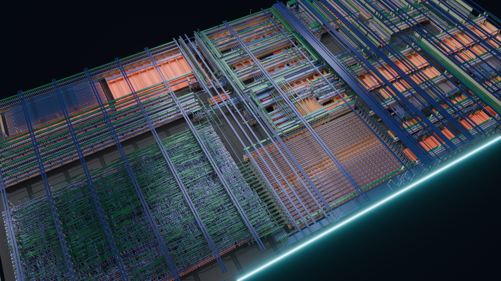

  

# 433 MHz radio toolkit (GF180MCU, Tiny Tapeout)

This is a small 433.92 MHz radio on one chip tile: a tunable ring voltage-controlled oscillator (VCO), a transmit (TX)
driver for a dipole antenna, on-chip fine tuning over a Serial Peripheral Interface (SPI), 2-level frequency-shift
keying (FSK), and a zero intermediate frequency (zero-IF) receiver (RX). It has no inductors. The digital work
(tuning, demodulation, framing) is done by the RP2350 on the Tiny Tapeout (TT) demo board. It is a 2x2 analog tile on
GlobalFoundries' 180 nm process (GF180MCU) for the ttgf26c shuttle, and part of an FM (frequency modulation) radio
toolkit for the Zero to ASIC Course.

**The chip has only been simulated, not yet measured.** Every number on this page is a simulation result.

The design, layout, simulations and documentation were done by Claude (Claude Code) agents working from Matt Venn's
briefs, with Matt reviewing the results and making the design decisions. See [How it was made](#how-it-was-made).

**Fig. 1.** A perspective 3D render of the tile's layout, with the metal stripes running over the receiver, the
ring oscillator and the digital macro.

To use the chip on a TT board, read the datasheet page, [docs/info.md](docs/info.md).

> **Radio regulations.** This is an experimental, uncertified transmitter. The antenna driver is off unless
> `ui_in[5]` / `ui_in[6]` enable it. The coarse code alone puts the ring anywhere in 209-754 MHz (typical corner, extracted
> tile; 193-851 MHz over all process corners at block level), so until the RP2350 has tuned it, it can be tens of MHz
> away from 433.92 MHz, outside the narrow 433.05-434.79 MHz licence-exempt band. That range includes frequencies used
> by aviation, emergency services and the 406 MHz distress beacons. The output is close to a square wave: in
> simulation the 3rd harmonic (1.3 GHz) is -14 dBc (dB relative to the carrier) and the 5th -23 dBc at the dipole,
> well above the band's spurious-emission limits. **Fit the board low-pass filter** in
> [docs/tx_harmonics.md](docs/tx_harmonics.md), which takes the 3rd harmonic below -55 dBc in simulation. Power is
> low (about +6 dBm, 4 mW, into the dipole), but transmitting over the air may need an amateur radio licence (the
> 70 cm band is 420-450 MHz in the US, 430-440 MHz in the UK and much of Europe), and outside the amateur band it
> may not be legal at all. Measure the frequency and harmonics with a software-defined radio (SDR) or spectrum
> analyser first, keep transmissions short, and prefer a cabled link with an attenuator. Receiving is fine. You are
> responsible for following your local rules.

<!-- The section headings below are linked from docs/info.md, which is frozen into the Tiny Tapeout datasheet.
     Do not rename them. -->

## How it was made

The project was run as a set of Claude Code agents, starting on 2026-11-07. Matt wrote each brief and made every
design decision; the decisions are dated in [STATUS.md](STATUS.md). The agents wrote the circuits as Python
generators, the xschem schematics, the layout generators, the testbenches and these documents. Long simulation runs
went to a separate simulation server through written hand-offs (`docs/handoff_*.md`), each the whole brief for the
agent there. The flow and the lessons learnt are in the project skill
[.claude/skills/mixed-signal-asic/](.claude/skills/mixed-signal-asic/SKILL.md). The git history is the log of the work.

## How it works

- **VCO:** a current-fed ring of five inverters; a 5-bit coarse current DAC (digital-to-analog converter) on
  `ui_in[4:0]`, a 10-bit medium DAC and a sigma-delta modulator set over SPI. [docs/tuning.md](docs/tuning.md),
  [docs/tx_fine_tune.md](docs/tx_fine_tune.md), [docs/cfed_results.md](docs/cfed_results.md).
- **TX:** a phase splitter and two push-pull arms in antiphase driving a two-wire dipole, about +6.3 dBm.
  [docs/tx_driver.md](docs/tx_driver.md), harmonics and the board filter in [docs/tx_harmonics.md](docs/tx_harmonics.md).
- **RX:** a low-noise amplifier (LNA), two mixers on ring taps 72° apart, baseband filters and limiters to `uo_out[4]` /
  `uo_out[5]`, decoded by the RP2350 as a quadrature counter. [docs/rx_design.md](docs/rx_design.md),
  [docs/rx_layout.md](docs/rx_layout.md).
- **Pins and power:** [docs/platform.md](docs/platform.md), [docs/pad_model.md](docs/pad_model.md).

## Pins

The pin map is in [info.yaml](info.yaml) and explained in [docs/info.md](docs/info.md). In short: the coarse code on
`ui_in[4:0]`, the TX enables on `ui_in[5:6]`, FSK data on `ui_in[7]`; divided clocks on `uo_out[0:3]`, the receiver's
two bits on `uo_out[4:5]`; SPI on `uio[0:3]`; the debug multiplexer on `ua[0]` (ground reference `ua[1]`), the TX
dipole on `ua[2:3]` and the RX dipole on `ua[4:5]`. `python3 tools/check_pinout.py` checks info.yaml against the
layout and the digital code.

## Schematics

The xschem schematics are drawn like textbook schematics and open in the online xschem viewer:
[docs/schematics.md](docs/schematics.md) lists them all. Key sheets:
[vco_top](https://xschem-viewer.com/?file=https://github.com/mattvenn/gf-433-fsk-radio/blob/main/xschem/vco_top.sch),
[cfed_dac](https://xschem-viewer.com/?file=https://github.com/mattvenn/gf-433-fsk-radio/blob/main/xschem/cfed_dac.sch),
[mdac](https://xschem-viewer.com/?file=https://github.com/mattvenn/gf-433-fsk-radio/blob/main/xschem/mdac.sch),
[tx_drv](https://xschem-viewer.com/?file=https://github.com/mattvenn/gf-433-fsk-radio/blob/main/xschem/tx_drv.sch),
[rx_top](https://xschem-viewer.com/?file=https://github.com/mattvenn/gf-433-fsk-radio/blob/main/xschem/rx_top.sch).
They are netlist-checked against the simulated circuits and the layout's LVS (layout versus schematic) source.

## Layout

The 2x2 tile is 693.28 × 325.36 µm, generated in Python (`layout/gen/tile.py`): [docs/tile_layout.md](docs/tile_layout.md)
and [docs/img/tile_layout.png](docs/img/tile_layout.png). Open the GDS (the layout file) in the
[TT 3D GDS viewer](https://gds-viewer.tinytapeout.com/?url=https://raw.githubusercontent.com/mattvenn/gf-433-fsk-radio/main/gds/tt_um_mattvenn_gf433_vco.gds&pdk=gf180mcuD).
The blocks' own layouts and viewer links are in [docs/schematics.md](docs/schematics.md).

## Digital

The digital macro `tx_fine` ([src/tx_fine.v](src/tx_fine.v), hardened with LibreLane in [macro/tx_fine](macro/tx_fine))
holds the SPI registers, the sigma-delta modulator, the FSK offset, the dividers, the clock gate, RX_EN and the debug
select. It is checked with cocotb on RTL (register-transfer level) and gate level, formal proofs and an equivalence
check: [docs/verification_digital.md](docs/verification_digital.md).

## Verification

Every test, with its command, result and planted-bug (mutation) check: [docs/verification.md](docs/verification.md).
The extracted tile in simulation: [sim/top/tile_results.md](sim/top/tile_results.md). The receiver and system gap
tests: [docs/plan_verify_gaps.md](docs/plan_verify_gaps.md). At the time of writing the full verification run
([docs/handoff_full_verification.md](docs/handoff_full_verification.md)) is in progress and finishes about
24 November 2026.

## Bring-up

The plan for testing the chip when it arrives, stage by stage, with the expected value and source for each test:
[docs/bringup.md](docs/bringup.md). The tuning procedure for the RP2350 is in [docs/tuning.md](docs/tuning.md).

## Status

Where the design is, the decisions and the next steps: [STATUS.md](STATUS.md).

## Repo layout

| Path | Contents |
|---|---|
| `docs/` | design notes, results and this project's datasheet page (`docs/info.md`) |
| `sim/` | circuits as Python, testbenches and results, by block (`vco`, `tx`, `rx`, `tune`, `top`, `verify`, ...) |
| `xschem/` | schematics, generated by `xschem/gen/` and checked by `xschem/gen/check.py` |
| `layout/` | layout generators (`layout/gen/`), block GDS files, extractions |
| `gds/`, `lef/`, `src/`, `macro/` | the TT deliverables, the Verilog and the hardened digital macro |
| `lvs/`, `test/`, `formal/` | LVS source, cocotb benches, formal proofs |
| `bench/` | bench notes from earlier GF180 test chips |
| `tools/` | the pinout check and helper scripts |

## What is Tiny Tapeout?

Tiny Tapeout is an educational project that makes it easier and cheaper to get designs made on a real chip. See
https://tinytapeout.com and the [analog specs](https://tinytapeout.com/specs/analog/).
