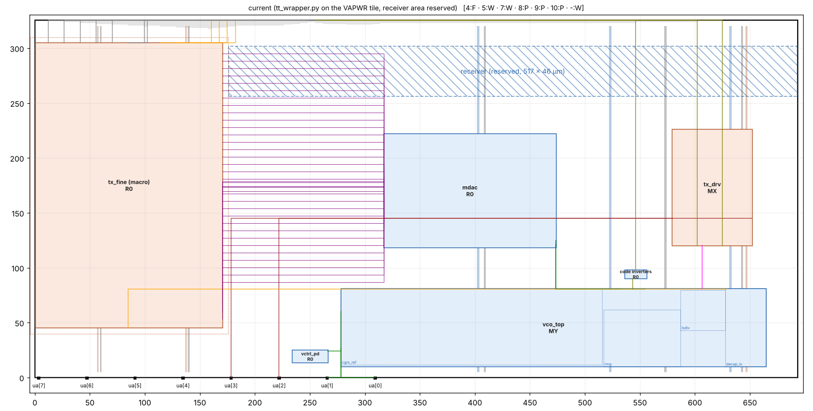
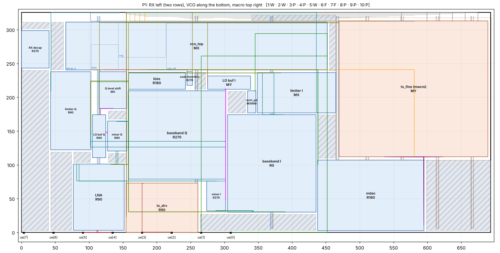
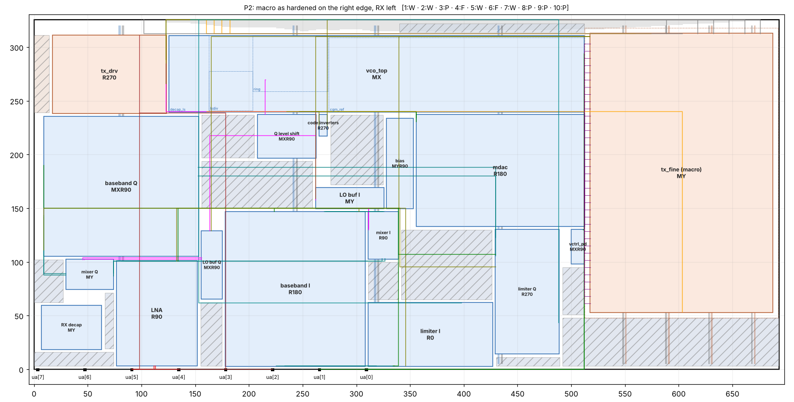
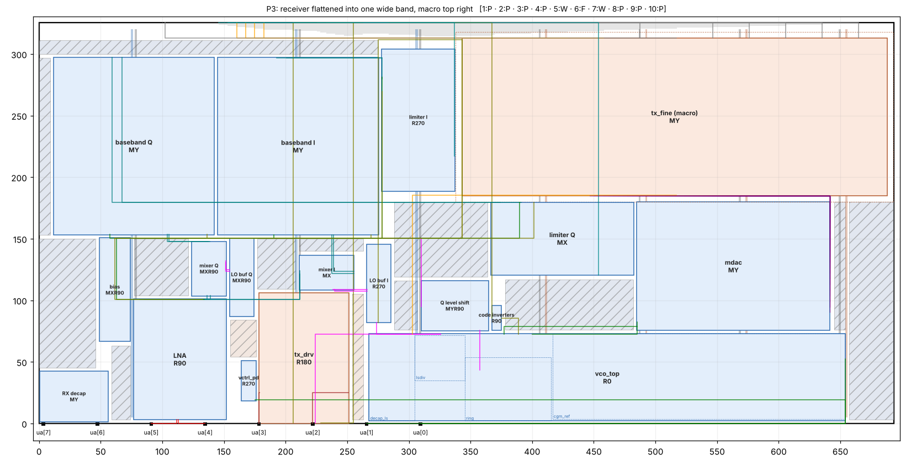
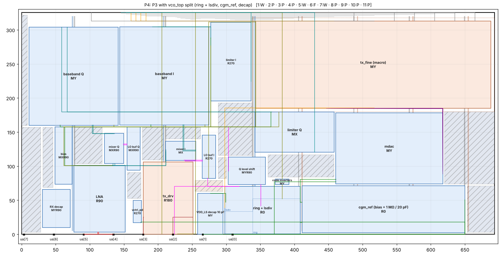
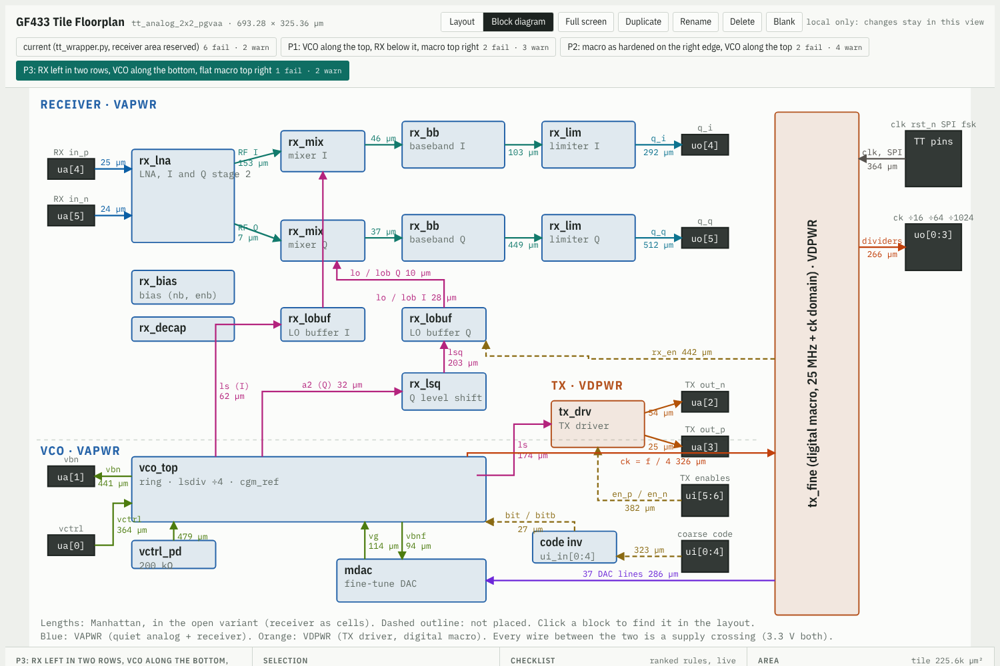

# Tile floorplan: the interactive floorplan page

[](https://claude.com/claude-code)

This page describes the floorplan tool for the Zero to ASIC Course 433 MHz radio tile: a 2x2 Tiny Tapeout analog tile
on GF180MCU (ttgf26c) holding the voltage-controlled oscillator (VCO), its fine-tuning digital-to-analog converter
(DAC), the transmit (TX) driver, the digital macro and, now, the receiver (RX). The tool is an interactive page (a
private claude.ai artifact with a shared database) on which Matt drags blocks and Claude proposes named variants. The
chosen variant is exported to `layout/floorplan/floorplan.json`, which the tile generator will read later.

It is a port of the OOK radio's floorplan page (`github.com/mattvenn/ook-asic-radio`, `docs/floorplan_spec.md` there),
with this tile's blocks, pins, nets, supply domains and rules. The brief was `docs/handoff_floorplan_tool.md`.

**The page:** https://claude.ai/artifact/942zW17HYnwDF8qCuYhQk3 (private; seeded with the four variants below).

## Data

| File | What | Made by |
|---|---|---|
| `layout/floorplan/tile.json` | The tile outline (693.28 × 325.36 µm) and its 51 signal pins | `tools/floorplan_tile.py` from tt-support-tools `tech/gf180mcuD/def/analog/tt_analog_2x2_pgvaa.def` |
| `layout/floorplan/blocks.json` | Every block's bbox, its pin labels (own frame, origin at the bbox's lower-left) and its Metal4 boxes; `rx_top` also lists where each of its cells sits; `tx_fine` lists its Metal4 power straps | `tools/floorplan_blocks.py` (needs `pip install klayout`) |
| `layout/floorplan/current.json` | Today's tile (`layout/gen/tt_wrapper.py`) moved onto the VAPWR template: each block's bbox as the wrapper places it (computed with KLayout from its own transformations) and the x shift applied | `tools/floorplan_current.py` |
| `layout/floorplan/variants.json` | The variants seeded into the page (mirrors the page's store) | `layout/floorplan/page/place.js` |
| `layout/floorplan/floorplan.json`, `pins.md` | The chosen variant, for the tile generator and the re-layouts | the page's export, or `layout/floorplan/page/pinreport.js` |

**The template has changed size.** The VAPWR template `tt_analog_2x2_pgvaa.def` is **693.28 µm wide, not 711.20 µm**
(the plain `tt_analog_2x2.def`), and every pin sits 17.92 µm further left: ua[0] … ua[7] at x 309.40, 265.72, 222.04,
178.36, 134.68, 91.00, 47.32, 3.64 µm (pad centres), the digital pins between x 14.69 and 320.75 µm. The height
(325.36 µm), the pin sizes and the stripe span (y 5 … 320.36 µm) are the same. **The tool uses the VAPWR template
throughout** (Matt, 2026-11-16). `tt_wrapper.py` and `docs/top_layout.md` still use the 711.20 µm tile, so the page's
"current" variant is today's tile moved onto the VAPWR one (below).

## What goes in the tile

| Instance | Cell | Size (µm) | Supply | Notes |
|---|---|---|---|---|
| xvco | `vco_top` | 386.56 × 70.80 | VAPWR | ring, `cgm_ref`, `lsdiv` and its VDD_LS decap; zones drawn for each. **a2 is not a pin yet:** the page uses the ring's a2 node (ring_core_v3 label, own x 89.89, y 41.17) as an estimate |
| vco.core, vco.ref, vco.decap | vco_top's parts | 110.58 × 69.76, 238.75 × 69.20, 37.23 × 59.96 | VAPWR | vco_top cut along its own sub-cells (instance boxes in `vco_top.gds`): the ring and lsdiv as one unit (their a0 abutment kept), `cgm_ref`, and the left part of the VDD_LS decap (its short fingers under lsdiv stay with the unit). Pins from the cells' own labels |
| xmdac | `mdac` | 156.83 × 104.24 | VAPWR | the 37 control lines on its west edge, vg / vbnf on its east edge |
| xvpd | `vctrl_pd` | 32.49 × 12.00 | VAPWR | 200 kΩ pull-down on vctrl |
| xbits | (standard cells) | 20.16 × 7.84 | VAPWR | the five coarse-code inverters and their antenna diodes, as `tt_wrapper.py` draws them (hatched: no GDS of its own) |
| xtxd | `tx_drv` | 72.97 × 105.91 | VDPWR | out_n / out_p on its side edges, ls / en_p / en_n on one end |
| xmac | `tx_fine` | 170.00 × 260.00 | VDPWR | the digital macro, with a 5 µm halo. It routes on Metal4, so a stripe may cross it only on one of its eight strap lanes. **rx_en is not a pin yet:** estimated at the top of its east edge. It can be reshaped at the same area (a re-harden) |
| xrx | `rx_top` | 299.38 × 370.62 | VAPWR | the receiver as one block, its cells drawn as zones. 45 µm taller than the tile |
| rx.* | `rx_lna`, `rx_bias`, `rx_lsq`, `rx_lobuf` × 2, `rx_mix` × 2, `rx_bb` × 2, `rx_lim` × 2, `rx_decap` | Table S1 of `docs/rx_layout.md` | VAPWR | the receiver as its 12 cells (70.4k µm² of cells against 111.0k µm² for `rx_top`) |
| decap | fill | editable | VAPWR / VDPWR | estimates at ~2.4 fF/µm² (nfet gate cap at ~60 % fill) |

`rx_top`'s GDS is 299.38 × 370.62 µm; `docs/rx_layout.md` Table S1 gives 299.4 × 376.0 µm. The page uses the GDS.

A variant holds the receiver either as `rx_top` (one block) or as its cells, and vco_top either as one block or as
its parts (two switches in the variant box). Splitting vco_top creates two wires that are abutments inside it: vbnf
(cgm_ref's filtered bias into the ring's coarse DAC gates) and vctrl (through cgm_ref to the ring), scored by rule 11. Cells
not yet placed start where `rx_top` has them. A variant that places the cells is the brief for an `rx_top` re-layout.

## Nets
Flylines are drawn as L routes (the one crossing fewer blocks) and measured as Manhattan lengths.
- **Pads:** ua[4] → RX inp, ua[5] → RX inn; tx_drv out_n → ua[2], out_p → ua[3]; ua[0] → vco_top vctrl, with
  vctrl_pd; ua[1] → vco_top vbn.
- **LO:** vco_top ls → the receiver's ls (rx_top's port, or `rx_lobuf` I's input) and → tx_drv ls; vco_top a2 → the
  receiver's aq (`rx_lsq`).
- **Fine tuning:** tx_fine's 37 DAC lines → mdac (dac_tn[i] → ns(i+1), dac_bn[b] → nb(b), dac_sdn → nsd); mdac vg →
  vco_top vg; vco_top vbnf → mdac.
- **Clocks and control:** vco_top ck → tx_fine ck; tx_fine rx_en → the receiver's en (`rx_bias` and both LO buffers);
  clk, rst_n, the SPI (uio_in[0:2], uio_out[3]) and fsk (ui_in[7]) → tx_fine; ui_in[0:4] → the code inverters →
  vco_top's bit pins; ui_in[5:6] → tx_drv en_p / en_n.
- **Ring-derived outputs:** tx_fine ck_o, div16, div64, div1024 → uo_out[0:3].
- **RX outputs:** q_i / q_q → uo_out[4] / uo_out[5].
- **Inside the receiver** (cells only; `layout/gen/rx_top.py`'s `nets`): the RF nets LNA → mixers, the LO nets
  (lsq → Q buffer, buffers → mixers), mixers → baseband → limiters, and nb / enb from `rx_bias` to every stage.

Net classes (colours on the page): RX input, RX signal, RX outputs, LO, ring-derived clock, 25 MHz / SPI, fine-tune
bus, enable / code (static), TX output, analog DC.

## Rules, ranked
The radio is half-duplex: while receiving, the TX driver's arms are off. The ring, lsdiv and its ck run all the time,
and so does the macro's 25 MHz clock.

| # | Rule | Measured as | Default threshold |
|---|---|---|---|
| 1 | RX input far from the macro and from everything the ring clocks | the gap from the LNA (rx_top's LNA zone, or `rx_lna`) and the ua[4] / ua[5] flylines to the macro halo, to every ck / divider / 25 MHz / SPI / DAC flyline and to the top channel; fails if one of those crosses the LNA | ≥ 150 µm (warn ≥ 75) |
| 2 | LO wires short and matched | a2 → aq; ls → RX; the I LO load (ls → RX + ls → tx_drv) against the Q LO load (lsq, or 43.5 µm inside `rx_top`) | a2 ≤ 40 µm, ls → RX ≤ 120 µm, \|Δ\| ≤ 150 µm |
| 3 | LNA at ua[4] / ua[5] | the longer of the two input flylines, and their difference | ≤ 40 µm, Δ ≤ 10 µm |
| 4 | TX driver at ua[2] / ua[3] | the longer output flyline (and, reported, its gap to the RX input) | ≤ 80 µm (warn ≤ 200) |
| 5 | Supply domains | fails if a rail with blocks has no stripe; warns if a block's nearest supply stripe is the other rail; lists every VAPWR ↔ VDPWR crossing | – |
| 6 | No digital or LO wire over the receiver | any clock, digital, DAC, enable, TX or LO flyline crossing a receiver block (its own wires excepted), or the top channel over it | none |
| 7 | Short fine-tune bus | the longest of the 37 DAC lines; mdac vg → vco_top vg | ≤ 200 µm; vg ≤ 60 µm |
| 8 | The macro near the top edge | the gap from the macro's top to the tile's; fails if a block sits in the top channel or the gap is less than the channel needs over the macro | ≤ 40 µm |
| 9 | Fit and spacing | overlaps (the macro's halo counts, and reserved areas), blocks outside the tile, gaps under the keep-out | keep-out 2.5 µm |
| 10 | Power stripes | each Metal4 stripe's lane (y 5 … 320.36) against every block's Metal4; over the macro only on its own straps of the same net; width ≥ 0.8 µm; VDPWR, VAPWR and VGND all present | – |
| 11 | VCO bias wires (vco_top split only) | cgm_ref → ring vbnf and vctrl, and their gap to the macro and every clock / DAC flyline | ≤ 40 µm, gap ≥ 50 µm |

Every threshold is a page setting (shared through the database). The checklist shows each rule's number and, on
hover, why it exists.

**The top channel.** Every net with a TT digital pin runs horizontally along the top edge between the pin's x and its
block pin's x; at each x the channel is as tall as the number of wires there times a track pitch (0.8 µm, as
`tt_wrapper.py`'s M2 tracks).

## The page as built
- **Sources:** `layout/floorplan/page/page.html` (the UI) and `engine.js` (orientations, pins, nets, the rule checks,
  export and import). `tools/floorplan_page.py [out.html] [--dev]` inlines them with `blocks.json` and `tile.json`
  into one page; `--dev` also embeds `variants.json` for a local preview without the store.
- **Shared state:** the artifact's database, one document per variant in `variants` and the thresholds in
  `config/settings`. Matt's edits are saved there; Claude reads and writes the same documents.
- **Canvas:** the tile to scale with zoom and pan, a µm grid, the pads with their roles, the TT digital pins, the top
  channel, the stripes, decap and reserved areas. Blocks are coloured by supply (blue VAPWR, orange VDPWR), with
  their pins, zones (vco_top's ring / lsdiv / cgm_ref / decap, rx_top's cells) and, on the Metal4 layer, the macro's
  Metal4 and its straps. Estimated pins (a2, rx_en) have orange rings and dotted flylines.
- **Editing:** drag, rotate (R), flip (X, Y), nudge with the arrows, group select (shift-drag), park a block, reshape
  any block at constant area (its pins scale with it; the macro is a re-harden, the rest a re-layout), add and edit
  stripes, decap and reserved areas, switch the receiver between `rx_top` and its cells and vco_top between one
  block and its parts.
- **Pin fitting** (ported from the OOK page's `pinfit.js`, now in the engine as `FP.fitPins`): "Fit its pins to this
  floorplan" (one block) or "Fit all pins" moves each signal pin to the point of the block's edge facing what it
  connects to, spreads pins ≥ 1 µm apart and orders each edge like the far ends so the flylines don't cross. Moved pins
  have orange rings; "Put its pins back" undoes it. Reshaped sizes and moved pins go into `floorplan.json`
  (`own_w` / `own_h`, `pins_moved`) and `pins.md`: the brief for the block re-layouts once a floorplan is agreed.
  On P3, fitting every block's pins takes a2 → aq from 32 to 3 µm and the longest DAC line from 286 to 45 µm, but
  rule 6 gets worse (7 flylines over the receiver against 2): the fit chooses edges by distance only.
- **Panels:** the checklist (live), area, nets (lengths, hover to highlight), supply crossings, stripes, the export /
  import of `floorplan.json`, and the thresholds.
- **Block diagram view:** the tile's blocks and how they join, with the open variant's wire lengths.
- **Not ported:** the OOK page's `refine.js` (decap refill after edits). Decap and stripes come from `place.js`.
- **Command line:** `node layout/floorplan/page/check.js [variants.json | floorplan.json] [--current]` prints the
  same checklist; `--current` also checks the "current" variant against `current.json`.
  `node layout/floorplan/page/mutate.js` runs the mutation tests below. `node tools/floorplan_dump.js` with
  `python3 tools/floorplan_draw.py` draws a variant to a PNG.

## Checks of the tool
- **"current" against `tt_wrapper.py`:** `check.js --current` compares the engine's placed rectangles with the bboxes
  KLayout computes from each block's GDS and the wrapper's own transformation (`db.Trans.M90` for vco_top,
  `db.Trans.M0` for tx_drv), plus the shift onto the VAPWR tile. All six blocks agree to 0.000 µm: in the wrapper
  vco_top MY at x 296.0, y 10.0; tx_drv MX at 597.15, 120.0; mdac 335, 118; vctrl_pd 252, 13.2; tx_fine 0.6, 45; the
  code inverters 554.04, 90.16. On the page every x but the macro's is 17.92 µm less.
- **Mutation tests** (`mutate.js`): each breaks a copy of a variant in which its rule does not already fail; all 12
  are caught.

**Table I.** Mutations and the rule that catches them.

| Mutation | Rule | Before → after |
|---|---|---|
| LNA moved 300 µm from ua[4] / ua[5] | 3 | pass 25 µm → fail 324 µm |
| a2 the long way (rx_lsq moved 250 µm away) | 2 | warn 39 µm → fail 361 µm |
| mdac placed on vco_top | 9 | pass → fail, 1 overlap |
| a block pushed outside the tile | 9 | pass → fail |
| the macro next to the LNA | 1 | warn 140 µm → fail 1 µm |
| a VAPWR stripe across the macro, off its straps | 10 | pass → fail, 1 blocked |
| every VAPWR stripe renamed VDPWR | 5 | warn → fail (no VAPWR stripe) |
| tx_drv moved 300 µm from ua[2] / ua[3] | 4 | pass 74 µm → fail 719 µm |
| mdac in the far corner from the macro | 7 | warn 169 µm → fail 793 µm |
| the macro dropped to the bottom edge | 8 | pass 12.5 µm → warn 121.5 µm |
| ck routed straight through a baseband arm | 6 | fail must name ck over the receiver: yes (1 → 41 crossings) |
| vco_top split: cgm_ref moved 200 µm from the ring | 11 | pass 3 µm → fail 197 µm |

- **Block mode:** `rx_top` placed as one block scores rules 1, 2, 3, 6 and 9 from its own pins and its LNA zone
  (checked by hand: placed over the pads it fails on fit, as it must at 370.6 µm tall).
- The page was loaded headless (Chromium) with the variants embedded: no console errors in the layout and block
  diagram views.

## Variants
Seeded by `place.js`: an annealer moves the free blocks around fixed anchors (the LNA on the pads, the macro), then
fills the free space with decap (each piece takes the supply of its nearest block) and puts a supply stripe plus a
VGND beside it over every large block, and the macro's own strap pairs over the macro. P1 and P3 were then polished
from their first annealed placement with the macro lowered to clear the top channel. They are starting points, not
optimised layouts.

**Table II.** The variants on the checklist (P pass, W warn, F fail).

| Variant | 1 | 2 | 3 | 4 | 5 | 6 | 7 | 8 | 9 | 10 | 11 |
|---|---|---|---|---|---|---|---|---|---|---|---|
| current | – | – | – | F | W | – | W | P | P | P | – |
| P1: VCO along the top, RX below it, macro top right | W | W | P | P | W | F | F | P | P | P | – |
| P2: macro as hardened on the right edge, VCO along the top | W | W | P | F | W | F | W | P | P | P | – |
| P3: RX left in two rows, VCO along the bottom, flat macro top right | P | P | P | P | W | F | W | P | P | P | – |
| P4: P3 with vco_top split (ring + lsdiv, cgm_ref, decap) | W | P | P | P | W | F | W | P | P | P | P |



**Fig. 1.** "current": today's tile from `tt_wrapper.py` moved onto the VAPWR template. Every block and stripe is
shifted 17.92 µm left with the pins, so each keeps its place against the pads and the digital pins. The macro is the
exception: it stays at x 0.6, as it would otherwise leave the tile. The stripes on vco_top (VDD and VDD_LS), mdac and the
code inverters are VAPWR, tx_drv's stays VDPWR. Rule 5 warns twice: vctrl_pd's nearest stripe is the macro's VDPWR, and
tx_drv's nearest is the VDD_LS stripe, now VAPWR. tx_drv's outputs run 503 / 618 µm (rule 4). The largest free rectangle
off the wrapper's routes, reserved for the receiver, is 517 × 46 µm: the receiver (70.4k µm² of cells) does not fit.



**Fig. 2.** P1: vco_top along the top (MX, pins down) with lsdiv and the ring over the receiver's LO column (a2 →
aq 39 µm); the macro re-hardened at 220 × 201 µm with its DAC pins on its south edge (longest DAC line 161 µm).
mdac lands 400 µm from vco_top's vg (rule 7 fails), and ls drives 417 µm against lsq's 28 µm.



**Fig. 3.** P2: the macro as hardened (no re-harden) on the right edge, mdac beside it (longest DAC line 169 µm).
tx_drv ends up top left, 435 µm from ua[2] (rule 4 fails).



**Fig. 4.** P3, the strongest seed: rules 1–4 and 8–10 pass. LNA on ua[4] / ua[5] (25 µm), a2 → aq 32 µm, ls → RX
62 µm, tx_drv on ua[2] / ua[3] (54 µm), the macro (re-hardened 345 × 128 µm, DAC pins on its south edge) 151 µm from
the RX input. Left open: the longest DAC line (286 µm) and vg (114 µm) warn; en_p / en_n cross baseband I (rule 6);
several stripes sit next to the other rail (rule 5).



**Fig. 5.** P4: P3 with vco_top cut into its parts (ring + lsdiv, cgm_ref, the VDD_LS decap). The placer only
polished it from P3, so cgm_ref still sits beside the ring (vbnf and vctrl 3 µm, rule 11 passes): it is the starting
point for moving the 239 µm-wide reference out of the 387 µm band by hand.



**Fig. 6.** The page's block diagram view for P3: every block, its supply, and the open variant's wire lengths.

**The receiver fits only as cells.** `rx_top` (299.4 × 370.6 µm) is 45 µm taller than the tile in any orientation
that keeps it under 325 µm wide; every proposal places the 12 cells, so the chosen one is the brief for the `rx_top`
re-layout. In P3 the tile is 88 % blocks and decap (26.6k µm² left, before routing).

## Open questions
1. **Gate ck and the dividers during RX, and when.** A step in a ring-locked signal blanks the receiver for ~1 ms;
   switch CK_EN and the divider outputs before rx_en's settling window, not during a packet (rule 1).
2. **The macro re-harden.** P1 and P3 need a new size (220 × 201 or 345 × 128 µm) and the 37 DAC pins on the south
   edge (`pins_moved` in the export); P2 keeps it as hardened but loses the TX pad routes. rx_en's side is still to be
   chosen (integration prep).
3. **The a2 pin.** Its position here is the ring node; the integration prep brings it to a vco_top edge. The edge
   should face the receiver's rx_lsq (in P3: the top edge, near the ring).
4. **The I / Q LO load match.** ls drives the TX tap and the I buffer; lsq only the Q buffer. In P3 they are close:
   ls 236 µm (62 to the receiver, 174 to tx_drv) against lsq 203 µm. The flyline lengths stand in for the wire C; the
   extracted loads decide (`docs/rx_layout.md`, LO section).
5. **vctrl and vbn wires.** In every proposal that keeps the LO end of vco_top near the receiver, vctrl (the VCO's
   fine-tune node) runs a long way to ua[0]; a long vctrl wire picks up coupling as FM. Not a ranked rule yet.
6. **Decap targets.** No tile-level target for VAPWR or VDPWR yet; the fill is reported in pF only.
7. **`tt_wrapper.py` is still on the 711.20 µm template.** The page's "current" is a shifted copy; the wrapper
   itself follows when the chosen floorplan goes into the tile generator.
8. **The integration prep** (`rx-option-b`) had not started when this was written: when it reports Done, merge
   `rx-option-b` into `floorplan` and regenerate `blocks.json` (macro size, rx_en and a2 pins, VAPWR stripes).
9. `layout/floorplan/floorplan.json` and `pins.md` are written when Matt picks a variant (page export, or
   `node layout/floorplan/page/pinreport.js layout/floorplan/variants.json <id>`).

## Reproduce
```bash
pip install klayout
python3 tools/floorplan_tile.py
python3 tools/floorplan_blocks.py
python3 tools/floorplan_current.py
node layout/floorplan/page/place.js
node layout/floorplan/page/check.js --current
node layout/floorplan/page/mutate.js
python3 tools/floorplan_page.py build/floorplan/floorplan.html
```
