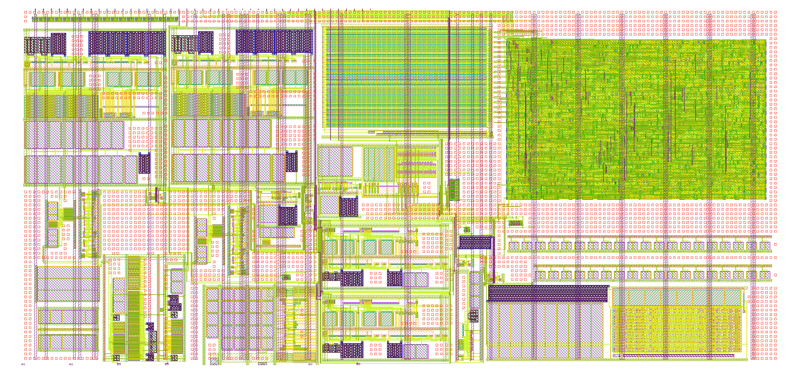

This project is a 433.92 MHz radio toolkit on a 2x2 Tiny Tapeout (TT) analog tile on GF180MCU (GlobalFoundries
180 nm), for the Zero to ASIC Course. It has a tunable ring voltage-controlled oscillator (VCO), a transmit (TX) driver
for a dipole, on-chip fine tuning over a Serial Peripheral Interface (SPI), 2-level frequency-shift keying (2-FSK) and
a zero intermediate frequency (zero-IF) in-phase / quadrature (I/Q) receiver (RX), with no inductors. The RP2350 on
the demo board does the digital work: tuning, demodulation and framing. The analog runs from VAPWR = 3.3 V.

**AI-assisted design.** The design, layout, simulations and documentation were done by Claude (Claude Code, an AI)
agents working from Matt Venn's briefs, with Matt reviewing the results and making the design decisions. All numbers
here are from simulation; the chip has not been measured yet.

> **Radio regulations.** This is an experimental, uncertified transmitter. The antenna driver is off unless ui[5] /
> ui[6] enable it. The coarse code alone puts the ring anywhere in 209-754 MHz (typical corner, extracted tile;
> 193-851 MHz over all process corners at block level), so until the RP2350 has tuned it, it can be tens of MHz away
> from 433.92 MHz, outside the 433.05-434.79 MHz licence-exempt band, and that range includes aviation, emergency
> services and the 406 MHz distress beacons. The output is close to a square wave: the 3rd harmonic is -14 dBc (dB
> relative to the carrier) and the 5th -23 dBc at the dipole. A board low-pass filter (LPF, below) takes the 3rd
> harmonic below -55 dBc in simulation: fit it before using an antenna. Power is about +6 dBm (4 mW), but transmitting
> over the air may need an amateur radio licence, and outside the amateur band it may not be legal at all. Measure
> first with a software-defined radio (SDR), keep transmissions short and prefer a cabled link with an attenuator.
> Receiving is fine. You are responsible for following your local rules.

## How it works

**VCO.** Five inverters sit between VDD and a shared node, vg; a current digital-to-analog converter (DAC) sinks the
ring current from vg, and the frequency follows the current. A 5-bit coarse code on ui[4:0] sets most of it. A 10-bit
medium DAC (register MED_INT) adds 0 to about 1.6 coarse steps in steps of about 31 kHz, and a first-order sigma-delta
(ΣΔ) modulator (MED_FRAC, CTRL.SD_EN) dithers one more DAC step for 8 fractional bits (115-150 Hz). vctrl, the old
analog fine input, is now only a bench override on ua[0]: it is pulled to 0 V by 200 kΩ on chip.

**Outputs.** An AC-coupled (alternating current) level shifter restores full swing, then dividers give f / 4 (`ck`, uo[0], gated off after
reset until CTRL.CK_EN is set), f / 16 (uo[1]), f / 64 (uo[2]) and f / 1024 (uo[3], 423.75 kHz at 433.92 MHz).

**TX.** The level shifter feeds a phase splitter and two arms in antiphase, out_p on ua[3] and out_n on ua[2], each
enabled by its own pin (ui[5], ui[6]), into a two-wire dipole.

**2-FSK.** With CTRL.FSK_EN set, ui[7] adds or subtracts the FSK_DEV register to the medium DAC word, so the data
pin moves the carrier by ±FSK_DEV (for example ±3 steps, a 204 kHz step that settles within 0.26 µs).

**RX.** The ring is also the receiver's local oscillator (LO). A low-noise amplifier (LNA) drives two passive mixers,
clocked from two ring taps 72° apart (a 5-stage ring has no 90° node), then baseband filters (about 8.5-143 kHz) and
limiters with hysteresis give two bits, q_i on uo[4] and q_q on uo[5]. A tone Δ away from the LO makes them toggle at
|Δ|, and their order gives the sign of Δ. The RP2350's programmable I/O (PIO) counts them as a quadrature counter: the
direction of rotation is the FSK bit. CTRL.RX_EN turns the receiver on.

**Debug multiplexer.** DBG_SEL (register 5) switches one internal node onto ua[0]: bit 0 RX baseband I, bit 1 RX
baseband Q, bit 2 RX bias nb, bit 3 vctrl. It is one-hot: write only 0, 1, 2, 4 or 8. ua[1] is the on-chip ground
(VGND): the reference for every reading on ua[0]. Never drive it.

**SPI registers.** The pins are uio[0] SCLK (serial clock), uio[1] MOSI (data in), uio[2] CS_n (chip select, active
low) and uio[3] MISO (data out). Mode 0, most significant bit first, 16-bit frames: [15] 1 = read, [14:12] address,
[11:0] data; read data comes back on MISO in the same frame. Project clock 25 MHz (10-50 MHz works); keep SCLK below
clk / 8.

| Addr | Register | Bits | Reset |
|---|---|---|---|
| 0 | MED_INT | [9:0] medium DAC word | 512 |
| 1 | MED_FRAC | [7:0] ΣΔ fraction | 0 |
| 2 | FSK_DEV | [11:0] FSK deviation, 4.8 fixed point in DAC steps | 0 |
| 3 | CTRL | [0] SD_EN, [1] CK_EN, [2] FSK_EN, [3] FSK_INV, [4] RX_EN | 0 |
| 4 | EFF_INT | [9:0] word in use, including FSK (read only) | 512 |
| 5 | DBG_SEL | [3:0] debug switches onto ua[0] | 0 |
| 7 | ID | 0x433 (read only) | |

**Headline numbers** (simulation, 27 °C, 3.3 V, typical corner unless stated):

| | |
|---|---|
| Coarse range, codes 0-31, word 512 | 209.1-753.8 MHz on the extracted tile; 193-851 MHz over all corners at block level |
| Code for 433.92 MHz | 10 on the extracted tile (about 3.6 % below the block-level extraction); slow-fast corner: code 15 = 400.0 MHz, code 23 = 506.5 MHz. Other corners not yet re-mapped on the tile |
| Medium DAC | step 31.1 kHz (27.4-35.6 kHz over corners), range more than 1.3 coarse steps |
| TX power into a 73 Ω dipole | +6.3 dBm (extracted tile); 3rd harmonic -14 dBc without the LPF |
| RX noise figure, current | 7.27 dB; about 7 mA on VAPWR |
| RX 1 dB compression, I/Q phase | -23.5 dBm; about 72° |
| FSK at 50 kbit/s, ±100 kHz, extracted tile | 0 bit errors at -70 and -95 dBm; with receiver noise at -105 dBm, 0 errors in 2 runs of 8 bits |
| Model sensitivity | -110.4 dBm (bit error rate 1e-3, 10 kbit/s) |

At the time of writing the full verification run is still in progress (finishing about 24 November 2026); see
Verification under More detail.

**Fig. 1.** The 2x2 tile layout, 693.28 × 325.36 µm: the VCO, medium DAC, TX driver, receiver, debug switches and
the digital macro.

## How to test

You need the RP2350 to run the SPI (from its PIO or a software SPI: the board's hardware SPI pins are in a different
order) and to count frequencies. Count uo[3] (f = 1024 × the count) or uo[1] (f / 16, more resolution). Don't use
uo[0]: it is off after reset, and the pads are only clean to about 50 MHz.

1. Select the project, set a 25 MHz clock and reset. Read address 7: it must return 0x433. Read every register and
   check the reset values in the table above.
2. Set code 10 on ui[4:0] (ui[0] is the least significant bit). uo[3] should toggle at about 414 kHz (424 MHz). Step
   the code from 0 to 31 and check that f rises every step, about 19 MHz per code near 433.92 MHz. The code for
   433.92 MHz may differ by one on silicon.
3. Tune: set MED_INT = 0 and binary-search the code for the highest one below 433.92 MHz. Count at MED_INT = 256 and
   768: the difference / 512 is the step in Hz. Set word = 256 + (433.92 MHz - f(256)) / step; the integer goes to
   MED_INT, 256 × the fraction to MED_FRAC, with CTRL.SD_EN = 1. Then servo between packets: count, and move the word
   by the error / step.
4. FSK: set FSK_DEV = 16 × (deviation / step), for example 0x033 for 100 kHz at 31.1 kHz per step, and CTRL.FSK_EN = 1.
   Count with ui[7] = 0 and 1: the counts should differ by twice the deviation. Rescale FSK_DEV until they do.
5. TX, cabled first: ui[5] = ui[6] = 1, each arm through a DC (direct current) block and an attenuator into an SDR or spectrum analyser.
   Check one arm at a time, then ui[5] = ui[6] = 0 (no carrier). Only then fit the LPF and the dipole.
6. RX: TX off, CTRL.RX_EN = 1, wait 2 ms. Feed a -70 dBm tone at f + 50 kHz into ua[4] through a DC block (ua[5] to
   ground through a DC block and 50 Ω). q_i and q_q toggle at 50 kHz, about 72° apart; at f - 50 kHz the order
   reverses. Lower the level to find where the bits stop.
7. Debug: with DBG_SEL = 8, a high-impedance probe on ua[0] against ua[1] reads vctrl, about 0 V. DBG_SEL = 4 reads
   nb, about 0.98 V with the RX on. To override vctrl, drive ua[0] at 0-3.3 V only after reading back DBG_SEL = 8.

**Firmware rules.** TX and RX share the oscillator, so the radio is half-duplex:
1. Keep CTRL.RX_EN off while transmitting (ui[5] / ui[6] high).
2. After RX_EN rises, after TX ends, or after a strong in-band signal, wait 2 ms before trusting q_i / q_q.
3. Set only one DBG_SEL bit at a time, and raise CS_n after every 16-bit SPI frame (a longer frame writes again).

## External hardware

- A 433 MHz board low-pass filter on the TX pins before the dipole: a balanced 5th-order pi filter, per line
  4.7 pF / 18 nH / 15 pF / 18 nH / 4.7 pF, capacitors to ground. It takes the 3rd harmonic below -55 dBc.
- A TX dipole (2 × 16.5 cm) on ua[2] / ua[3], or for cabled tests a 50 Ω attenuator (at least 30 dB into another
  receiver) with DC blocks.
- An RX dipole or an SMA (SubMiniature version A) connector on ua[4] / ua[5], with DC blocks: the inputs self-bias at
  about 1.37 V.
- An SDR or spectrum analyser covering 300-600 MHz and up to the 3rd harmonic, and a high-impedance probe for ua[0].

## More detail

The project repository: https://github.com/mattvenn/gf-433-oscillator

- How it was made, with Claude Code: https://github.com/mattvenn/gf-433-oscillator/blob/main/README.md#how-it-was-made
- How it works: https://github.com/mattvenn/gf-433-oscillator/blob/main/README.md#how-it-works
- Pins: https://github.com/mattvenn/gf-433-oscillator/blob/main/README.md#pins
- Schematics: https://github.com/mattvenn/gf-433-oscillator/blob/main/README.md#schematics
- Layout: https://github.com/mattvenn/gf-433-oscillator/blob/main/README.md#layout
- Digital: https://github.com/mattvenn/gf-433-oscillator/blob/main/README.md#digital
- Verification: https://github.com/mattvenn/gf-433-oscillator/blob/main/README.md#verification
- Bring-up: https://github.com/mattvenn/gf-433-oscillator/blob/main/README.md#bring-up
- Status: https://github.com/mattvenn/gf-433-oscillator/blob/main/README.md#status
