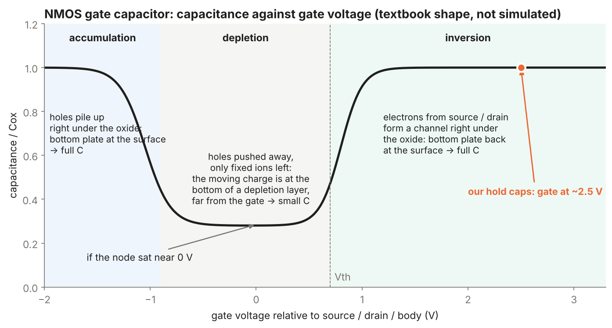
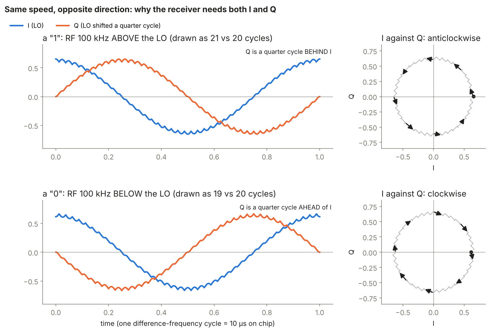
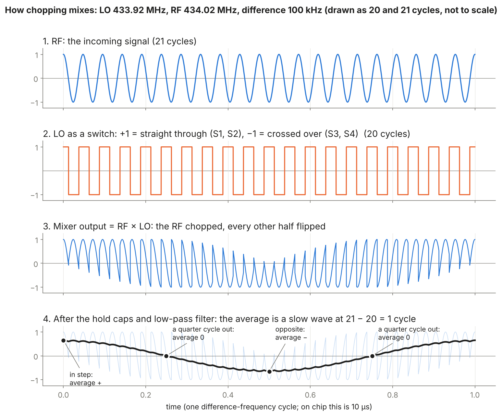
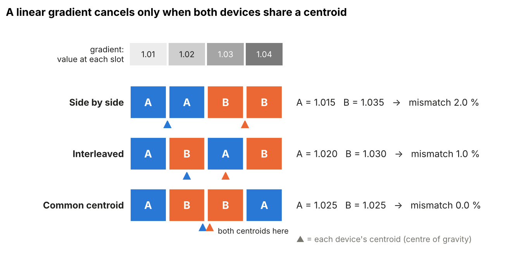
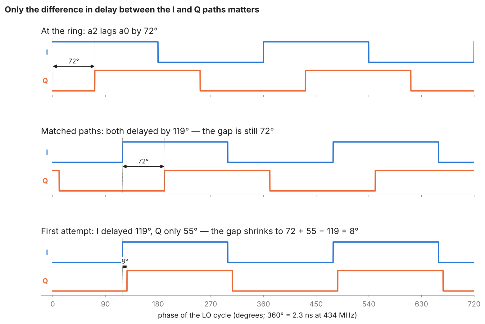
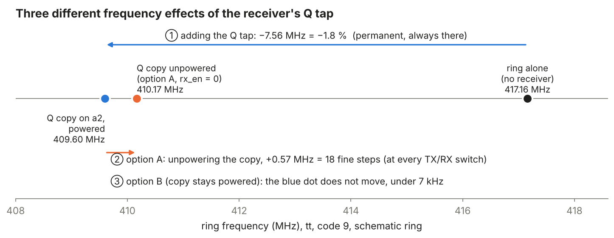
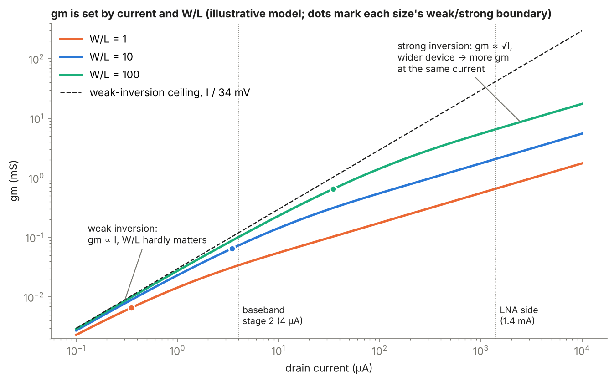
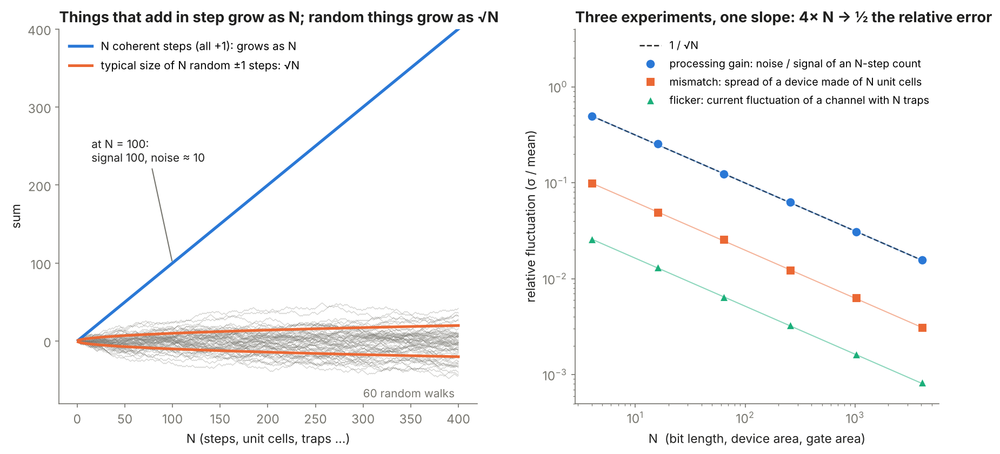

# Learning notes: a tunable 433.92 MHz ring oscillator on GF180

Notes written while designing this block, so the reasoning can be reused when explaining it to others.
Each section gives the idea in plain words, then the number from our own simulation. Results are
schematic simulations unless marked otherwise. Sections 1–7 come from the VCO study (scripts in `sim/vco/`,
results in [vco_study.md](vco_study.md)). Sections 8–20 come from the review sessions on the current DAC and
the receiver (2026-11-08 to 11-15); their figures are drawn by the scripts in `sim/learning/`.

## 1. What sets a ring oscillator's frequency
A ring oscillator is an odd number N of inverters in a loop. An edge travels round the loop twice per
period, so f = 1 / (2 · N · td), where td is the delay of one stage. The delay is
roughly the time to charge the next stage's capacitance C through the switch-on current I over the voltage
swing V: td ≈ C · V / I.

- GF180 3.3 V inverters (Wn/Wp = 2/5 µm) have td of about 51 ps, so f · N ≈ 9.74 GHz. A plain
  ring needs about 22 stages for 433.92 MHz.
- Power is about 2.5 mW whatever N is: each stage switches C · V² once per period, and N · f is constant.
- Every term in td ≈ C · V / I moves: the supply V, the current I (temperature, process) and C
  (process). That is why a free-running ring lands anywhere in ×0.73 … ×1.29 of nominal across
  process, voltage and temperature (PVT).

## 2. Why the drift matters for FM and FSK
Frequency-shift keying (FSK) sends data by switching the carrier between two frequencies, often only
±25–50 kHz apart. The plain ring moves about +1 MHz for 10 mV of supply and about −800 kHz per °C, so a
0.5 mV supply change or a 0.06 °C temperature change is as large as the whole deviation. The frequency
loop therefore has to keep running during transmit, and the oscillator itself should be made as
insensitive as possible.

## 3. Tuning knobs: change C or change I
- **Switched capacitors** (change C). Tried and rejected: a switched GF180 MOS capacitor still loads the node
  through its junctions when switched off, so the on/off ratio is poor (only ×0.86 of range from a 4-bit
  bank).
- **Current starving** (change I). Each inverter gets its current through a series PMOS "head" and NMOS
  "foot" transistor that act as current sources. Switching binary-weighted foot transistors on and off
  (the coarse code) gives ×2–3 of range cleanly, because an off transistor adds almost no load.

## 4. Kvco: why steep tuning is bad
Kvco is the change in frequency per volt on the analog control input (vctrl). Noise on vctrl becomes
frequency noise multiplied by Kvco. With vctrl driving the whole foot current, Kvco was about
500–800 MHz/V, so just 1 mV of noise would move the carrier by up to 0.8 MHz.

The usual fix is to split the jobs: a fixed, clean bias sets most of the current (with the digital
coarse code), and vctrl drives only a small "fine" transistor. Our version brought Kvco down to about
16 MHz/V (±3.8 % fine range), roughly 50× lower.

## 5. A constant-gm bias, and why its current rises with temperature
A constant-gm (β-multiplier) reference is a small self-biased loop: two NMOS transistors with a size
ratio K, one with a resistor R in its source, and a PMOS current mirror forcing equal currents. The loop
settles where the transistor's transconductance gm ≈ 2(1 − 1/√K) / R. Its current is
I ∝ 1 / (μ · R²), where μ is the carrier mobility.

μ falls as the chip warms (roughly as T−1.5), so the reference pushes more current to keep gm
constant. With an ideal resistor, the ring's frequency followed and drifted **+2950 ppm/°C**, the opposite
sign to the plain ring (−1840 ppm/°C) and larger.

## 6. Cancelling temperature with the resistor's own tempco
Since I ∝ 1 / R², a resistor whose value rises with temperature pulls the current back down. Sweeping an
ideal resistor's tempco found a null at about **+1900 ppm/°C**. The GF180 PDK resistors (model file
`sm141064.ngspice`) range from about −1700 ppm/°C (high-resistance poly) to +3300 ppm/°C (salicided
diffusion). Two of them fit:

- **n-well** (about +2300 ppm/°C, about 1.3 kΩ/square) but with a large second-order term, so alone it bent the curve
  down when hot (−740 ppm/°C end to end);
- **n+ diffusion** (about +1360 ppm/°C, 60 Ω/square) with a much smaller second-order term.

**In series** (2 × 4.5 µm n-well + 2 × 100 µm n+) the drift is about −20 ppm/°C end to end, with a
±0.8 % bow (487.4 / 495.0 / 488.4 MHz at 0 / 27 / 70 °C). That is about 100× better than the ideal
resistor. This is the same trick a bandgap reference uses: add two effects with opposite temperature
behaviour so the first-order terms cancel.

## 7. Why starving flips the supply sensitivity
- Plain ring: a higher VDD gives more drive current, so f rises (+0.23 % per 10 mV).
- Starved ring with a fixed current: the current no longer rises with VDD, but the swing V in
  td ≈ C · V / I still does. So f ∝ 1 / VDD: −0.30 % per 10 mV at 3.3 V, which is what we see
  (−0.27 to −0.29 %/10 mV).

So the remaining supply sensitivity comes from the swing, not the bias. The ways to remove it are to
regulate the ring's own supply, or to make the current rise with VDD exactly enough to cancel. This is the
next decision.

## 8. Current mirrors: a current becomes a voltage and back again
A diode-connected MOSFET (gate tied to drain) is always in saturation, because VDS = VGS
is always above VGS − Vth. Push a current I into it and it settles at the gate voltage that
carries exactly that current: VGS = Vth + √(2I / β), with β = μ · Cox · W / L.
So it **turns a current into a voltage**.

The gate draws no DC current, so that voltage can be wired to any number of other gates for free. Each one,
in saturation with the same VGS, **turns the voltage back into a current** scaled by its own W / L.
That is a current mirror, and the coarse DAC (`cfed_dac`) is a row of them: the reference's `vbnf` on the gates
of a base leg (×6) and binary legs (×1 … ×16), so I(vg) = (6 + code) units plus the fine leg.

The derivative of the square law gives the transconductance, gm = β · (VGS − Vth)
= √(2βI). The bias reference is "constant-gm" because its loop sets gm = 1 / R (for K = 4), not the
current.

## 9. Switching a current-source leg: switch the gate, not the drain
Each coarse bit connects its leg's gate either to `vbnf` (on) or to VSS (off), with three transistors: a
transmission gate (NMOS and PMOS in parallel) and a pull-down.

- **Why the gate:** a switch in the drain would carry the leg's current, so its on-resistance would drop a
  voltage that eats the leg's headroom, varies with process, temperature and code, and unbalances the binary
  weights (differential non-linearity, DNL). On the gate side no DC current flows, so I · Ron = 0 and
  the gate sits at exactly `vbnf`. The switch's resistance only sets how fast the gate charges.
- **Why the pull-down:** a gate is a capacitor. Open the switch and the gate *keeps* its 1.23 V, so the leg stays
  on, then drifts as the charge leaks away. (That is how flash memory works, on purpose.) The pull-down holds an
  off leg at 0 V.
- **Which half of a transmission gate does the work:** whichever has the larger gate drive. Passing 1.23 V
  with 3.3 V on the NMOS gives it VGS ≈ 2.1 V (hard on), while the PMOS has only VSG ≈ 1.23 V
  (barely on). In the receiver's mixer, whose nodes sit at about 2.5 V, it is the other way round.
- **Source and drain are set by voltage, not by the symbol:** the source of an NMOS is whichever end is lower.
  In a pass gate it swaps during operation, so the drawn arrow is only a label.
- **The cost:** an off gate at 0 V takes its charge from the 20 pF filter cap when it turns on. For the ×16 leg
  (about 0.4 pF of gate) `vbnf` dips about 25 mV and recovers with the 1 MΩ × 20 pF = 20 µs time constant.

## 10. Big gates for low flicker noise, without changing W / L
Flicker (1/f) noise voltage falls with gate area, vn² ∝ 1 / (W · L · f). The bias reference's NMOS
devices are 14 × 14 **series-parallel arrays** of a 2/1 µm unit: 14 in parallel multiplies W by 14, 14 in series
multiplies the effective L by 14. W / L, and so the current and gm, is unchanged, every channel stays
1 µm long (so the temperature behaviour stays that of the unit), and the area is 196× larger, so the noise
voltage drops about 14× (√196). Fingers alone cannot do this: they are always parallel slices with the same L.
Plain scaling of the reference cut the noise but lost the temperature-coefficient null; the arrays kept both
(13.3 kHz rms FM over 1–10 kHz, +1 ppm/°C, `docs/bias_tuning_results.md`).

## 11. MOS capacitors, and why they must be biased
GF180 projects on Tiny Tapeout have no Metal5, so no MIM capacitors: every large capacitor on this chip is a
MOSFET's gate (about 4 fF/µm² for the 3.3 V oxide). The gate is the top plate. The bottom plate is wherever
**mobile** charge can gather right under the oxide:

**Fig. 1.** Capacitance of an NMOS gate cap against gate voltage (textbook shape, not simulated). In inversion
(electrons supplied by the source and drain) and in accumulation (holes) the charge sits at the surface and C is
the full Cox. In depletion only fixed ions are left and C falls to a fraction. The mixer's hold caps
sit at about 2.5 V, deep in inversion. The vg decap is a PMOS with its gate 1.5 V below its source and body,
which is inversion for a PMOS.

So every MOS cap needs a check of its DC bias. The same effect, used on purpose, is a **varactor**: the tuning
element of LC oscillators.

## 12. Zero IF: a mixer multiplies, and I/Q gives the sign of the frequency
A mixer multiplies the signal by the local oscillator (LO): cos a · cos b = ½ cos(a − b) + ½ cos(a + b). With the
LO exactly on the carrier (zero intermediate frequency, zero IF), a "1" at +100 kHz and a "0" at −100 kHz both
come out of one mixer as 100 kHz, because cos(−x) = cos(x). A second mixer with the LO shifted a quarter cycle
(Q, for quadrature) solves it: plotted against each other, I and Q go round a circle, **anticlockwise for +f and
clockwise for −f**.

**Fig. 2.** A "1" (RF one cycle above the LO) and a "0" (one cycle below) both give a 100 kHz I signal. Only the
order of I and Q differs, so the point turns anticlockwise for a "1" and clockwise for a "0"
(`sim/learning/iq_direction.py`, frequencies scaled down to 20 / 21 / 19 cycles).

Our receiver keeps only the sign of I and Q (one limiter per arm), so the RP2350 sees which quadrant the point
is in. The quadrant sequence is a Gray code (one bit changes per step), exactly like a rotary encoder, and the PIO
decodes it the same way: +1 or −1 per step. At 10 kbit/s and ±100 kHz each bit is 10 turns, about ±40 steps.
A 5-stage ring has no 90° node, so the receiver uses taps 72° apart: the part of Q independent of I is
sin 72° = 0.95, a loss of only 0.4 dB.

## 13. A switching mixer: chop, then average
The mixer (`rx_mix`) is four transmission gates. When the LO is high the RF passes straight through; when it is low
the two wires cross over. So the output is the RF times a ±1 square wave, chopped with every other half flipped.

**Fig. 3.** The RF (21 cycles) chopped by the LO (20 cycles). Where they are in step, every flipped half lands
positive; half a cycle later every half lands negative. The average (the hold caps and the baseband low-pass)
is a slow wave at the difference, 21 − 20 = 1 cycle: 100 kHz on chip (`sim/learning/chopping_mixer.py`).

A ±1 square wave is (4/π)[cos ωt − ⅓ cos 3ωt + ⅕ cos 5ωt − …], so the chopper is a cos(LO) multiplier plus
weaker ones at the odd harmonics. It also hears signals near 3 × 433.92 ≈ 1.3 GHz, ⅓ in voltage (−9.5 dB); the
LNA's own roll-off at 1.3 GHz takes that to about 15–17 dB below the main response.

## 14. Image and mirror
- **Low IF with one real mixer (option A):** a signal the same distance on the *other* side of the LO (the
  image) lands on exactly the same IF frequency. No filter can remove it.
- **Zero IF with I/Q (option B):** an interferer stays at its own offset, and the baseband filter decides. With
  imperfect I/Q (72° instead of 90°) a weak **mirror** appears at the opposite offset, −f for +f, about
  tan(9°) ≈ 0.16 of the signal (−16 dB). It only lands in band if the interferer itself is in band, so it never
  creates a new problem; in option A the same 16 dB would be a real one.
- **But** the LO delays of the I and Q paths must match. In the first LO design the two level shifters delayed by
  119° and 55°, so the 72° shrank to about 8°: sin 8° = 0.14, roughly 17 dB lost (section 17).

## 15. Noise, sensitivity and averaging
- **Thermal noise floor:** kT = −174 dBm/Hz. In a bandwidth B with noise figure NF the noise is
  −174 + 10 log10(B) + NF dBm. Our arm: 150 kHz (52 dB) and 7.27 dB gives about −115 dBm.
- **dB and dBm:** dBm is an absolute power (relative to 1 mW); dB is a ratio. The difference between two dBm
  values is in dB. Use 20 log for voltage ratios and 10 log for power ratios.
- **Processing gain:** at the −110.4 dBm sensitivity the signal is only about 5 dB above the noise in the filter,
  yet it decodes. Over one bit the signal's quadrant steps add up (about 40), while the noise's random ±1 steps
  only grow as √N (about 10 for 100). Equivalently, averaging over a 10 kHz bit throws away
  10 log(150 k / 10 k) ≈ 12 dB of noise bandwidth.
- **Limits of averaging after a limiter:** going from 10 to 1 kbit/s should gain 10 dB but the model shows 6.7 dB,
  because the filter stayed 150 kHz wide and the signal is then below the noise *before* the 1-bit limiter
  (limiter suppression). Rule: filter as narrow as the signal needs before any non-linearity.
- **Hysteresis:** flicks of the comparator near a boundary cancel in the count (+1 −1), but fast chatter right
  next to a −110 dBm input couples back through the supply and substrate, and the PIO can miss edges. So the
  comparator gets ±0.5 × the noise rms of hysteresis.

## 16. Gain at radio frequency: Friis, gain-bandwidth and the differential pair
- **Friis:** Ftotal = F1 + (F2 − 1)/G1 + … Noise added before the
  first gain is amplified as much as the signal; later noise is divided by the gain in front of it. So the first
  stage sets the noise figure, and every 10 Ω of pad routing before the LNA costs about 0.35 dB.
- **Gain-bandwidth:** a resistor-loaded stage has A = gm · RL and a corner at
  1 / (2π RL C), so A × f ≈ gm / (2πC): raise RL and the corner drops as fast as
  the gain rises. At 434 MHz that caps a stage at about 13 dB (sky130 and GF180 alike), so the LNA uses two
  stages (about 26 dB) and the cheap gain (64 dB) is taken after the mixer, at 100 kHz.
- **Resistor loads at RF:** a PMOS current-source load gives more low-frequency gain but puts the corner near
  50 MHz, adds noise, and needs common-mode feedback; 800 Ω puts it near 660 MHz.
- **Prefix check:** mS × kΩ is a plain number (8 mS × 1.2 kΩ = 9.6, about 20 dB). A single stage above a few
  hundred means a prefix has slipped.
- **The differential pair:** the tail fixes the total current, the input only steers it between the two sides,
  and the load resistors turn the steered current into voltage. A common-mode disturbance (both inputs moving
  together) cannot steer anything, so it is rejected. The rejection is only as good as the matching: the supply
  appears on both outputs almost at full size (−1.4 dB), and any mismatch converts part of it to a differential
  signal.

## 17. Filters, AC coupling and variation
- **Reading a Bode plot:** each pole adds 20 dB per decade, but only on the asymptote, about a decade past its
  corner. Near the corner the slope reads fractional.
- **AC coupling:** a series C into a resistor to the bias is a first-order high-pass, 1 / (2πRC). The baseband
  has four, so its low side falls at about 80 dB/decade. In zero IF they must block the mixer's DC offset, which
  the 69 dB of gain would otherwise turn into volts.
- **Huge on-chip resistors:** a 2.6 kHz corner with about 1 pF needs about 60 MΩ: 60 000 squares of 1 kΩ/sq poly,
  60 mm at 1 µm wide. A MOSFET biased just below threshold does it in a few µm², with a replica device to set its
  bias. The cost: pushed hard it passes only about 1 nA, so the couplings slew, and an offset step (for example a
  strong interferer switching on, whose second-order distortion and self-mixing make DC) blanks the receiver for
  0.5–0.9 ms.
- **Three kinds of variation, three defences:**

| Kind | Example | Defence | How we check it |
|---|---|---|---|
| Global (process corners) | the whole ring faster at ff | ratios that track (gm · RL with a constant-gm bias); calibration (the RP2350 servo) | corner simulations |
| Local systematic | gradients, wiring, neighbours, loads | symmetry: common centroid, dummies, same orientation, same load, layout copies | extraction |
| Local random (mismatch) | dopant counts, edge roughness | area (Pelgrom: σ ∝ 1 / √(W · L)), or calibration | Monte Carlo |

**Fig. 4.** Two devices A and B, each split in two, on a 1 %-per-slot gradient. Side by side they mismatch by 2 %,
interleaved by 1 %, and in common-centroid order (ABBA) by 0 %, because both centroids sit at the same point
(`sim/learning/common_centroid.py`).

- **The LO paths are the same lesson at block level.** Both level shifters came from one schematic, but the
  laid-out one has 1.4 fF on its input node against the schematic's 0.4 fF. Through the 2 fF coupling cap that
  passes 59 % of the ring's swing instead of 83 %, the first inverter switches more weakly, and the delays came
  out 119° and 55°.

**Fig. 5.** A delay common to both LO paths keeps the 72° between I and Q; a mismatched delay collapses it to
72 + 55 − 119 = 8° (`sim/learning/lo_delay.py`). The fix copies lsdiv's level shifter *and its load* for the Q tap,
and requires the layout to copy lsdiv's cell; the simulated I/Q phase is then 71–74° at every corner.

## 18. Loading the ring, the Miller effect, and calibrating out a systematic jump
- **Any load slows a ring.** Each stage's delay is about C · V / I, so extra capacitance on any node lowers f.
  Hanging the receiver's Q level shifter on node a2 lowered the ring by 1.8 % (417.16 → 409.60 MHz at tt, code 9),
  about one coarse code. A fixed offset is harmless, because the servo tunes the absolute frequency; but permanent
  slowdowns all come out of the same tuning headroom, so keep a running total.
- **The Miller effect.** Inside every inverter, Cgd connects the input to the output. When the input
  moves by v the output moves by −A · v, so the voltage across Cgd changes by (1 + A) · v and the input
  sees Cgd × (1 + A) to ground. No loop around the amplifier is needed: the transistor's own capacitance is
  the path. The level shifter's first inverter is biased at its switching point, where A is largest, so it loads
  the ring through its 2 fF coupling cap far more than its bare gate would. Example: 0.3 fF with a gain of 5 looks
  like 1.8 fF.
- **Switching an amplifier's supply changes its Miller load.** Unpowering the Q copy (gain about 0) removes that
  capacitance, and the ring jumps up by 0.42–0.71 MHz over the corners, 14–23 fine-DAC steps (31 kHz each).

**Fig. 6.** The receiver's Q tap moves the ring twice: permanently by −1.8 % when it is added, and by +0.57 MHz
(at tt) each time its supply is switched, if rx_en gates it. Kept powered, it moves the ring by under 7 kHz
(`sim/learning/q_tap_shifts.py`, numbers from `docs/rx_design.md` Table II).

- **Counting a frequency takes time.** The RP2350 counts edges of f / 16 for a gate time T. The count is ±1, so the
  resolution is 16 / T in the ring's frequency: 16 kHz at 1 ms (enough for the coarse search), 1.6 kHz at 10 ms
  (the fine servo). A reciprocal count (timing whole periods with the 150 MHz clock) gets 290 Hz in 10 ms
  (`docs/tuning.md`). So re-tuning after a 0.57 MHz jump by measurement alone takes about 11 ms, far more than
  the receiver's 1–2 ms settling.
- **Feed-forward plus feedback.** Because the jump is systematic (the same chip, the same temperature, the same jump),
  the RP2350 can measure it once, store the DAC word for each state, and write the stored word at the same moment as
  rx_en, in microseconds. The servo then only trims the slow drift between packets, and an occasional re-calibration
  tracks any change of the jump with temperature. A random error could not be handled this way: it would have to
  be measured every time.

## 19. gm: the transistor's exchange rate from volts to current
gm says how much drain current changes per volt on the gate: 1 mS = 1 mA/V = 1 µA per mV. A load resistor
turns that current back into voltage, so gain = gm × R (and mS × kΩ is a plain number). 1 / gm is
a resistance: 1 mS ↔ 1 kΩ, what you see looking into a source or a diode-connected transistor.

| Stage | gm | 1 mV on the gate gives | × load | = output |
|---|---|---|---|---|
| LNA | ≈ 10 mS | 10 µA | × 800 Ω | 8 mV (gain 8) |
| Baseband stage 2 | ≈ 0.09 mS (from its ≈ 25 dB gain) | 0.09 µA | × 200 kΩ | 18 mV (gain 18) |

The knobs are the **bias current** (set by the tail or mirror; it costs power) and **W / L** (a wider device needs
less overdrive for the same current, so more gm; it costs area and capacitance). The gate voltage is not set
directly: it settles wherever that W / L needs it to carry the current.

**Fig. 7.** gm against drain current for W / L = 1, 10 and 100 (EKV-style interpolation with round-number
parameters, illustrative, not a GF180 simulation; `sim/learning/gm_vs_current.py`). In weak inversion gm ≈ I / 34 mV
whatever the size, the most gm per µA; in strong inversion gm = 2I / Vov grows only as √I, and a
wider device stays nearer the ceiling. The baseband runs at µA near the ceiling (efficient, slow); the LNA runs at mA
with wide devices (fast, power-hungry).

## 20. √N: one law behind processing gain, mismatch and flicker noise
Things that add **in step** grow as N; things that add **at random** grow only as √N. So whenever a quantity is the
sum of N independent random parts, its relative fluctuation falls as 1 / √N, and its power as 1 / N.
- **Processing gain:** a bit's quadrant count adds the signal's N steps coherently and the noise's steps at random.
- **Mismatch (Pelgrom):** a transistor is many small random patches (dopants, edges); σ ∝ 1 / √(W · L).
- **Flicker noise:** each oxide trap disturbs only its own patch of channel. A bigger gate has more traps, but their
  random sum grows as √N while the channel's charge grows as N, so vn² ∝ 1 / (W · L). That is why the bias
  reference uses 196-unit arrays and baseband stage 1 uses 16 × 20/1 µm devices.

**Fig. 8.** Left: 60 random walks of ±1 steps spread as ±√N while N coherent steps reach N. Right: three Monte Carlo
experiments (the noise of an N-step count, a device of N random unit cells, a channel with N random traps) all fall on
1 / √N, fitted slopes −0.500, −0.499 and −0.497 (`sim/learning/sqrt_n.py`).

Receiver numbers in sections 12–20 are from `docs/rx_design.md` on branch `rx-option-b`
(schematic level, before layout).
