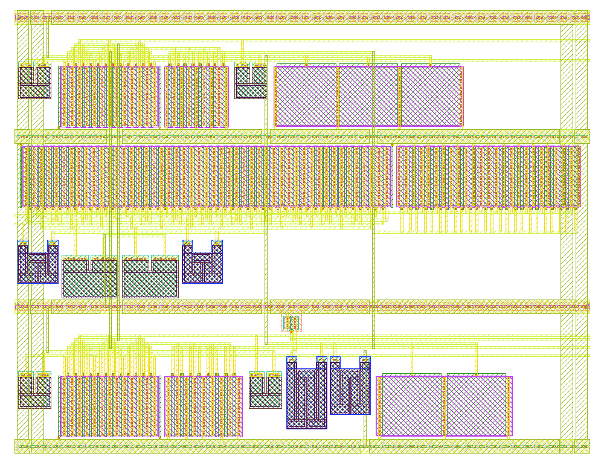
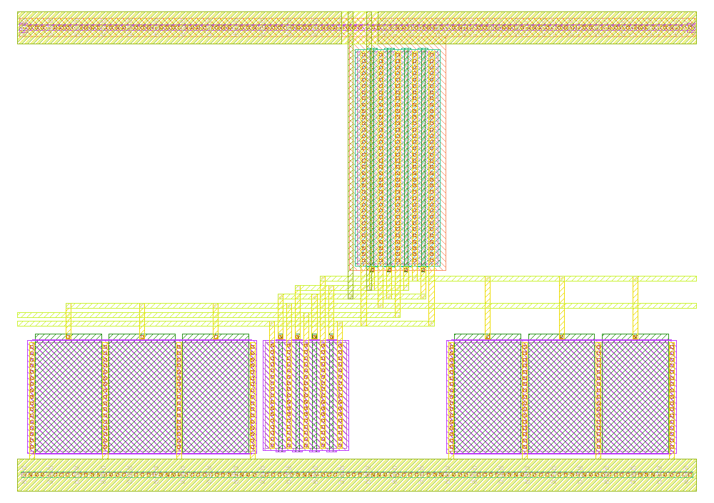
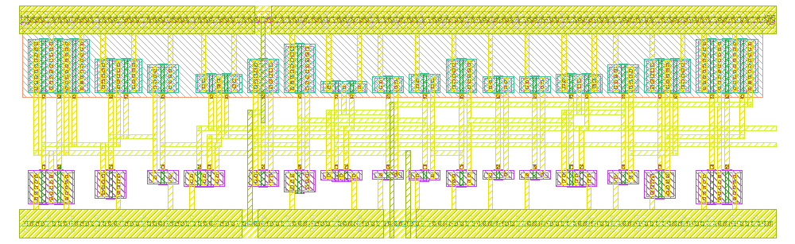
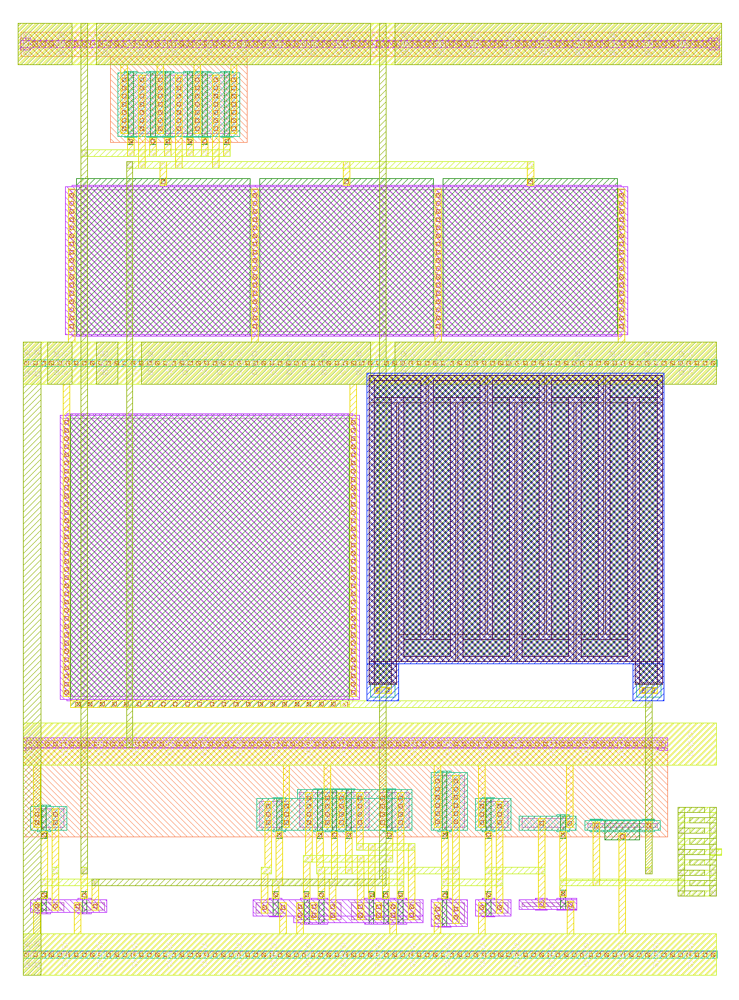
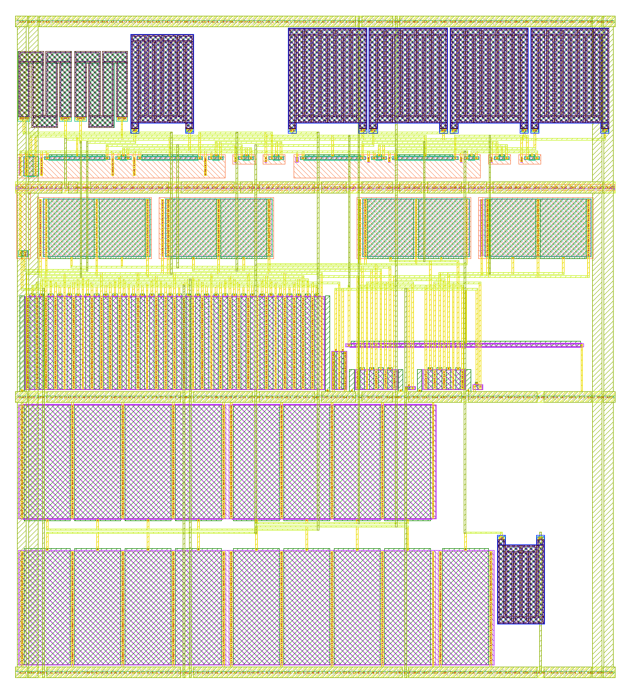
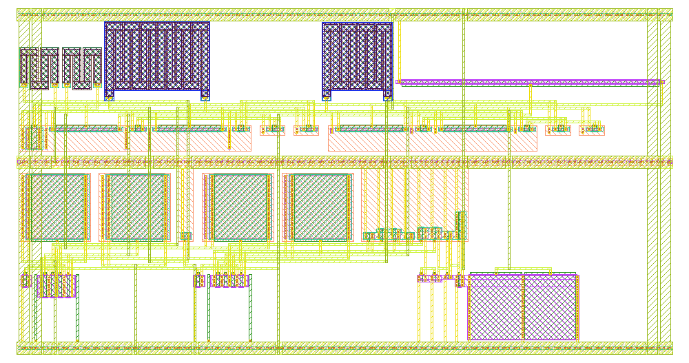
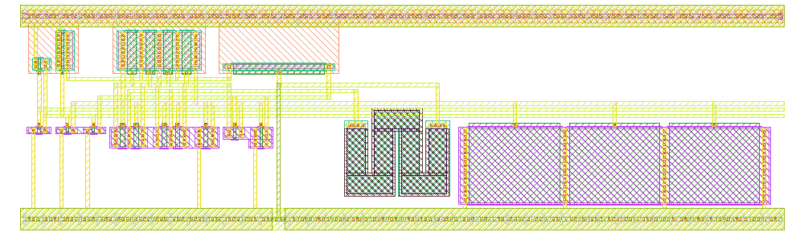
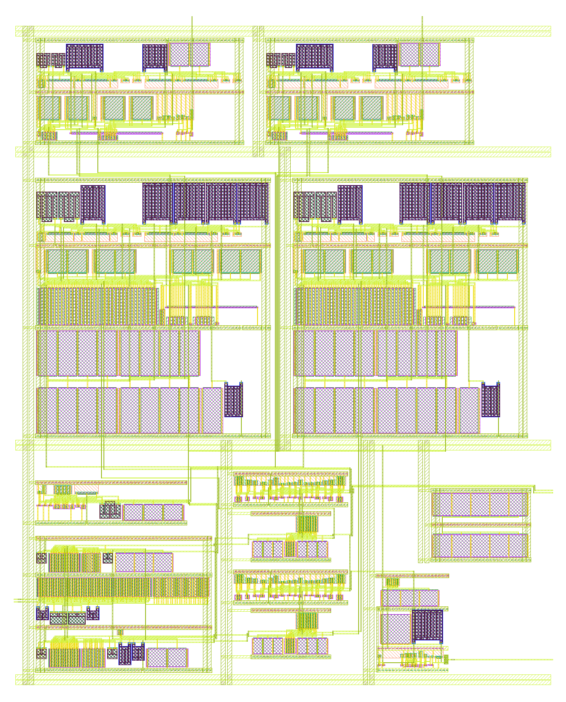

# Receiver (option B): first-pass layout

[](https://claude.com/claude-code)

This is the first-pass layout of the zero-IF (intermediate frequency) receiver described in `docs/rx_design.md`, on
GF180MCU for Tiny Tapeout ttgf26c. Every block (rx_bias, rx_lna, rx_lsq, rx_lobuf, rx_mix, rx_bb, rx_lim) and the
assembled rx_top was generated from Python, checked with DRC (design rule check), LVS (layout versus schematic) and
antenna checks, extracted (PEX, parasitic extraction), and re-simulated with the schematic benches from `sim/rx/`.
No device size was changed from the schematic.

**Summary (2026-11-16).** rx_top is 328.2 × 400.4 µm (131,434 µm²) with its 12 µm margin, 304.2 × 376.4 µm
(114,522 µm²) for the core, and the cells alone add up to 81,851 µm²: 4.0 × the device area, well above the
40,000-60,000 µm² estimate. The baseband arms are half of the cell area. Every cell and rx_top is clean in magic DRC,
KLayout DRC, antenna and LVS, with every device size checked against the simulation netlists. On the extraction
the LNA (low-noise amplifier) loses 1.8 dB of gain and 0.4 dB of NF (noise figure) at tt (24.19 dB, 7.58 dB), the
baseband matches its schematic to within 0.8 dB, and the comparator hysteresis is ±36.3 mV (schematic ±36.1 mV).
The LO (local oscillator) I/Q (in-phase and quadrature) phase is 75.7-78.2° against 72.0-72.7° in the schematic,
inside the 72 ± 25° stop rule, and the ring's frequency shift from the receiver's load matches the schematic to
0.02 %. The FSK (frequency-shift keying) decode through the real ring LO on the extracted rx_top was still running
at the time of writing.

Brief: `docs/handoff_rx_layout.md`. Generators: `layout/gen/rx_*.py`. Bench results (JSON):
`docs/rx_layout_results/`; check logs and run directories (not committed): `build/rx_layout/`.

## How the cells were made

1) **One generator per cell:** `layout/gen/rx_bias.py`, `rx_lna.py`, `rx_mix.py`, `rx_lobuf.py`, `rx_lsq.py`,
   `rx_bb.py`, `rx_lim.py` and `rx_top.py`, with a shared library `layout/gen/rx_lib.py`. Device sizes are read
   from the simulation netlisters (`sim/rx/*.py`'s `block()`, through `sim/rx/rx_top.py`), never typed in.
2) **Band style:** the same as `layout/gen/lsdiv.py` and `tx_drv.py`, whose `strip()` and channel router are reused
   unchanged. A band is VSS rail | NMOS row | channel of M2 tracks | PMOS row | VDD rail. Bands stack, and every
   second one is mirrored so that neighbours share a rail.
3) **Added for the receiver:**
   - poly resistors: ppolyf_u as U-shapes, and ppolyf_u_1k as serpentines with lsdiv's 0.7 µm gap and terminal
     strips 2.5 µm longer than their neighbours;
   - n-well islands with their own taps, for PMOS whose bulk is not VDD (the AC-coupling caps and the
     pseudo-resistors);
   - "NN" bands with NMOS rows on both sides, for the 4 pF caps;
   - M3 risers between bands and M3 rail straps at both edges of each cell;
   - every net labelled with its simulation name.
4) **Matching:** the LNA, baseband and limiter pairs are each one diffusion with fingers A B B A (common centroid,
   shared sources) and a poly dummy finger at each end, tied to VSS. rx_bias's MP1 / MP2 are A B B A, and its MN2 |
   MN1 | MN2. The mixer's four NMOS switches share one diffusion (rfp |S1| bbp |S3| rfn |S2| bbn |S4| rfp,
   symmetric) and its four PMOS another. The I and Q copies of each block (LO buffers, mixers, LNA stage 2,
   baseband arms, limiters) are the same cell in the same orientation.
5) **rx_lsq, the Q-tap level shifter,** runs lsdiv.py's own `build()` (imported, not edited) with a different
   column list. B1 and D2 (the /4's second stage and buffer, which the Q tap doesn't have) are replaced by the
   TX-tap stand-in TT and Dq, padded to exactly the width of B1 + D2. The generator asserts that every strip from D1
   rightwards, the passive band (R1, C1), Cc and every level-shifter track sit at lsdiv's coordinates.
6) **rx_top's floorplan, power and router:** below.

Table I. rx_lsq against lsdiv, C-only extraction (fF).

| Net | rx_lsq | lsdiv |
|---|---|---|
| Cc (aq-lg) | 1.985 | 1.985 |
| lg | 4.20 | 4.20 |
| lo1 | 2.31 | 2.31 |
| lo2 | 3.21 | 3.21 |
| lf | 11.34 | 10.21 |
| output node (lsq / ls) | 14.71 | 7.68 |

The level shifter's internal nodes match. The output node does not: lsq drives TT, Dq and the jumper to the pin,
while lsdiv's internal ls in this number does not include the TX tap wire it drives in vco_top. This matters for
the I/Q phase (below).

## Floorplans

### Blocks



**Fig. 1.** rx_lna, stage 1 and both stage-2 copies: 133.9 × 70.1 µm. The Q outputs leave the bottom band and the I
outputs the top band, so each mixer sits level with its stage 2.



**Fig. 2.** rx_mix, the passive double-balanced mixer: 51.3 × 36.1 µm. The NMOS and PMOS switch diffusions sit side
by side, each symmetric about its centre.



**Fig. 3.** rx_lobuf, one LO buffer: 63.6 × 19.5 µm. lo / lob leave straight down on M3 into the mixer below it.



**Fig. 4.** rx_lsq, the Q-tap level shifter built by lsdiv.py's own `build()`: 40.5 × 61.7 µm, with every
level-shifter strip and track at lsdiv's coordinates.



**Fig. 5.** rx_bb, one baseband arm: 145.8 × 144.2 µm, the largest cell. The 4 pF load caps (8 per arm) are nfet
gate caps in their own band.



**Fig. 6.** rx_lim, the AC-coupled limiting stage and the comparator: 127.8 × 67.4 µm. Extracted hysteresis
±36.3 mV at tt.



**Fig. 7.** rx_bias, the constant-gm reference: 62.6 × 35.7 µm. The extracted cell gives nb 0.978 V and 51 µA at
power-up (schematic 0.979 V).

### rx_top

Signal flows up the page, with I and Q side by side above the front end:

- **row C:** rx_lim I | rx_lim Q. The comparators are the noisy end, at the top; q_i / q_q leave through the top
  edge.
- **row B:** rx_bb I | rx_bb Q, with their cap band at the bottom, between the LO buffers and stage 1.
- **row A:** the LNA (bias and decap above it) | the mixer column (bottom to top: mix_q, lobuf_q, mix_i, lobuf_i) |
  rx_lsq.

Because each mixer sits level with its stage 2, the RF (radio frequency) routes are 20-21 µm (Q) and 35-38 µm (I).
Each LO buffer sits right on its mixer, with lo / lob straight down on M3, and takes its LO input from the right,
away from the LNA: lsq from rx_lsq next to it (43.5 µm) and ls from the cell's right edge (107 µm).

The handoff proposed I and Q as two rows with the signal flowing left to right. rx_bb is 146 × 144 µm, so two such
rows would be about 290 µm tall and 490 µm wide, with the 36 µm mixers and 67 µm limiters leaving most of the rows
empty.

**Power.** A VDD / VSS bus pair (M2, 2.5 µm) runs below row A, between the rows and above row C. M3 straps (2.5 µm)
run on the left of every block column from bus to bus, with an M2 stub from each strap into every rail of its net.
The receiver has its own VDD / VSS pins (for the VAPWR / VDPWR review question). No Metal4 or Metal5 is used.

**Signals.** An A* maze router on M2 (horizontal) and M3 (vertical) at the 0.68 µm track pitch in the gaps between
blocks; every block's tracks and pins are on that grid by construction. qenb is tied to the VSS bus with one M3
wire; to gate the Q tap instead, that wire goes to enb (open review item 1).

**Fill.** Dummy COMP (active) fill on layer 22/4 (`layout/gen/rx_fill.py`) goes in the free areas. GF180MCU's DCF.1a
(dummy COMP fill) rule asks that no 20 × 20 µm area be free of active. magic reads 22/4 as fill, not a device, so
LVS and extraction don't see it.



**Fig. 8.** rx_top, the whole receiver (fill hidden): 328.2 × 400.4 µm with the 12 µm margin, core utilisation
71 %. Row A (LNA, mixer column, rx_lsq) at the bottom, the baseband arms in row B and the limiters in row C.

## Area

Table II. Area per cell against the device area (gate and resistor area) from `docs/rx_design.md`, open question 5.

| Cell | Size (µm) | Area (µm²) | Device area (µm²) |
|---|---|---|---|
| rx_bias | 62.6 × 35.7 | 2237 | 333 |
| rx_lna (incl. both stage 2) | 133.9 × 70.1 | 9383 | 1150 |
| rx_lsq | 40.5 × 61.7 | 2499 | rx_lo 721 (rx_lsq + 2 × rx_lobuf) |
| rx_lobuf × 2 | 63.6 × 19.5 | 2 × 1243 | (in rx_lo) |
| rx_mix × 2 | 51.3 × 36.1 | 2 × 1853 | 545 (both) |
| rx_bb × 2 | 145.8 × 144.2 | 2 × 21022 | 14335 (both; 7900 of it the 4 pF caps) |
| rx_lim × 2 | 127.8 × 67.4 | 2 × 8608 | 2230 (both) |
| rx_decap | 55.7 × 40.9 | 2280 | 1200 |
| **sum of cells** | | **81851** | **about 20500** |
| rx_top core (blocks, gaps, power, routing) | 304.2 × 376.4 | 114522 | |
| rx_top with its 12 µm margin (pins, outer straps and buses) | 328.2 × 400.4 | 131434 | |

The handoff estimated 40,000-60,000 µm², a layout factor of 2-3 on the device area. The cells alone are 4.0 × the
device area (81,851 / 20,500) and rx_top's core 5.6 ×. rx_bb is 51 % of the cell area: its caps are 4 pF per stage
output, 8 per arm, drawn as nfet gate caps in their own band. The core utilisation is 71 %.

What would shrink it, roughly in order of size:

1) higher load resistors with smaller caps for the same poles (`docs/rx_design.md`, open question 5);
2) caps under the routing channels (the band style keeps devices and channels apart);
3) the empty part of row A: 14,000 of its 37,000 µm², right of the mixer column and above rx_lsq;
4) tighter gaps between blocks (12-18 µm now, set by the straps and buses);
5) the 12 µm margin.

## Checks

Every cell is checked with `layout/gen/check_rx_block.sh <cell>`; the logs are in
`build/rx_layout/check/<cell>/summary.txt`.

Table III. Check results (all clean).

| Check | Tool and settings | Result, every cell |
|---|---|---|
| DRC | magic `drc(full)` | 0 |
| DRC | KLayout, PDK deck gf180mcu.drc, variant D, `feol=true beol=true`, all decks except density: 768 rules run | 0 |
| Antenna | magic, flattened | 0 violations |
| LVS | netgen against the xschem sheet | "Circuits match uniquely", no property errors |
| Device sizes | `layout/gen/rx_sizes.py`: every MOS group's total W and every resistor's W / L against `sim/rx`, 0.5 % tolerance | all match |
| LVS mutations | an m or W change, and a gate net to VSS (for rx_top, two nets of an instance swapped) | both caught |

Table IV. Device-size groups checked per cell.

| rx_bias | rx_lna | rx_mix | rx_lobuf | rx_lsq | rx_bb | rx_lim | rx_top |
|---|---|---|---|---|---|---|---|
| 14 | 21 | 10 | 38 | 25 | 41 | 42 | 323 |

The antenna check was itself tested: a copy of rx_bias with a 60 × 30 µm Metal2 plate on its en pin gives 1
violation (ratio 421.5 > 400). The LVS source drops lsdiv's `Cc a0 net1 2e-15` line, as `layout/gen/check_lsdiv.sh`
does: Cc is drawn as metal fingers, which extract as the 1.985 fF coupling in Table I, not as a device.

## Extraction

Extraction uses `layout/gen/pex_rx_block.sh <cell> c|rc` with magic 8.3.642; the R + C (rc) netlists go through
`layout/gen/rcfix.py` (`docs/rc_extraction_fix.md`).

Table V. C-only extraction per cell.

| Cell | Devices | C count | Total C |
|---|---|---|---|
| rx_bias | 21 | 36 | 116 fF |
| rx_lna | 128 | 98 | 588 fF |
| rx_mix | 14 | 28 | 87 fF |
| rx_lobuf | 46 | 127 | 144 fF |
| rx_lsq | 28 | 83 | 115 fF |
| rx_bb | 92 | 210 | 834 fF |
| rx_lim | 47 | 195 | 463 fF |
| rx_top | 585 | 1324 | 4.57 pF |

The R + C extraction of rx_top has 8163 resistors, and its total C per net matches the C-only one. The nets that
matter, from rx_top's C extraction:

- **LO, buffer to mixer:** lo_i 19.4, lob_i 20.4, lo_q 19.3, lob_q 20.3 fF. I and Q are within 0.1 fF, because the
  two columns are identical and the lo / lob jumper is the same 2 µm M3 in both.
- **LO inputs:** ls 17.6 fF (107 µm routed from the cell edge), lsq 27.8 fF (43.5 µm plus TT and Dq). The I-to-Q
  difference in LO wiring is in these inputs, not in the buffer-to-mixer nets. The integration adds the ls wire from
  lsdiv in vco_top.
- **AC-coupling nodes (about 60 MΩ):** rx_bb g2p / g2n / g3p / g3n 37.2 / 32.5 / 29.1 / 27.6 fF; rx_lim glp / gln /
  gcp / gcn 19.9 / 21.5 / 21.7 / 24.4 fF, the same in I and Q.
- **Coupling to noisy nets:** the only one is the comparator's own q onto its input nodes, gcp 59 aF and gcn 49 aF.
  The 10 aF difference gives about 1.5 mV at the comparator input for a 3.3 V q edge, against the ±36 mV
  hysteresis. There is no coupling at all from the LO nets or q to the LNA inputs.
- **RF, LNA to mixer:** ri_p / ri_n 38.3 / 39.3 fF, rq_p / rq_n 43.6 / 38.8 fF.
- **Mixer to baseband** (230 / 150 µm routed, I / Q): 95-101 fF (I) and 84-85 fF (Q), next to the 0.5 pF hold
  caps.

## Extracted against schematic

The benches are `layout/gen/rx_pexbench.py <mode>`: the `sim/rx` benches, imported read-only, with the extracted
`.subckt` swapped in. Corners tt, ss and ff at 27 °C and 3.3 V.

### LNA

Table VI. LNA (`rx_lna.py bench`, n_off 3, Rroute 40 Ω, extracted R + C) against the schematic
(`sim/rx/results/lna/final.json`), schematic / extracted.

| Corner | Gain (dB) | NF (dB) | Current (mA) | −3 dB (MHz) |
|---|---|---|---|---|
| tt | 25.97 / 24.19 | 7.18 / 7.58 | 4.89 / 4.65 | 225 / 193 |
| ss | 25.22 / 23.50 | 7.65 / 8.01 | 5.01 / 4.80 | 209 / 180 |
| ff | 26.46 / 24.64 | 6.93 / 7.35 | 4.82 / 4.54 | 238 / 204 |

With C only (no wire R) at tt the LNA gives 24.81 dB, NF 7.23 dB and 4.9 mA. So the wiring C costs 1.2 dB of gain
(its pole moves from 225 to 197 MHz) and 0.05 dB of NF; the wire R costs a further 0.6 dB and 0.35 dB, through the
tail current. The tail-current problem and its partial fix are under "Problems found and fixed".

### Baseband and limiter

Table VII. Baseband (`rx_bb.py bench`, extracted rx_bb R + C, the limiter stage after it from the schematic) against
Table IV of `docs/rx_design.md`, schematic / extracted.

| Corner | Gain incl. limiter stage (dB) | rx_bb gain (dB) | −3 dB low, high (kHz) | Input noise 10 k, 100 k (nV/√Hz) | Current (µA) |
|---|---|---|---|---|---|
| tt | 69.2 / 69.7 | 64.5 / 65.2 | 8.5, 143 / 8.3, 142.5 | 31, 6.8 / 31.4, 6.86 | 371 / 372 |
| ss | 68.1 / 68.3 | 63.7 / 64.2 | 9.3, 150 / 9.1, 149.6 | 38, 7.3 / 38.7, 7.41 | 376 / 378 |
| ff | 70.2 / 70.8 | 65.3 / 66.1 | 8.3, 137 / 8.1, 136.6 | 29, 6.5 / 29.1, 6.58 | 369 / 369 |

The extracted baseband is within 0.8 dB of gain, 0.2 kHz of corner frequency and 2 % of input noise of the
schematic. The bench's print of `@m.xbb.xmvbsnk.m0[id]` fails on the extraction (a device name); nothing else does.

### Comparator

The `rx_lim.py hyst` stimulus on gcp / gcn inside the extracted rx_lim gives ±36.3 mV hysteresis with a 0.02 mV
offset at tt (schematic ±36.1 mV).

### LO path

The LO ring bench (`rx_lo.py ring`, A1; `rx_pexbench.py lo`) runs the ring (extracted core) with the extracted lsdiv
on a0 (I) and the TX splitter, the extracted rx_lsq on a2 (Q, qenb = VSS), two extracted rx_lobuf and both extracted
rx_mix (R + C, rcfix), for 1.2 µs at the middle code per corner. It is compared with the same ring without the
receiver ("no RX") and with `docs/rx_design.md` Table II, where the Q tap was a copy of the extracted lsdiv.

Table VIII. LO path, extracted against schematic.

| Corner | Code | f no RX (MHz) | f with RX (MHz) | Shift pex / sch | I/Q phase pex / sch (°) | Duty lo_i / lob_i / lo_q / lob_q, pex (%) | Duty lo_i / lob_i / lo_q, sch (%) |
|---|---|---|---|---|---|---|---|
| tt | 9 | 417.14 | 409.61 | −1.81 / −1.81 % | 77.2 / 72.2 | 51.2 / 51.2 / 51.5 / 50.9 | 49.6 / 51.3 / 49.8 |
| ss | 11 | 418.51 | 411.24 | −1.74 / −1.76 % | 78.2 / 72.7 | 54.2 / 49.0 / 54.4 / 48.7 | 52.1 / 49.1 / 52.3 |
| ff | 7 | 416.91 | 409.11 | −1.87 / −1.87 % | 75.7 / 72.0 | 49.0 / 53.0 / 49.2 / 52.8 | 47.7 / 52.9 / 47.9 |

The LO path current (Q tap copy, buffers and switch gates) is 1.7-1.8 mA, against 1.16-1.21 mA in the schematic at
these codes (Table II, "LO path current on"): the extraction adds the wiring C the buffers charge. The lo / lob
overlap (I) is 2.0-3.2 % of a period (schematic 0.5-1.4 %).

The ring shift matches the schematic to 0.02 %, so the Q tap loads the ring exactly as designed: the copy's level
shifter has lsdiv's geometry. The I/Q phase is 3.7-5.5° further from 72° than in the schematic, well inside the
72 ± 25° stop rule, and the model's 1-bit limiters only need the sign of the rotation. The likely cause is the Q
level shifter's output: lsq carries 14.7 fF in the extraction against 7.7 fF on lsdiv's ls in this bench (Table I).
TT, Dq and the jumper stand in for the TX tap wire that lsdiv's ls drives in vco_top, which this bench doesn't have,
so the Q copy is slower. Matching the two outputs' loads at integration should move the phase back towards 72°.

### Start-up

The start-up deck (`rx_startup.py`, `rx_pexbench.py startup`, tt, VDD ramped in 10 µs, 12 µs run) with the extracted
rx_lsq on a2:

- the ring runs in the fundamental mode: a0 → a2 phase 0.197 of a period at codes 0 and 31 (0.199 without the tap);
- it starts at 4.83 µs (4.82 µs without the tap), and lsq toggles (60 edges in the last 2 µs);
- its frequency is 2.2 % below the deck without the tap (the schematic copy gave 1.7 %). The script's "within 1 %"
  line is missed by both, consistent with the 1.8 % ring shift at 434 MHz in Table VIII.

The extracted rx_bias powers up with VDD and en ramped: nb 0.978 V (schematic 0.979 V), 51 µA.

### FSK decode through the real LO

The chain run (`rx_chain.py realfsk` flow, −70 dBm, tt) uses the extracted rx_top (C only) and the extracted lsdiv.
It takes about 9 h and was still running at the time of writing. The schematic result is from
`docs/rx_design.md`, "Decode through the real LO".

Table IX. FSK decode through the real ring LO, −70 dBm, tt.

| Quantity | Schematic | Extracted |
|---|---|---|
| bit errors | 0 of 4 | PENDING_CHAIN |
| steps per bit | −8, +7, −7, +7 | PENDING_CHAIN |
| glitches (< 1 µs) | 0 | PENDING_CHAIN |
| LO I/Q phase at the mixer switches | 73.0° | PENDING_CHAIN |
| supply current | 6.7 mA | PENDING_CHAIN |
| ring drift | within 1.4 kHz | PENDING_CHAIN |

## Problems found and fixed

- **LNA tail current.** The R + C extraction first gave 4.3 mA (12 % low), 23.4 dB and NF 7.67 dB. The tails mirror
  nb, which is made in rx_bias with the VSS pin as its ground, and their sources sat up to 13 mV above that pin: the
  LNA's 4.9 mA reached its VSS pin through one 1 µm M3 strap and the rails. Straps of 2 µm at both edges of every
  multi-band cell brought it to 4.6 mA (6 % low). What remains is distributed rail and source resistance; the cure
  is in the second pass (below).
- **Floating poly.** The first extraction had capacitor-only nodes, because the poly dummies were floating, and
  every operating point needed gmin stepping ("singular matrix"). The dummies now land on the VSS rail, and no
  extracted netlist has such a node.
- **Mixer track order.** Stacking the N and P switches gives a cycle in the track order: a transmission gate's N and
  P gates are complementary, so lo is below lob at one finger and above it at the next. The N and P diffusions now
  sit side by side.
- **ppolyf_u_1k serpentines.** A 1.0 µm gap fails HRES.1 (the HRES markers grow 0.4 µm and don't merge), and lsdiv's
  0.7 µm gap fails SB.2 at facing heads. The fix is lsdiv's geometry: a 0.7 µm gap, at least 4 strips, and terminal
  strips 2.5 µm longer than their neighbours so the heads face nothing.
- **ppolyf_u heads.** The contact must sit 0.22-0.44 µm from the salicide block (PRES.7 both ways).
- **DCF.1a.** Long rows next to short ones, and rx_top's gaps, left 20 × 20 µm areas without active. Fixed by the
  22/4 fill step.
- **DF.13 / DF.14 (well and substrate tap within 20 µm).** Short strips in tall rows move next to their rail's tap;
  long n-well islands get a tap every 14 µm.
- **Shared rails.** Both bands drew the shared rail, with different M3 windows, so the via2s overlapped (V2.2a).
  `stack()` now draws each rail once with the union of the windows, and multi-band cells' rails are joined by M3
  straps.
- **rx_top routing.** Pins on adjacent tracks walled each other in, and off-grid pin stubs came within 0.06 µm of
  the same net's own wire. Every block track and exit is now on the 0.68 µm routing grid by construction. Left and
  right pins leave on M3, so a long M2 route never joins a gate's M2 directly: that had been a real antenna
  violation on ls (ratio 514).
- **rcfix.py and hierarchical names.** rcfix.py read names like b.n2 (rx_bias's n2) as pieces of a split net "b".
  The extraction script now renames `<inst>.<net>` to `<inst>_<net>` before rcfix.

## Before the second pass

What the numbers mean for the open review items in `docs/rx_design.md`:

1) **Item 5, area.** 131,000 µm² with margins, 115,000 µm² core and 82,000 µm² of cells, against 40,000-60,000 µm²
   estimated; the baseband arms are half of it. Higher load resistors with smaller caps is the biggest lever, then
   caps under the routing.
2) **Item 3, VAPWR or VDPWR.** The receiver has its own pins and no rail merged with the VCO's. The LNA's current
   depends on the VSS drop between rx_bias and the tails (13 mV cost 12 %). Whichever supply is chosen, the second
   pass needs a stiffer VSS inside the receiver (an M3 mesh, the tail sources strapped on M2) or a bias distributed
   as a current rather than as the voltage nb.
3) **Item 1, rx_en and the Q tap.** qenb is one M3 wire to the VSS bus in rx_top; to gate the copy it goes to enb.
4) **Item 4, filter order.** A third pole or a biquad adds about 2000 µm² of device area per arm, which in this
   style is about 5000 µm² of layout per arm.

**Integration (not in scope here):** the a2 pin on the vco_top layout; the wires from the ring's a2 to aq and from
lsdiv's ls to rx_top's ls, whose loads set the I/Q phase (lsdiv's ls also drives the TX tap wire, rx_lsq's lsq
drives the TT stand-in); and the RX antenna pins.

**Not done in this pass:** Monte Carlo (mismatch: LO leakage, comparator offset, I/Q gain), temperature and VDD
corners, the extracted start-up run of `sim/rx/rx_startup.py`, an extracted rx_top in the LO bench (the blocks are
extracted one by one there), and EM (electromigration) or current-density checks of the power grid.

## Reproduce

Everything (generate, check, extract, benches; about 9 h, most of it the chain):

```
bash layout/gen/rx_layout_driver.sh
```

Single steps:

```
python3 layout/gen/rx_<cell>.py
bash layout/gen/check_rx_block.sh rx_<cell>
bash layout/gen/pex_rx_block.sh rx_<cell> c|rc
python3 layout/gen/rx_pexbench.py lo|lna|bb|lim|chain
```

The figures are rendered with `layout/gen/render_gds.py` (fill hidden) into `docs/img/rx_layout/`.
