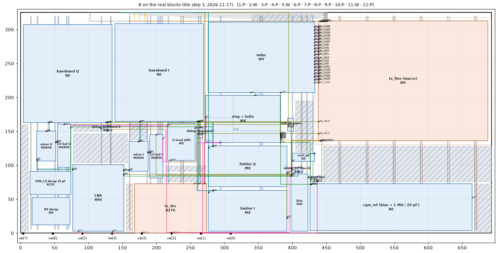
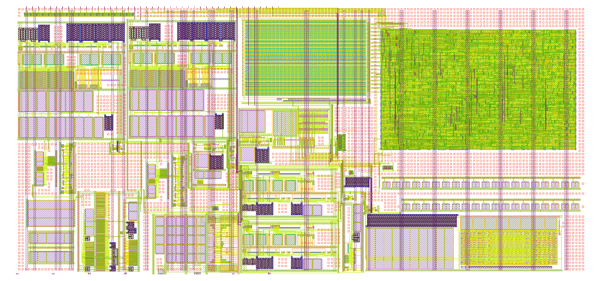

# The tile layout: the agreed floorplan in GDS

[](https://claude.com/claude-code)

This page describes how the 433 MHz radio tile was laid out from the floorplan Matt chose on the floorplan page
(variant B, 2026-11-17): a Tiny Tapeout (TT) 2x2 analog tile on GF180MCU (ttgf26c, the VAPWR template) holding the
voltage-controlled oscillator (VCO), its fine-tuning digital-to-analog converter (DAC), the transmit (TX) driver, the
digital macro, the receiver (RX) as its cells and a four-way debug multiplexer on ua[0]. The work followed
`docs/handoff_tile_layout.md` in five steps: the macro, the block pin moves, the floorplan closed on the real blocks,
the tile generator, and the checks. The work was done by Claude (Claude Code), three sub-agents doing the block
re-layouts in parallel.

**Table I.** Results.

| Item | Result |
|---|---|
| Digital macro `tx_fine` | RX_EN (CTRL[4]) and DBG_SEL (register 5, [3:0]) added; re-hardened at 250 × 176.8 µm (same area as before); design rule check (DRC) 0 / 0 (magic / KLayout), layout versus schematic (LVS) 0, antenna 0; setup slack +1.7 ns at 50 MHz typical (25 MHz recommended); 7 / 7 cocotb tests on RTL and on the gate-level netlist |
| Block pin moves | 12 cells re-laid out (vco_core, cgm_ref, decap_ls, mdac, tx_drv, the 7 receiver cells) plus the new debug switch `dbg_tg`; every one passes its own DRC, LVS against its schematic, antenna and mutation checks |
| Floorplan on the real blocks | no rule fails; warnings: a2 33 µm, ls 148 µm (want ≤ 120), cgm_ref → ring bias wires 113 µm (as in B), 47 supply crossings (3.3 V both) |
| Tile | 693.28 × 325.36 µm, every one of 97 nets routed (M2 / M3 between blocks, Metal4 drops over the blocks that allow it), 39 Metal4 power stripes, no Metal5 |
| DRC | magic 0, KLayout 0 (768 rules run, `feol=true beol=true`) |
| LVS | match (10 536 devices, 5711 nets); resistor totals match; 13 of 13 mutations caught |
| Antenna | KLayout antenna deck: 0 |
| TT precheck | local structural checks pass (`layout/gen/tile_precheck.py`); the real TT precheck runs in CI on push (not run here, below) |

## Step 1: the digital macro

**What changed.** `src/tx_fine.v` gets CTRL[4] = RX_EN (output `rx_en`, the receiver's enable) and a new register at
address 5, DBG_SEL[3:0] (outputs `dbg_sel[3:0]`, one per debug switch), both 0 after reset and both readable. Table VI
of `docs/tx_fine_tune.md` lists them. A new cocotb test checks the reset values, write and read-back, and that neither
register disturbs the other bits; six broken copies of the RTL (rx_en tied to 0, dbg_sel tied to 0, the wrong
address, CTRL[4] not stored, no read-back, a wrong reset value) each fail it.

**Pin placement.** LibreLane's pin placer spaces pins evenly, but a `$n` entry in `pin_order.cfg` leaves n slots
empty, so `macro/tx_fine/make_pin_order.py` writes the order with gaps that put each pin in the slot nearest its
target (1.12 µm slots). The macro is placed MY, so its own east edge faces west in the tile. Three rules set the
targets:
- the 37 DAC control lines sit level with mdac's real pins (its pins are fixed by its PMOS rows: pairs 0.68 µm apart),
  not the floorplan's estimates, so the 5.1 µm gap between the two needs jogs of 0.92 µm at most;
- the TT-facing pins (clk, rst_n, SPI, fsk, ck_o and the dividers) are on the north edge, under the TT pins they go to;
- ck, rx_en and dbg_sel[2:3] are at the south-west corner, dbg_sel[0:1] low on the west edge.

**Evidence.** Run r250c: magic and KLayout DRC 0, LVS 0, antenna 0, setup +1.70 ns at typical 3.3 V / 25 °C with the
50 MHz constraint; the gate-level tests pass 7 / 7. The macro is 44 200 µm², as before.

## Step 2: the block re-layouts

Each block's generator was changed so its pins land on the edges the floorplan wanted (`layout/floorplan/pins.md`
of variant B), by re-routing inside the block. No device size or schematic topology changed. Every changed cell was
checked with its own script; all report CHECK OK (Table II).

**Table II.** The re-laid-out blocks.

| Block | Size (µm) | What moved | Check |
|---|---|---|---|
| `vco_core` (new: ring + lsdiv, a0 abutment kept, the short VDD_LS fingers) | 110.58 × 69.76 | a2 out on the west edge (a new pin), ls / vctrl on the north edge, vg south, the code bits, vbnf and ck east (ck at the corner, a VDD shield between ck and vbnf) | `check_core.sh`: DRC, LVS, antenna, 6 mutations, a port map check |
| `cgm_ref` | 238.75 × 69.20 | vctrl and vbnf on the north edge, left end (vctrl is one metal feed-through); VDD Metal3 strap to its left end | `check_ref.sh` |
| `decap_ls` (new: the VDD_LS decap's main group) | 34.02 × 59.96 | - | `check_decap.sh` |
| `mdac` | 156.83 × 104.24 | vg and vbnf to the south edge; the 37 control pins unchanged | `check_mdac.sh` |
| `tx_drv` | 72.97 × 105.92 | both outputs on one edge, 43.68 µm apart (the pad pitch), 8 µm wide; ls and the enables on the opposite edge; Metal3 on every rail | `check_tx.sh` |
| `dbg_tg` (new) | 7.41 × 15.97 | nfet 2 / 0.28 µm and pfet 4 / 0.28 µm in parallel, an inverter for the complement; on-resistance 0.84-1.25 kΩ from 0.3 to 3.0 V, about 6 fF off | `check_dbg.sh` |
| `rx_lna`, `rx_bias`, `rx_lsq`, `rx_lobuf`, `rx_mix`, `rx_bb`, `rx_lim` | as before (`rx_lim` 0.68 µm taller) | as `pins.md` (below) | `check_rx_block.sh` |

**The shared I and Q cells.** `rx_mix`, `rx_lobuf`, `rx_bb` and `rx_lim` stay one cell each for both copies (matched).
Where the two copies wanted different edges, the pin went to the corner both targets point at, and DC nets (en, nb,
enb) got a pin on each edge. The I LO buffer turned from R270 to MXR90, so its lo / lob line up with the I mixer's
without crossing. The receiver generators keep a `pins='rx_top'` variant, so `rx_top` still builds identically (XOR).

**a2.** a2 is a ring node: its capacitance slows the ring and shifts the I/Q phase. Two routes were drawn: the west
edge (built) adds about 3.2 fF extracted (magic 8.3.684; about 4 fF with substrate C estimated by hand), the north edge
about 0.7 fF but needs at least 55 µm more wire round to `rx_lsq` and crosses ck. In the tile a2 is a 31 µm wire, about
2 fF more. At about 1 % of frequency per fF, expect the ring about 5 % slower until the tile is extracted.

**Not on target** (a few µm, set by internal tracks): the LNA inputs are 50.3 µm apart, not 43.68 (each band's channel
track; the two input wires are the same length inside); `rx_lsq`'s lsq and `rx_lim`'s q are at y 3.1 µm (the bottom
rail); mdac's vg is 6.5 µm from its target; ls on `vco_core` stays at x 21 µm, where lsdiv's own port reaches the edge.

## Step 3: the floorplan on the real blocks

The floorplan page's engine (`layout/floorplan/page/engine.js`) now reads the real cells from `blocks.json`
(`tools/floorplan_blocks.py`), the variant was imported without `pins_moved`, and the blocks were moved the least
needed (`layout/floorplan/step3_edits.py`). `floorplan.json` and `pins.md` were rewritten by `pinreport.js`.

**Table III.** Moves from variant B (µm).

| Block | B | Now | Why |
|---|---|---|---|
| mdac | y 197.79 | y 207.0 | room for routes between the ring, the limiters and mdac; the macro was re-hardened with its DAC pins at the new offset |
| vco.core | y 125.51 | y 133.5 | 5 µm channels above lim_q (rx_lim grew 0.68 µm) |
| rx.lim_q | y 64.81 | y 68.5 | as above |
| rx.lsq | x 222.45, y 102.17 | x 216.45, y 107.2 | room for the baseband-I debug switch beside it; aq level with the space under bb_i |
| rx.lobuf_i | R270, y 91.49 | MXR90, y 81.44 | lo / lob line up with the I mixer's |
| debug switches | inside rx.bb_i and rx.bias, 15 × 12 estimate | beside their sources, 7.41 × 15.97 | the real cell, no re-layout of the source blocks |
| xvpd | y 90 | y 106 | room for the nb switch |
| xbits | R90 at (385.2, 133.5) | R90 at (393, 150) | the code inverters face the ring's bit pins with a 10 µm channel (bits_inv, 19.04 × 9.04) |
| decap rectangles | as B | clipped 2.6 µm clear of every block | - |
| stripes | 14 | 39 | the macro's 12 straps as stripes, plus a stripe on each turned block's rails (below) |

**Evidence.** `node layout/floorplan/page/check.js layout/floorplan/floorplan.json`: no rule fails; rules 2, 5 and 11
warn (Table I). The page's own mutation tests still catch all 14.



**Fig. 1.** The floorplan closed on the real blocks (variant B moved as Table III): no rule fails; a2 33 µm, the
fine-tune bus 6 µm, the macro 12.6 µm under the top edge.

## Step 4: the tile generator

`layout/gen/tile.py` builds the tile from `floorplan.json` and `layout/gen/tile_nets.py` (the connectivity, shared
with the LVS source). The assembly is KLayout on GDS layers: each block GDS is copied in, its sub-cells renamed after it.

1) **Placement** as `floorplan.json`'s transform, snapped to the 5 nm grid (the floorplan's coordinates are not).
2) **Power.** The 39 Metal4 stripes run y 5-320.36 µm: the macro's 12 straps (VDPWR / VGND, the only lanes over it),
   the floorplan's VAPWR / VGND pairs and one stripe on each rail the stripes miss. The turned blocks (the LNA, bias,
   mixers, LO buffers, tx_drv) have their rails vertical in the tile, parallel to the stripes, so a planner lays a
   stripe right over each. Via3 arrays land where a stripe crosses its own net's Metal3 inside a block (found by
   connectivity from the block's supply labels). Blocks no stripe reaches (the switches, the code inverters, the
   antenna-diode rows, decap_ls, qenb tied to VGND) are wired to the nearest stripe of their net by the router. The
   stripe groups of each net that share no block are joined by thin wires: on chip TT's Metal5 grid joins every
   stripe; inside the tile, LVS needs one net.
3) **Signals.** A maze router on a 0.68 µm grid: Metal2 horizontal and Metal3 vertical in the gaps between blocks,
   Metal4 vertical over the blocks that allow it (not the macro, the ring or the reference; over the receiver only
   its own analog nets: rule 6 of the floorplan). Each pin reaches the grid through a stub; failed nets are moved to
   the front and everything is routed again (3 rounds).
4) **Special wiring.** The 37 DAC lines across the 5.1 µm gap (a backtracking search finds jog columns that keep 0.28
   µm spacing); tx_drv's outputs straight onto ua[2] / ua[3] (via3 arrays of 76 and 36 cuts); the tie cells for the
   unused outputs; the code inverters (`bits_inv`, with an antenna diode on each input).
5) **Guards.** vbnf, vctrl and the four baseband outputs get VGND shield wires on the free tracks beside them, each
   wired to a VGND stripe (59 runs, 1.2 mm in all); ck pays to come within 3 tracks of vbnf / vctrl and the limiter
   outputs to come near the baseband.
6) **Antenna diodes.** Rows of the library's antenna cell on en_p / en_n (next to tx_drv), enb and dbg_sel[0:3]
   (next to the macro); those nets stay off Metal4, so the diodes protect them at every metal level checked.
7) **Decap and fill.** Gate-capacitor units fill the decap rectangles where no route runs and a stripe pair crosses
   them; dummy COMP squares (`rx_fill.py`) fill the rest (DCF.1a).

**Table IV.** Key wires in the tile (µm, routed).

| Wire | Length | Floorplan B (flyline) |
|---|---|---|
| a2 (ring → rx_lsq) | 31 | 10 |
| ls (ring → tx_drv, LO buffer I) / lsq (→ LO buffer Q) | 184 / 148 | 163 / 149 |
| vg (mdac → ring) | 11 | 3 |
| vbnf / vctrl (cgm_ref → ring, mdac / pull-down, switch) | 188 / 133 | 108 / 99 |
| ck (ring → macro) | 60 | - |
| ua[4] / ua[5] → LNA | 3 / 8 | 3 / 3 |
| LNA → mixer I / Q (each wire) | 8 / 70 | - |
| baseband → limiter I / Q (each wire) | 127 / 218-248 | - |
| q_i / q_q → uo[4] / uo[5] | 424 / 445 | 387 / 333 |
| debug bus (4 switches → ua[0]) | 607 | 872 |



**Fig. 2.** The tile (693.28 × 325.36 µm): the receiver on the left and bottom middle, the ring, mdac and the code
inverters in the middle, the macro top right, cgm_ref bottom right; DRC 0 (magic and KLayout), LVS match.

## Step 5: the checks

One driver, `layout/gen/tile_driver.sh`, runs them in order and stops on the first failure (`build/tile/run/`:
`status.txt`, `DONE` or `FAILED`): the macro (with `HARDEN=1`), the 13 block checks, the tile, magic and KLayout DRC,
LVS (`check_tt.sh`), the antenna deck and the local precheck.

**DRC.** magic (`drc(full)`) 0 and KLayout 0 with 768 rules run. Both, and the local precheck, were mutation-tested on
a copy with a planted Metal2 spacing error, a Metal3 width error and a Metal5 square: each was caught. On the way to 0,
the first full run had 384 KLayout errors; the causes and fixes:
- abutted decap units left 0.3-0.6 µm gaps in their n-well and tap implants (NW.2a, NP.2): bridged across each run;
- a route via next to its own pin stub's via (the stub's is off the grid) made overlapping cuts (V2.1, V2.2a): the
  route's via is left out and the two metals joined to the stub's;
- via3 arrays per decomposed piece of a landing came too close (V3.2a): one cut grid per landing polygon;
- long wires into small gates (ANT.16): the antenna-diode rows;
- a stub's 0.18 µm spacing inside `bits_inv`, and DCF.1a (fill; existing fill now counts as a keep-out).

**LVS.** `layout/gen/check_tt.sh` extracts the flattened tile with magic and compares it with
`lvs/tt_um_mattvenn_gf433_vco.spice` (`lvs/make_source.py`: every block its own subcircuit, from xschem, the
generators and the macro netlist): circuits match uniquely, 10 536 devices and 5711 nets. Two shorts were found and
fixed on the way, both with a metal-only connectivity check of the GDS (a via patch over a neighbouring pin's stub;
a tie row's rail via on an output's riser). Fourteen mutations of the source must fail (Table V); all 14 do.
ua[1] is tied to VGND (see Precheck below): the extraction keeps it as its own port joined to VGND by a 0 Ω resistor
(`ext2spice short resistor`), and the source has the same resistor (`Rshort_ua1`).

**Table V.** LVS mutations.

| Mutation | Caught by |
|---|---|
| ui_in[0] ↔ ui_in[1] at the code inverters | pin matching |
| macro ck_o ↔ div16 (uo_out[0] ↔ uo_out[1]) | pin matching |
| SPI SCLK ↔ MOSI at the macro | pin matching |
| DAC line b4 ↔ s1 at mdac | property errors |
| VDD_LS decap m 3 → 2 | property errors |
| tx_drv out_p ↔ out_n | pin matching |
| tx_drv en_p ↔ en_n | pin matching |
| ua[4] ↔ ua[5] at the LNA | pin matching |
| q_i ↔ q_q at uo[4] / uo[5] | pin matching |
| dbg_sel[0] ↔ dbg_sel[1] at the baseband switches | pin matching, netlists differ |
| a2 ↔ ls at the receiver | pin matching, netlists differ |
| mixer Q on VDPWR instead of VAPWR | pin matching, netlists differ |
| vbnf ↔ vctrl at cgm_ref | pin matching, netlists differ |
| ua[1] not strapped to VGND | pin matching |

**LVS can't tell a2 from the other ring nodes.** With lsdiv's coupling capacitor out of the LVS source, the 5-stage
ring is rotation-symmetric, so netgen matches with a2 on any of its nodes. `check_core.sh` checks the ports of the
extracted hierarchy instead: a2 is the ring's a2 (its mutations put a2 on a1, a3, a4 and fail).

**Precheck.** `layout/gen/tile_precheck.py` checks the TT rules that need no third-party code: the top cell and its
boundary, all 51 template pins at their DEF rectangles with labels and in the LEF, VDPWR / VAPWR / VGND stripes at
least 1.2 µm wide reaching within 10 µm of both edges, no Metal5, `analog_pins: 6`, `uses_vapwr` and VAPWR in
`src/project.v`. The real precheck (tt-support-tools) was not run here: this session's permissions blocked running
the cloned tool. CI runs it on every push (`.github/workflows/gds.yaml`).

**The first CI precheck failed one check** (2026-11-17): every check passed except the analog pin check, "Analog pin
`ua[1]` is not connected to any adjacent metal but `analog_pins` is set to 6". The template numbers the analog pins
from ua[0], and `analog_pins: 6` claims ua[0]–ua[5], but the floorplan left ua[1] spare. Moving the used pins down
would have meant re-routing the TX and RX pads, so ua[1] is now an on-chip ground sense: a Metal4 strap (1.74 × 5.5 µm)
from the pin up into the VGND stripe that starts above it (`tile_nets.SUPPLY_PINS`, `tile.py` `supply_pins`), with
the pinout entry "on-chip ground sense (VGND)", a Kelvin reference for readings on ua[0]. The local precheck now
repeats the TT check (metal touching a ring 0.1–0.5 µm around each analog pin, or Via3 inside it, must match
`analog_pins` and the pinout description): it fails on the GDS that CI rejected and passes on the new one.

## Open items, at the time of writing

- **Decap: about 7.4 pF placed** (38 units, mostly VDPWR under the macro), against about 61 pF the floorplan estimated.
  The unit is 12 × 15.7 µm and most decap rectangles are narrow, carry routes or have no stripe pair. A smaller unit,
  or decap wired by the router, would recover most of it.
- **The baseband pairs are not routed as pairs**: each wire is routed and shielded on its own. The I pair's wires are
  127 µm each; the Q pair's 218 and 248 µm.
- **ls / lsq: 184 / 148 µm** (the I LO load against the Q), 36 µm apart; the floorplan had 163 / 149. The extracted
  loads decide (`docs/rx_layout.md`, LO section).
- **vbnf 188 µm** from cgm_ref to the ring and mdac (the floorplan's flyline was 108 µm), shielded on 85 % of both sides.
- **Extraction**: magic 8.3.642 is now built on the sim server (`~/.local/magic642`), and `layout/gen/pex_tile.sh`
  extracts the tile without the macro (`layout/pex/tile_c.spice`, `tile_rcx.spice`): 126 ports, the TT pins and
  every net between blocks by name. The simulations on it are in `sim/top/tile_results.md`.
- Three small blocks are not in the floorplan: the antenna-diode rows (6.7, 4.5 and 11.2 µm wide), placed by
  `tile.py` (`EXTRA`).
- `tt_wrapper.py` (the old tile) is kept as it was, for reference; it no longer builds against the new blocks.

## Reproduce

```bash
python3 macro/tx_fine/make_pin_order.py 250 176.8   # then LibreLane as docs/tx_fine_tune.md (or HARDEN=1 below)
python3 tools/floorplan_blocks.py
node layout/floorplan/page/check.js layout/floorplan/floorplan.json
python3 layout/gen/tile.py                           # gds/, lef/, build/tile/meta.json
python3 lvs/make_source.py                           # lvs/tt_um_mattvenn_gf433_vco.spice
bash layout/gen/tile_driver.sh                       # every check; build/tile/run/
```
