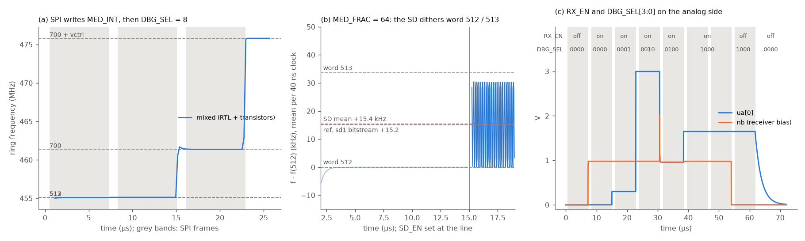

# Mixed-signal co-simulation of the fine-tuning loop

[](https://claude.com/claude-code)

2026-11-17, branch `floorplan`. Set up, run and written up by Claude (the AI); the numbers are from the runs listed
below. 27 °C, VDD 3.3 V, the tt / ss / ff process corners.

## What it is

The digital macro's register-transfer level (RTL) description, `src/tx_fine.v`, is compiled with Verilator into a
shared object and runs inside ngspice as an XSPICE `d_cosim` instance, next to transistor-level analog. So the
loop the chip relies on is closed for real, from the Serial Peripheral Interface (SPI) pins to the ring frequency:

    SPI frames -> tx_fine RTL -> 37 active-low DAC lines (dac_bridge, 0 / 3.3 V) -> medium current
    digital-to-analogue converter (DAC, mdac) -> vg -> current-fed ring -> f(a0)
    rx_en, dbg_sel[3:0] -> rx_bias and the four dbg_tg debug switches onto ua[0]

- **Digital:** `src/tx_fine.v` unchanged, behavioural clock gates (`build_so.sh`, after ook-asic-radio's
  `sim/mixed/`). The `d_cosim` port list is generated from the build's own `inputs.h` / `outputs.h`, so it can't
  drift from the shared object. Clock 25 MHz, SCLK 2.5 MHz (clk / 10), stimulus from a `d_source` file.
- **Analog:** the extracted mdac (`layout/pex/mdac_cm.spice`, C only, merged fingers), the schematic ring,
  constant-gm reference and RC filter (`sim/vco/vco_bias.py`), and the vctrl pull-down. `vbnf` is held at its DC
  value, as in `sim/tune/phase_c.py`. `dbg_tg` and `rx_bias` come from the tile's LVS source. Coarse code
  (ui_in[4:0]): 9 / 11 / 7 at tt / ss / ff.
- **Wiring:** the 37 DAC lines go to the mdac port by port, as the tile's LVS source (`lvs/tt_um_mattvenn_gf433_vco.spice`,
  instance `xxmdac`) connects them. A crossed line in the tile would show up here.
- **Reference ("the model"):** the same analog with ideal control sources. This is the `mdac_sim.py` / `phase_c.py`
  bench, with the ΣΔ cell driven by `sim/tune/sd_model.py`'s `sd1(64)` bitstream.
- **Frequency:** from a0's rising crossings at mid-swing, (min + max) / 2 of a0 in each window. The ring swings
  vg…VDD, so the level is never VDD / 2. Windows start 1 µs after each DAC word change, and from 4 µs in the first
  segment (start-up).

| Run | SPI programme | Simulated | Wall time |
|---|---|---|---|
| `step_<c>` | MED_INT 512 (reset) → 513 → 700, then DBG_SEL = 8 with a 1.65 V bench source (1 kΩ) on ua[0] | 26 µs | 38-51 min |
| `sd_<c>` | MED_FRAC = 64, then CTRL = SD_EN \| RX_EN | 19 µs | 32 min |
| `io_<c>` | no ring: CTRL = RX_EN, DBG_SEL = 1 / 2 / 4 / 8, read ID, CTRL = 0, DBG_SEL = 0; ua[0] loaded by 1 MΩ / 2 pF | 72 µs | 3 s |
| `ref_<c>_*` | ideal lines: words 512, 513, 700, 512 + sd1(64), 700 + vctrl override | 3.5-4.5 µs | 4-7 min |

```
bash sim/mixed/build_so.sh                                        # build/mixed/tx_fine.so
nohup setsid python3 sim/sched.py sim/mixed/jobs.py --budget 8 --out build/mixed > build/mixed/sched.log 2>&1 &
python3 sim/mixed/verdict.py --mutants                            # PASS / FAIL per check, mutants must FAIL
python3 sim/mixed/plot_mixed.py tt                                # docs/img/mixed/mixed_tt.png
```

Every run's ngspice log was checked for "singular", "timestep too small" and "Transient op started"
(`analyse.py`); none has them, and every run reached its stop time.

## Results



*Fig. 1. tt. (a) The SPI writes move the ring from 455.098 to 455.131 MHz (513) and 461.376 MHz (700); DBG_SEL = 8
then closes the vctrl debug switch, giving 475.810 MHz. Dashed lines: the reference runs. (b) With MED_FRAC = 64 the
ΣΔ toggles between words 512 and 513 every fourth clock. The mean, +15.4 kHz above word 512, matches the reference
driven by `sd1(64)` (+15.2 kHz) to 0.2 kHz. (c) RX_EN brings the receiver bias nb up to 0.98 V. Each DBG_SEL bit puts
its own input on ua[0]: 0.300, 2.996, 0.959 (nb) and 1.648 V.*

*Table I. Per-check results (`verdict.py`). Tolerances: f per word ±3 kHz (about 0.1 LSB), 188-LSB step ±1 %,
1-LSB step ±10 %.*

| Check | tt | ss | ff |
|---|---|---|---|
| SPI → DAC lines (words 512 → 513 → 700, thermometer contiguous) | PASS | PASS | PASS |
| f(512), mixed − reference | 455.0977 MHz, +0.06 kHz | 458.5333, +0.04 | 449.2803, +0.09 |
| f(700), mixed − reference | 461.3758 MHz, +2.02 kHz | 464.0541, +1.83 | 456.4908, +2.25 |
| Step 512 → 700 (reference) | +6.2782 MHz (+6.2762), +0.03 % | +5.5208 (+5.5190), +0.03 % | +7.2105 (+7.2084), +0.03 % |
| LSB 512 → 513 (reference) | 33.54 kHz (33.54) | 29.49 (29.48) | 38.53 (38.53) |
| ΣΔ cell line against `sd1(64)`, 95 clocks | bit for bit, mean 0.25 | same | same |
| f before SD_EN − step run's f(512) | 0.00 kHz | 0.00 | 0.00 |
| ΣΔ mean f, in LSB above 512 (reference) | 0.458 (0.454), +0.20 kHz | 0.478 (0.474), +0.15 | 0.436 (0.432), +0.24 |
| vctrl override: vctrl (reference), f | 1.6322 V (1.6322), 475.810 MHz, 0 ppm | 1.6292 (1.6292), 472.893 | 1.6343 (1.6343), 479.647 |
| RX_EN → rx_en → rx_bias: nb on / off | 0.96-0.98 V / 0 V | **FAIL**, see below | 0.84-0.85 V / 0 V |
| DBG_SEL[k] → ua[0] (one switch at a time) | PASS | PASS (except the nb input, rx off) | PASS |
| MISO: read ID | 0x433 | 0x433 | 0x433 |

35 of 36 checks pass.
- **Direction and amount:** each SPI write moves the frequency the right way, by the amount the reference predicts.
  The 188-LSB step agrees to 0.03 % at every corner, and the 1-LSB step to 0.01 kHz.
- **The LSB:** 33.39 kHz / LSB at tt over the 188-LSB step. `docs/tx_fine_tune.md` Table II has 33.4 kHz (tt,
  schematic ring).
- **f(700) is about 2 kHz high against its reference.** The reference window starts at 1.5 µs, before word 700's
  operating point has fully settled. This is inside the tolerance.

**ΣΔ.** The ideal fraction is 0.25 LSB; both the mixed run and the reference land at about 0.46 LSB at tt. The
extra 0.21 LSB, about 7 kHz, is the ΣΔ cell's known charge injection (`docs/tx_fine_tune.md`: 8.4 kHz at fraction
77). It is not a co-simulation error, since the reference driven by the model bitstream shows it too. The mean
still lies strictly between words 512 and 513 at every corner.

**RX_EN and DBG_SEL at the boundary.** The control nets reach 0 / 3.3 V (within 10 mV) at the switches. With RX_EN
on, nb is 0.98 V (tt) and enb is 0 V. Off, nb is 0 V and enb 3.3 V. Each DBG_SEL bit puts its own input on ua[0]
within 1 % (0.3 V and 3.0 V pass through the transmission gate, so both rails work), and no other switch conducts.
Through ua[0], DBG_SEL[3] pulls vctrl to 1.632 V and the ring to 475.8 MHz, exactly as the reference does.

## Mutation test

Two netlist mutants of the tt runs, both simulated (`verdict.py --mutants`):

| Mutant | Failing checks | Result |
|---|---|---|
| `step_tt_bswap`: dac_bn[0] and dac_bn[1] crossed at the mdac | f_word (513: +33.60 kHz), lsb (67.09 against 33.54 kHz) | caught |
| `sd_tt_sdinv`: the ΣΔ cell's line inverted (the fine word's sign flipped) | sd_base (+33.54 kHz with SD off), sd_mean (0.959 LSB, +17.0 kHz) | caught |

The digital checks (SPI decode, ΣΔ bitstream) still pass on both, as they should: the faults are in the wiring,
and only the analog checks see them.

## Problems found

- **io_ss: the first SPI write (CTRL = 0x10) never reached rx_en.** The four DBG_SEL writes, the ID read and the
  same CTRL bit in the `sd_ss` run all worked. The stimulus is identical to io_tt's, and the failure repeats on
  every rerun. The same io_ss deck, with a Verilator build that also exports `ctrl`, `bitcnt`, `addr` and the shift
  register, takes the write normally: 16 SCLK edges counted and ctrl[4] set at 7.221 µs, as at tt. The RTL is the
  same in both builds, and the digital part doesn't depend on the corner, so this is a `d_cosim` artefact, not a
  design fault. Event ordering between the shared object and the analog time steps is the likely cause, but it is
  not root-caused. ook-asic-radio saw lost `d_cosim` inputs too (its `docs/sim_learnings.md`). Until it is
  understood, check every `d_cosim` result on the digital side as well; `verdict.py` does.
- **The RTL's asynchronous reset needs a falling edge in co-simulation.** With rst_n starting low, ngspice's
  Verilator shim never sees a negedge, so the reset ran only at the first clk edge (20 ns). The `d_source` stimulus
  now pulses rst_n (1 → 0 at 10 ns → 1 at 0.1 µs). The io runs use this pulse. The step / sd runs and the mutants
  predate it; their decoded words, bitstreams and frequencies show the reset values were in place.
- **Two runs stopped on "timestep too small" with analog PWL stimulus.** This happened at SPI edges next to
  `d_cosim` events, with the stimulus through `adc_bridge`. The stimulus is now a digital `d_source`, and every run
  completes.
- **Debug path loading (design note):** nb is a weak bias node. With ua[0] loaded by 1 MΩ, selecting nb pulls it
  from 0.979 to 0.959 V (−2 %). A first run with 100 kΩ on ua[0] pulled it to 0.629 V (−36 %). On the bench, probe
  nb on ua[0] only with a high-impedance probe, or the receiver's bias moves while you look at it.

## Limits (at the time of writing)

- The ring and reference are the schematic. The extracted `vco_top_rcx` with the mdac ran at about 23 minutes per
  simulated µs (0.1 µs in 2.3 min), so a 26 µs SPI run would take about 10 hours. Only the mdac is extracted.
- The digital outputs are ideal `dac_bridge` sources with 100 ps edges, not the macro's output cells. The digital
  supply coupling is covered separately (`docs/tx_fine_tune.md`, Table X).
- `vbnf` is held at its DC value. The FSK input and the `ck` divider are tied off and not exercised here (they are in
  the cocotb tests).
- Corners: tt / ss / ff at 27 °C, VDD 3.3 V, nominal mismatch.
