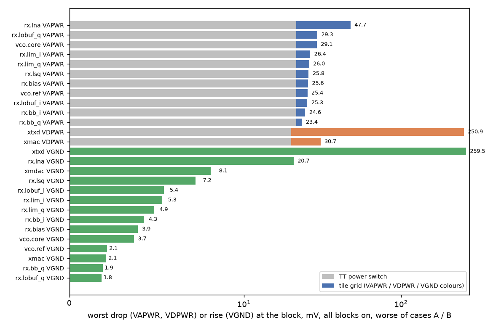
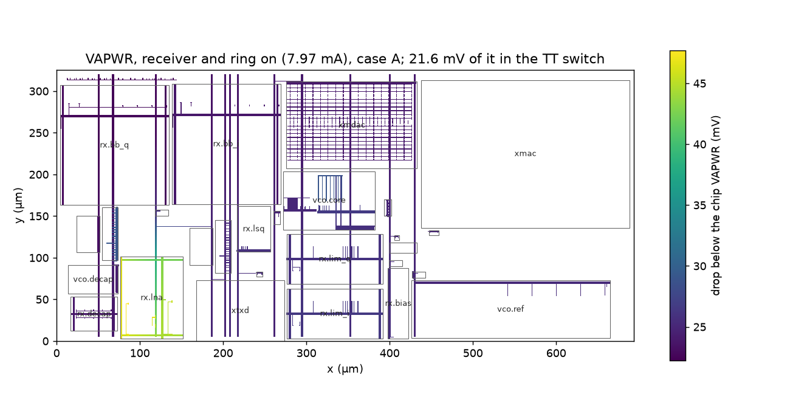

# Power grid: IR drop and electromigration of the tile (2026-11-17)

[](https://claude.com/claude-code)

This page gives the direct-current (DC) voltage drop (IR drop) and the electromigration (EM) current densities on the
three supplies of the routed tile `gds/tt_um_mattvenn_gf433_vco.gds` (branch `floorplan`), from Tiny Tapeout's (TT)
chip supply down to each block's devices. The method is a port of the sky130 study in ook-asic-radio
(`sim/power/`, `docs/power.md`). The scripts, the runs and this write-up were done by Claude (Claude Code), working
from Matt's brief, on 2026-11-17.

## Summary

**The transmit (TX) driver's supply connections fail by a large margin. Everything else is small or marginal.**

| supply, block | worst drop / rise, all blocks on | of which TT's switch | EM, worst against the limit | verdict |
|---|---|---|---|---|
| VGND at tx_drv | **+259 mV** (17.6 Ω, one Via2 + one Via3) | - | Via2 / Via3 15 mA per cut: **81× the LEF limit**, 25× the 85 °C limit | **FAIL: fix** |
| VDPWR at tx_drv | **-191 mV** case A, **-251 mV** case B | 20 mV | Via3 7.4 mA per cut (41×), Metal3 rail 16.8 mA/µm (25×) | **FAIL: fix** |
| VAPWR at the LNA | -48 mV (case A), -34 mV (B) | 21.6 mV | Metal4 stripe x 118.1: 2.7 mA/µm (4.0× LEF, 1.3× 85 °C) | marginal: widen |
| VGND at the LNA | +21 mV | - | Via2 at (98.5, 99): 0.94 mA per cut (5.2× LEF, 1.6× 85 °C) | marginal: more cuts |
| VAPWR at the ring (vco.core) | -7.3 mV ring only, -29 mV with the RX on | 2.3 / 21.6 mV | Via2 0.24 mA per cut (1.4× LEF, 0.4× 85 °C) | OK |
| VGND at the ring (vco.core / mdac) | +3.7 / +8.1 mV | - | below the limit | OK |
| VDPWR at the tx_fine macro | -31 mV with the TX on | 20 mV | below the limit | OK |

- **tx_drv's ground hangs on one via.** The block's VSS reaches the VGND stripes only through the router's wire at
  its top edge: a Metal3 stub, one Via2, 6.5 µm of 0.38 µm Metal2 and one Via3 onto the VGND stripe at x 238.35
  (around (233-239, 74) µm). All 14.6 mA of the TX ground current (ff) goes through that chain. The VGND stripes
  that run over the driver have no Metal3 under them to land on (`meta.json` lists `xtxd: VSS` as unlanded).
- **tx_drv's VDD lands on 2 Via3 cuts** under the VDPWR stripe at x 235.03, on a 0.6 µm Metal3 rail.
- The extracted-tile simulations (`sim/top/tile_results.md`) used the capacitance-only netlist, so they could not
  see either: their +6.40 dBm TX result assumed ideal supply wiring inside the tile.
- **At the ring** the grid itself is fine. The visible effect is TT's VAPWR switch: turning the receiver (RX) on
  adds 7.1 mA through the switch's 2.7 Ω and lowers the ring's supply by about 22 mV, a shift of about -0.017 %
  (75 kHz) at the ring-only sensitivity (-0.008 %/10 mV) and up to -0.046 % (200 kHz) at the tile's all-supplies
  sensitivity (-0.021 %/10 mV, `sim/top/tile_results.md`). The frequency servo absorbs it, but a frequency
  calibration made with the RX off will be off by that much with it on.

## After the fix (2026-11-17, layout/floorplan/floorplan.json straps)
Both high-current blocks are turned in the tile (tx_drv R270, rx_lna R90), so their supply rails are vertical Metal3
columns, and the floorplan's straps ran beside them, not over them. The straps now sit over the rails:
- **tx_drv:** VDPWR moved from x 235.03 to 267.5 (6 µm) over the VDD rail; a new 6 µm VGND strap at 228.53 over the
  VSS rail.
- **rx_lna:** VAPWR moved from 118.1 to 126.02, plus a new VAPWR strap at 76.7 and new VGND straps at 97.01 and 149.83.

Landing Via3 cuts, before → after: tx_drv VDD 2 → 417, VSS 0 → 206; LNA VDD 10 → 524, VSS 9 → 503. The tile driver now
gates on this (`layout/gen/supply_check.py`: every block supply on a strap with at least 2 × I / 0.58 mA cuts, with
router wiring only for an allow-list of tiny blocks; its planted fault is caught). DRC, LVS (14 / 14 mutations),
antenna and the local precheck all pass on the new GDS.

**Table 0.** Worst drop per block, all modes on, mesh 0.5 µm, case A / B, after the fix.

| Supply, block | Before | After |
|---|---|---|
| VGND at tx_drv | +259 mV | **+12.6 mV** |
| VGND at the LNA | +21 mV | +5.7 mV |
| VAPWR at the LNA | −48 / −34 mV | −32.7 / −26.8 mV (21.6 mV of it the TT switch) |
| VAPWR at the ring | −29 mV | −28.9 / −28.2 mV (switch-dominated) |
| VDPWR at tx_drv (worst point) | −191 / −251 mV | −183 / −205 mV, **but see below** |

The remaining VDPWR hotspot is at tx_drv's decap feed: a 0.6 µm VDD line crossing the VSS rail on an M2 bridge, one
Via2 at each end (x 231-235, y 72), reported at 27× the LEF via limit. solve.py spreads a block's current over its
supply contacts by area, so the decap, which draws no DC, gets DC here: this hotspot and the worst-point drop are an
artefact of the current model. The output stage takes its current from the VDD rail under the new strap. Open:
weight the sinks onto the output stage's sources and rerun; widen the decap feed anyway, because one via is ESR that
makes the decap less effective.

## How TT feeds the tile (GF180)

Sources: tt-multiplexer at commit 885086c (2026-09-16), `ol2/tt_top/odb_route.py` (`ModulePowerStrapper`),
`ol2/tt_top/odb_power.py`, `ol2/tt_top/build.py`, `py/tt/elements.py`, `py/tt/layout.py`, `cfg/gf180mcuD.yaml`,
`pg/gf180mcuD/`. tt-support-tools has no GF power switch data (`tech.py`: `mux_macros` empty for gf180mcuD).

1. **Switches.** VDPWR goes through `tt_pg_3v3_hp_2` and VAPWR through `tt_pg_5v0_2` (the `pg_vaa` switch), both
   placed west of the tile, the VDPWR one outermost (`elements.py`). Each is one big PMOS:
   - `tt_pg_3v3_hp_2`: pfet_03v3, W 3357.5 µm, L 0.28 µm;
   - `tt_pg_5v0_2`: pfet_05v0, W 3311 µm, L 0.5 µm.
2. **Straps.** Each switch output feeds two Metal5 straps across the tile: a narrow one (8.75 µm) at
   y_mid ± 5.5 µm and a wide one (19.75 µm) at y_mid ∓ 82.32 µm (y_mid = 162.68 µm). A Via4 array lands wherever a
   strap crosses a Metal4 pin of its own net. The Metal5 pitch, 82.32 µm, is a quarter of the tile height plus the
   row margin (4 × 82.32 - 3.92 = 325.36 µm).
3. **VGND.** VGND comes from the chip's Metal5 grid: 8.75 µm stripes at y 39.20, 121.52, 203.84 and 286.16 µm.
   These positions are inferred from the sky130 tile, where they were read from the GDS; for GF they are an
   assumption.
4. **Unknown: which switch gets which strap pair** (pin order and N / FS orientation). Case A puts VDPWR's narrow
   strap at y 168.18 and its wide one at 80.36, with VAPWR at 157.18 / 245.00. Case B swaps them. Both are reported.

**Table I.** Switch on-resistance (`sim/power/pg_rdson.py`, ngspice, 27 °C, 10 mA, gate at 0 V).

| switch | supply | tt | ff | ss |
|---|---|---|---|---|
| tt_pg_3v3_hp_2 (VDPWR) | 3.3 V | 1.32 Ω | 1.18 Ω | 1.48 Ω |
| tt_pg_5v0_2 (VAPWR) | 3.3 V | **2.71 Ω** | 2.23 Ω | 3.42 Ω |
| tt_pg_5v0_2 (VAPWR) | 5.0 V | 1.94 Ω | 1.66 Ω | 2.36 Ω |

The 3v3 value matches `docs/platform.md` (1.32 Ω tt). The VAPWR switch is a 5 V device, so at 3.3 V it has twice
the on-resistance of the VDPWR one.

## Method

1. **Mesh** (`mesh.py`). KLayout traces VAPWR, VDPWR and VGND from their Metal4 stripe labels (Metal1-Metal4,
   Via1-Via3, contacts). Each metal is rasterized on a 0.5 µm grid. Neighbouring cells are joined by coverage /
   sheet R, and the layers by (cuts in the cell) / cut R, with a cut split across cells counted fractionally.
   This is the mesh method of ook's `mesh.py`, chosen over magic's `extresist`, which the sky130 study found folds
   large parts of a supply net into its port.
2. **TT's part.** TT's Metal5 straps and Via4 landings are drawn in as described above. For VDPWR / VAPWR the straps
   start at the switch column (x -20 / -4 µm), and the switch joins it to an ideal chip supply. The VGND stripes are
   held at 0 V at both tile edges. A best case with every VGND landing ideal is also run (`A_gnd_ideal`).
3. **Sinks.** A block's current is spread over the Metal1 cells of its contacts on that net inside its box
   (`build/tile/meta.json` `blocks`). This is cruder than ook's per-device terminals: it spreads, for example, the
   LNA's tail current over the whole block. A loaded block with no sink on a net is flagged as not connected.
4. **Solve** (`solve.py`). scipy sparse LU (lower-upper) factorization, one factorization per net and case:
   - the unit response of every loaded block (Ω, `T_ohm` in `result.json`);
   - the four modes;
   - the branch currents for EM.
5. **Currents** (`currents.py`): average currents, worst corner per block, 27 °C, 3.3 V.

**Table II.** Block currents (mA, average).

| block | supply | mA | source |
|---|---|---|---|
| ring: vco.core / xmdac / vco.ref | VAPWR | 0.79 / - / 0.05 (VGND 0.24 / 0.55 / 0.05) | tile Table III: 0.84 mA at fs code 10, the highest 433.92 MHz case; the ring's current returns through the DAC |
| rx.lna | VAPWR | 5.06 | `docs/rx_design.md`, sf |
| rx.lobuf_i / lobuf_q / lsq | VAPWR | 0.45 / 0.45 / 0.26 | LO path 1.16 mA (`docs/rx_design.md` Table II), split assumed |
| rx.bb_i,q / rx.lim_i,q | VAPWR | 0.22 / 0.15 each | 0.371 mA per arm (Table IV), split assumed |
| rx.bias | VAPWR | 0.17 | remainder of the measured 6.96 mA |
| xtxd (tx_drv) | VDPWR | 14.58 | tile Table IV, ff (rms 15.01) |
| xmac (tx_fine) | VDPWR | 0.6 | `docs/tx_fine_tune.md` |

The modes are:
1) ring: the ring and the macro;
2) rx: plus the receiver, 7.97 mA VAPWR in all;
3) tx: the ring plus the TX driver, 15.18 mA VDPWR;
4) all: everything on, since nothing prevents TX and RX at the same time.

The VGND current of each block equals its supply current.

**EM limits.**
- The gf180mcuD tech LEF (`gf180mcu_fd_sc_mcu7t5v0__nom.tlef`, DCCURRENTDENSITY AVERAGE) gives:
  - Metal1-Metal4: 0.67 mA/µm;
  - Metal5: 1.5 mA/µm;
  - Via1-Via4: 0.18, read as mA per 0.26 µm cut, as the sky130 study read its LEF. Read as mA/µm², it would be
    15× stricter.
- The LEF does not state a temperature.
- The project's earlier "GF180MCU 85 °C" figures (2.09 mA/µm per metal, 0.58 mA per via; `layout/gen/tx_drv.py`,
  `docs/tx_driver.md`) are given as a second, looser bound. Their primary source is not cited there.
- Sheet and cut R come from the same LEF and from magic's `gf180mcuD.tech`:
  - Metal1-4: 0.090 Ω/sq;
  - Metal5: 0.060 Ω/sq;
  - Via1-4: 4.5 Ω per cut.
- The LEF's max corner is 0.104 Ω/sq and 15 Ω per cut, which is not run.

## Results



**Fig. 1.** Worst drop (VAPWR, VDPWR) or rise (VGND) at each loaded block with every block on, the worse of cases A
and B, split into TT's switch (grey) and the tile grid: 259 mV of VGND rise and 251 mV of VDPWR drop at the TX
driver, at most 48 mV elsewhere.



**Fig. 2.** VAPWR drop with the receiver and ring on (case A, lowest metal shown), 22 mV at the switch output and
48 mV at the far end of the LNA. The single 2 µm stripe at x 118.1 carries most of the LNA's current.

**Table III.** Drop per block (mV, mean / worst over the block's contacts, case A; case B in brackets where it
differs by more than 2 mV). Drop below the chip supply, switch included; VGND is the rise above the chip ground.

| block | VAPWR ring | VAPWR rx / all | VDPWR tx / all | VGND ring | VGND all |
|---|---|---|---|---|---|
| vco.core | 5.9 / 7.3 | 27.7 / 29.1 | - | 0.9 / 1.1 | 3.6 / 3.7 |
| xmdac | 2.7 / 2.7 | 24.0 / 24.0 | - | 2.6 / 5.9 | 4.9 / 8.1 |
| vco.ref | 3.6 / 3.6 | 25.3 / 25.4 | - | 0.2 / 0.2 | 2.0 / 2.1 |
| rx.lna | 2.5 / 2.5 | 45.3 / 47.7 (31.4 / 33.6) | - | 0.1 / 0.1 | 19.2 / 20.7 |
| rx.lobuf_q | 2.4 / 2.4 | 29.2 / 29.3 | - | 0.0 | 1.8 / 1.8 |
| rx.lim_i | 3.0 / 3.0 | 26.4 / 26.4 (24.8) | - | 0.2 / 0.2 | 5.2 / 5.3 |
| rx.bias | 3.1 / 3.1 | 25.6 / 25.6 | - | 0.1 / 0.2 | 3.9 / 3.9 |
| xtxd | - | - | **136.7 / 191.3 (196.4 / 250.9)** | 0.1 / 0.1 | **257.8 / 259.5** |
| xmac | - | - | 28.2 / 28.4 (28.7 / 30.7) | 0.2 / 0.3 | 1.2 / 2.1 |
| switch only | 2.3 | 21.6 | 20.0 | - | - |

**Resistance from the block to the chip supply** (unit response, mean, case A, switch included):
- vco.core: VAPWR 7.2 Ω, VGND 2.6 Ω;
- rx.lna: VAPWR 7.2 Ω (4.5 Ω in case B), VGND 3.2 Ω;
- xtxd: VDPWR 9.3 Ω (13.4 Ω in case B), **VGND 17.6 Ω**.

The cross terms that matter:
- TX current to the ring's VGND: 0.13 Ω, so about 2 mV with the TX on;
- LNA current to the ring's VAPWR: 3.0 Ω, of which 2.7 Ω is the switch.

**Table IV.** EM, worst element per layer (case A, LEF limits; ratio to the 85 °C bound in brackets).

| mode, supply | element, place (x, y µm) | value | × LEF limit |
|---|---|---|---|
| tx, VGND | Via2 (233, 73.5), Via3 (239, 73.5): the single-cut chain | 15.4 / 14.7 mA per cut | **85× / 81×** (25×) |
| tx, VGND | Metal2 jog 0.38 µm (233, 74) | 45 mA/µm | **68×** (22×) |
| tx, VDPWR | Via3 (235, 72), 2 cuts under the stripe at x 235.03 | 7.4 mA per cut | **41×** (13×) |
| tx, VDPWR | Metal3 VDD rail 0.6 µm (236, 71.5) | 16.8 mA/µm | **25×** (8×) |
| tx, VDPWR | Via2 (231.5, 72) / Via1 (220.5, 71.5) | 4.8 / 1.7 mA per cut | 27× / 9.5× |
| tx, VDPWR | Metal4 stripe x 235.03 (235.5, 72) | 5.7 (B: 8.0) mA/µm | 8.4× (B: 12×) |
| rx, VAPWR | Metal4 stripe x 118.1 (118.5, 97.5) | 2.7 mA/µm | 4.0× (1.3×) |
| rx, VAPWR | Via3 (119.5, 97.5) / Via2 (78, 96) | 0.69 / 0.48 mA per cut | 3.8× / 2.7× (1.2× / 0.8×) |
| rx, VGND | Via2 (98.5, 99) / Via3 (131.5, 100) | 0.94 / 0.58 mA per cut | 5.2× / 3.2× (1.6× / 1.0×) |
| rx, VGND | Metal4 stripe x 131.67 (133, 100) | 1.87 mA/µm | 2.8× (0.9×) |
| ring, VAPWR | Via2 (335.5, 198.5) in vco.core | 0.24 mA per cut | 1.4× (0.4×) |
| ring, VGND | Metal1 (426.5, 211) in xmdac | 0.70 mA/µm | 1.0× (0.3×) |
| TT's Via4 landings | worst VGND landing near the TX | 0.19 mA per cut | 1.1× (0.3×) |
| TT's Metal5 straps | VDPWR, all of the TX current | 1.4 mA/µm | 0.9× |

The worst elements are at the same place and within 2-13 % at 0.25 µm (Metal4 at the narrow landings reads up to
1.8× higher at the finer pitch, where the cell resolves the stripe's edge). These are average currents. The TX
driver's rms is only about 3 % higher (15.0 against 14.6 mA).

## Does it matter

- **TX driver: yes.**
  - The DC rise of about 0.26 V on its ground and the drop of 0.19-0.25 V on its VDD take about 0.4-0.5 V off the
    output stage's 3.3 V swing. That is roughly -1 to -1.4 dB of output power (20 log(2.85 / 3.3)), not simulated.
    The drops would also shrink the current somewhat, so the DC numbers here are a little pessimistic.
  - The EM ratios are 13-85× over either limit: the single vias would fail.
  - This must be fixed before tape-out.
- **Ring: no.**
  - The grid adds about 5 mV of VAPWR drop and about 3 mV of VGND rise; the rest is the switch.
  - The RX-on step of about 22 mV moves the ring by about -0.017 to -0.046 % (75-200 kHz at 433.92 MHz). The servo
    absorbs it, but a code / word table made with the RX off should be re-checked with the RX on.
  - The TX's ground current lifts the ring's VGND by about 2 mV (about -0.002 %).
- **RX bias point: small.**
  - The LNA loses up to about 48 mV of VAPWR and gains 21 mV of ground: about 70 mV, or 2 %, of its headroom.
  - The rest of the receiver sees about 24-29 mV, almost all of it the switch.
  - The bias generator (rx.bias, 25.6 / 3.9 mV) sits at nearly the same drop as the blocks it biases, so the mirrors
    see a few mV of difference.
  - The EM ratios on the LNA's stripe and vias are 1.2-1.6× over the 85 °C bound and 3-5× over the LEF's: worth a
    cheap fix while the TX supply is reworked.

## Proposed fixes (for the layout owner; estimates, not simulated)

1. **tx_drv VSS** (must). Give the block's VSS a Metal3 landing under the VGND stripes that already cross it
   (x 190.27, 204.33, 238.35, 241.41, 263.96), each with a Via3 array.
   - At 0.58 mA per cut, the 14.6 mA needs at least 26 cuts; at the LEF's 0.18 mA it needs 81.
   - Five stripes × 3 × 6 cuts, for example, would give 90 cuts.
   - Alternatively, a VSS route of at least 7 µm (85 °C) or 22 µm (LEF) of Metal2 / Metal3 with matching via arrays.
   - Target: under 1 Ω, or about 15 mV.
2. **tx_drv VDD** (must). Widen the Metal3 VDD rail under the VDPWR stripe at x 235.03 from 0.6 µm to at least 7 µm,
   with a Via3 array of at least 26 cuts (81 at the LEF limit).
   - Add a second VDPWR stripe over the driver (or widen the one at x 235.03 to 4-6 µm): the stripe itself runs at
     5.7-8 mA/µm.
   - Target: under 2 Ω, about 30 mV, on top of the switch's 20 mV.
3. **LNA VAPWR** (recommended). Widen the VAPWR stripe at x 118.1 from 2 to 4-5 µm, or add a second one over the
   LNA, and add Via3 cuts at (119.5, 97.5) and Via2 cuts at (78, 96).
   - The mutation below shows the stripe's width sets this path: halving it raised the LNA drop 45 → 71 mV.
4. **LNA VGND** (recommended). Add Via2 cuts at (98.5, 99) and Via3 cuts at (131.5, 100).

## Checks

- **Hand check of one stripe** (`check_stripe.py`): the VAPWR stripe at x 49.52 µm, 2.0 µm wide, from y 5 to
  320.36 µm.
  - By hand: 0.090 Ω/sq × 315.36 / 2.0 = 14.19 Ω.
  - Mesh at 0.5 µm: 14.25 Ω (+0.5 % over the same span). Mesh at 0.25 µm: 14.22 Ω (+0.2 %).
- **Hand check of the TX ground**: two vias at 4.5 Ω each, plus 17 squares of 0.38 µm Metal2 (1.5 Ω), gives about
  10.5 Ω. The rest of the 17.6 Ω is the block's own rails.
- **Mesh pitch**: 0.5 against 0.25 µm, every block's mean drop within 0.2 mV and the worst within 0.6 mV, except
  tx_drv's VGND (257.8 against 256.0 mV) and rx.lsq's worst VGND point (7.2 against 10.9 mV).
- **Bug found on the way**: the first run clamped each via cell to at least one cut. That counted a cut split over
  four cells as four cuts, and it showed up as a 257 / 150 mV disagreement between pitches. With fractional counts
  the pitches agree.
- **Ron corners**: ss / ff switches move only the switch part (VAPWR 21.6 → 27.2 / 17.8 mV with the RX on).

**Table V.** Mutation tests (`jobs.py`, mesh copies; each must move the reported number the right way).

| mutation | expected | result |
|---|---|---|
| cut the TX ground's single path (box 233.0-234.6 × 73.8-74.5 µm, Metal1-4) | xtxd loses VGND | `NOT CONNECTED to the grid: ['xtxd']`: caught |
| VAPWR stripe x 118.1 narrowed 2 → 1 µm (the box also cuts the LNA's VGND rails under it) | LNA drop and Metal4 density up | LNA VAPWR 45.3 → 70.7 mV mean, Metal4 2.70 → 5.37 mA/µm (×2.0); LNA VGND 16.6 → 38.5 mV: caught |
| every sheet R × 2 (vias unchanged) | grid drops up, less than × 2 | LNA grid part 23.7 → 40.2 mV (×1.7), tx_drv VGND 257 → 307 mV (vias dominate): caught |

3 of 3 mutations caught.

## Limits at the time of writing

- **TT's grid is modelled from tt-multiplexer's code, not from a ttgf26c GDS:**
  - the VGND stripe positions are inferred from the sky130 tile;
  - the switch-to-strap pairing is unknown (cases A / B);
  - the chip supply behind the switches is ideal: no package, bond wire or chip-grid R.
- **DC only.** No transient, no package inductance, no decap.
  - The VDPWR ripple with the TX on (13.7 mV p-p) is in `sim/top/tile_results.md`, measured without the in-tile
    R found here.
  - After the fixes, an extraction with the supply R (or this mesh stitched in) should re-run the TX bench.
- **Current splits are approximate:**
  - inside the RX LO path and baseband;
  - the ring's split between core and DAC;
  - the sinks spread over each block's contacts rather than placed at the devices.
  The TX and LNA findings do not depend on the split: each is one block's whole current through one path.
- **The tx_fine macro is modelled as 0.6 mA DC** spread over its contacts; its clock-edge peaks are not modelled.
- **EM limits:** the LEF does not state its temperature or its via unit, and the 85 °C bound has no cited primary
  source. Both are given. RMS and peak limits are not checked.
- **The VAPWR switch's on-resistance is for VAPWR = 3.3 V.** At 5 V it falls to 1.94 Ω (switch drop -28 %).

## Re-running

```
python3 sim/sched.py sim/power/jobs.py --budget 14 --out build/power   # pg_rdson, meshes, solves, mutations, check
python3 sim/power/figs.py                                              # docs/img/power/*.png
```

Results: `build/power/res_<mesh>[_ss|_ff]/result.json` (per case, net and mode: block drops, switch drop, EM with
locations, unit responses `T_ohm`, `missing`). Total run time is about 3 minutes on this machine.
