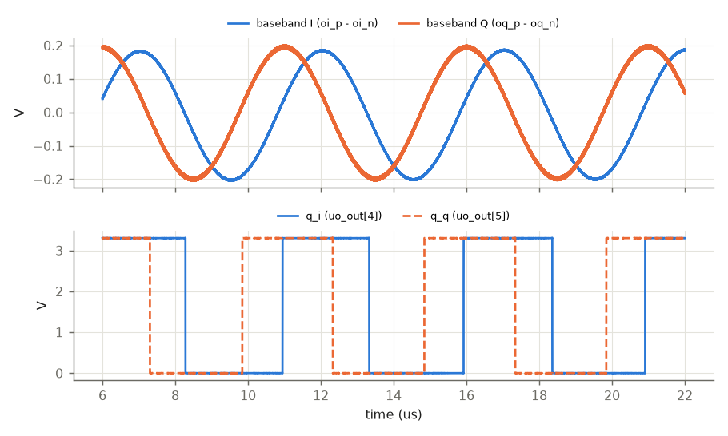
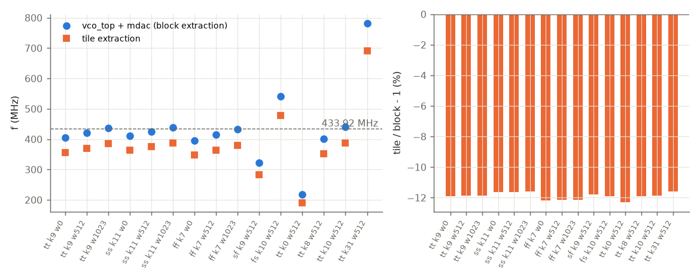
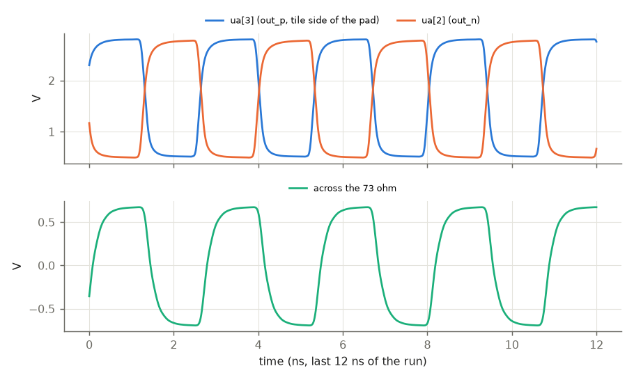
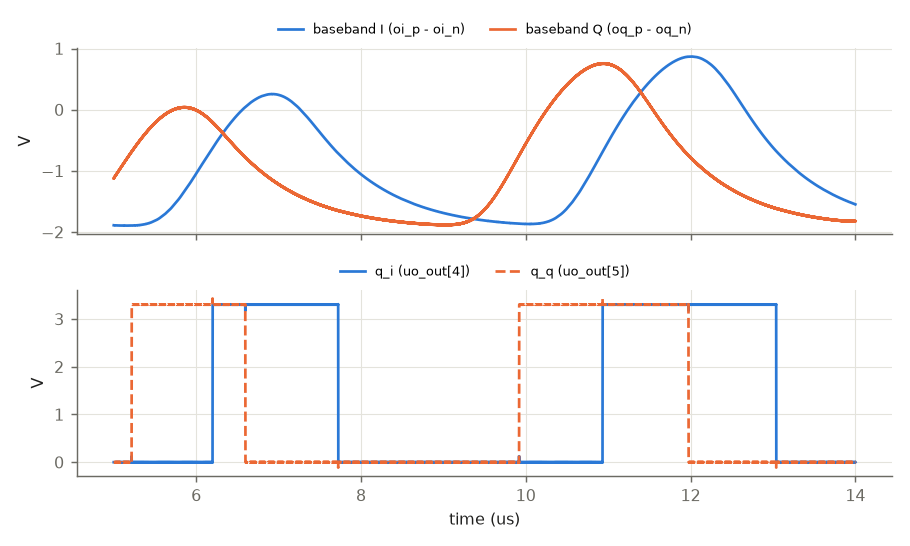
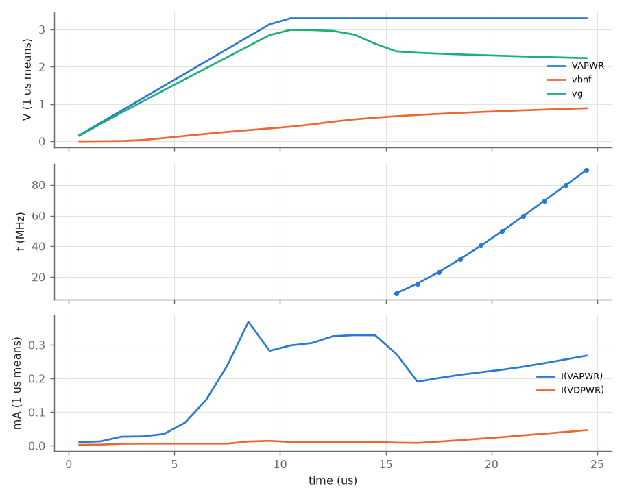
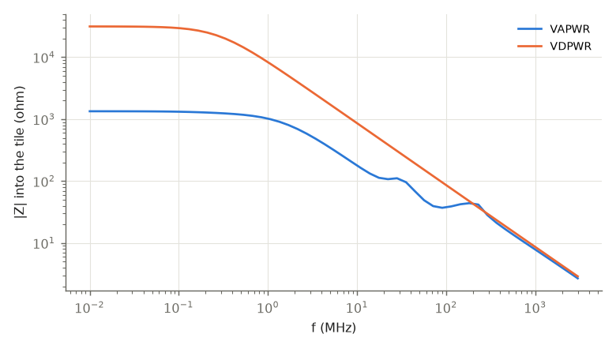

# The extracted tile in simulation: results

[](https://claude.com/claude-code)

This page reports the first simulations of the whole 433 MHz radio tile from its layout: the Tiny Tapeout (TT) 2x2
analog tile `tt_um_mattvenn_gf433_vco` on GF180MCU, extracted as one flat netlist without the digital macro. Each
function is compared with the block-level bench it was designed against: the voltage-controlled oscillator (VCO), the
transmit (TX) driver, the receiver (RX), power-up, the debug multiplexer on ua[0] and the supplies. The benches, the
runs and this write-up were done by Claude (Claude Code), working from Matt's brief, on 2026-11-17.

## Summary

**Table I.** Results at 27 °C, 3.3 V, on the C-only extraction unless stated (checks: `sim/top/tb_tile_verdict.py`).

| Test | Result | Reference | Verdict |
|---|---|---|---|
| 1 VCO frequency | **11.6-12.3 % below the block-level extraction** at every corner, code and word (tt code 9, word 512: 370.52 MHz against 420.50 MHz); explained by the a2 net (19.0 fF of wiring capacitance against about 3.3 fF on the other ring nodes) | extracted `vco_top` + medium digital-to-analog converter (DAC) | consistent shift: PASS; shift larger than the layout's estimate of about 5 %: **FAIL** |
| 1 tuning range | codes 0-31 span 190.8-691.3 MHz at tt (block 217.6-782.1); medium DAC range 28.25 MHz = 1.59 coarse steps of 17.80 MHz (block 31.86 / 20.06 MHz); 433.92 MHz at code 12-13 at tt (block: 9) and about 20 at sf | extracted `vco_top` + DAC | PASS |
| 2 TX | fundamental into the 73 Ω dipole +4.72 (ss) to +7.57 (ff) dBm, within 0.5 dB of the block bench; TX off -91 dBm | `sim/tx/results/top.md` (case pg) | PASS |
| 3 RX, -70 dBm | q_i / q_q toggle at the 200 kHz offset at tt, ss and ff; limiter I/Q phase +70 to +76°, its sign follows the sign of the offset; LO I/Q phase 74.6° | `sim/rx/results/summary.md` (72-73°) | PASS |
| 3 RX, -90 to -100 dBm, settled | with the high-pass preset to its steady state (update below): q_i / q_q toggle at the 200 kHz offset down to -100 dBm, duty 47-49 %, limiter I/Q +77 to +79° (baseband +75°), noiseless | - | PASS |
| 3 RX, -95 dBm, from the LO's start | no toggles in 14 µs: the 8.5 kHz high-pass has not yet removed the -3 mV mixer offset that appears when the local oscillator (LO) starts | `docs/rx_design.md`: 0.5-0.9 ms recovery after an offset step | FAIL (settling, as designed) |
| 4 power-up | ring oscillates from 15 µs, 89.7 MHz at 25 µs and rising with the bias filter; no output on the dipole (0.03 mV p-p) | `sim/top/results.md` start-up | PASS |
| 5 debug mux | each select reads its node within 0.4 mV, 0.86-1.63 kΩ pin to node, off switches move no node; ua[1] = VGND | `docs/tile_layout.md` (dbg_tg 0.84-1.25 kΩ) | PASS |
| 6 supply | f +0.32 % / -0.30 % at 3.15 / 3.45 V (both supplies); ring supply (VAPWR) ripple 1.0 mV p-p with the TX on (VDPWR 13.7 mV); VDPWR 18.5 pF, VAPWR 86 pF effective at 1 MHz | `sim/tx/results/top.md` (13-15 mV) | PASS |
| mutations | all 10 caught (Section 7) | - | - |

The tile works as a radio on the extracted netlist: the ring runs, divides and drives the TX and the receiver's LO,
the TX puts the same power into the dipole as the block benches, the receiver demodulates a -70 dBm tone into
quadrature bits with the right phase sign, and the debug mux reads the right nodes. **The one design problem is the
ring's a2 node**: its route to the receiver's Q tap adds about 16 fF, which slows the whole ring by 12 % (Section 1).
The 433.92 MHz coarse code moves up by three to four at tt, and 433.92 MHz is still in reach at tt and at sf (the
slowest corner), so the chip works with firmware calibration. But a2 also couples into the baseband, the ring's
phase noise was never checked with this load, and the frequency map in `docs/remap_results.md` no longer holds, so
the a2 wire should be shortened or buffered before tape-out.

## Update 2026-11-18: after the supply-strap changes (d606bd4, fca76de)

The layout gained supply straps over the turned TX driver's and LNA's rails (d606bd4) and a wider TX VDPWR strap
(fca76de). The tile was re-extracted at fca76de (`layout/pex/tile_*.spice`, same 126 ports) and the VCO and TX benches
rerun on it (`vco3_*`, `tx3_*`); `vco2_*` are the same VCO runs on the d606bd4 extraction.

**VCO.** The shift against the block-level reference did not shrink: it grew by about 0.5-0.7 % (Table U1), as a2's
extracted load grew from 19.0 to 19.71 fF (d606bd4) and 19.88 fF (fca76de). The new straps pass near the a2 wire: it
now couples 0.92 fF to ui_in[6], 0.59 fF to ui_in[5] (the TX enables) and 0.63 fF to dbg_sel[0]. At -0.77 % per fF
the extra 0.88 fF predicts -0.68 %; measured -0.66 to -0.67 %.

**Table U1.** Ring frequency at word 512 (MHz) and the shift against the block-level reference.

| corner, code | block | first layout | d606bd4 | fca76de | fca76de / block |
|---|---|---|---|---|---|
| tt, 9 | 420.50 | 370.52 (-11.89 %) | 368.53 (-12.36 %) | 368.05 | -12.47 % |
| ss, 11 | 425.12 | 375.71 (-11.62 %) | 373.71 (-12.09 %) | 373.23 | -12.21 % |
| ff, 7 | 414.63 | 364.22 (-12.16 %) | 362.26 (-12.63 %) | 361.78 | -12.75 % |

**TX** (fca76de, C-only, both supplies behind TT switches). The C-only netlist has no supply resistance, so the power
barely moves (Table U2); the RC extraction puts the supply grid's resistance in the loop. At tt code 13 the
rcx tile (`tx3_rcx_tt_on_k13`, 150 ns on four threads, 2.0 hours, measured over the last 60 ns) gives
+5.97 dBm of fundamental at 432.56 MHz, -0.19 dB against the C-only tile; VDPWR at the tile's port
averages 3.283 V (the TT switch) and ripples 14.1 mV p-p, and the VAPWR port 3.6 mV p-p (C-only
1.1 mV). The ring is -0.64 % slower in rcx, as in the VCO's rcx run.

**Table U2.** TX into the dipole after fca76de (fundamental, dBm).

| run | f (MHz) | fundamental (dBm) | first layout (dBm) | I(VDPWR) (mA) | ripple VDPWR / VAPWR (mV p-p) |
|---|---|---|---|---|---|
| tx3_c_tt_on | 368.02 | +6.41 | +6.40 | 12.48 | 13.6 / 1.0 |
| tx3_c_ss_on | 373.19 | +4.73 | +4.72 | 10.39 | 13.8 / 0.9 |
| tx3_c_ff_on | 361.75 | +7.58 | +7.57 | 14.56 | 15.1 / 0.9 |
| tx3_c_tt_on_k13 | 435.34 | +6.16 | +6.15 | 12.90 | 13.4 / 1.1 |
| tx3_rcx_tt_on_k13 (rcx) | 432.56 | +5.97 | - | 12.59 | 14.1 / 3.6 |

**RX settled at -70 to -100 dBm.** The 14 µs runs could not show sensitivity: the -3 mV mixer offset when the LO
starts needs 0.5-0.9 ms to clear the 8.5 kHz high-pass, about 110 hours of simulation at the measured 6.5 min per µs.
Instead the run starts with the high-pass in its steady state. Only the first AC coupling per arm sees the offset:
stage 1 of `rx_bb` is DC-coupled to the mixer, and every later coupling follows a settled high-pass. In
`tile_c.spice` the four stage-1 outputs are the drains of the nfets gated by bi_* / bq_*, each the upstream side of an
L = 10 µm pfet coupling capacitor (`S1_NODES` in `tb_tile.py`). A 3 µs pre-run with the receiver on and no RF
(`rxset_c_tt`, vbnf held) gives their running means: the I pair 2.2932 / 2.2397 V,
a 53 mV differential (0 V in the operating point with the LO static); differential drift under 0.01 mV/µs. The RX runs
(`rxs_c_tt_*`, on the d606bd4 extraction, 22 µs) set those nodes and the mixer outputs to these means with `.ic`. In the
operating point the coupling capacitor is open, so its charge then equals the settled value; the gate side stays at
its bias.

**Evidence.** The baseband DC stays at zero (oi mean +0.2 mV at -95 dBm, against -0.9 V in the unsettled run), the
limiter duty is 47-49 %, and q_i / q_q toggle at the 200 kHz offset at every level down to -100 dBm, with Q leading
I by +77 to +79° (Table U3, Fig. U1). These runs have no noise source (ngspice's transient has no device noise), so
they show the settled chain working at these levels, not the noise-limited sensitivity (`sim/rx/results/`: the noise
runs use the model's noise figure). At -70 dBm the limiter phase is +77.9°, close to the 14 µs run's +71.8°.

**Table U3.** RX, settled high-pass, tt, tone 200 kHz above the LO, last 16 µs of 22 µs.

| level (dBm) | q_i / q_q (kHz) | edges i / q | duty q_i | I/Q limiter / baseband (deg) | baseband I / Q (V) | baseband DC I (mV) | LO I/Q (deg) |
|---|---|---|---|---|---|---|---|
| -70 | 197.9 / 199.8 | 6 / 6 | 48.7 % | +77.9 / +74.5 | 1.610 / 1.611 | +32.1 | 74.6 |
| -90 | 197.9 / 199.7 | 6 / 6 | 48.4 % | +78.6 / +74.8 | 0.341 / 0.347 | +2.0 | 74.6 |
| -95 | 198.0 / 199.4 | 6 / 6 | 48.4 % | +77.6 / +75.0 | 0.193 / 0.197 | +0.2 | 74.6 |
| -100 | 201.4 / 198.4 | 7 / 6 | 47.3 % | +77.0 / +75.2 | 0.109 / 0.111 | -0.9 | 74.6 |



**Fig. U1.** Baseband and limiter outputs at -95 dBm with the high-pass preset to its steady state, tt: q_q leads q_i
by +77.6°, 48.4 % duty, the baseband centred on 0 V (0.19 V amplitude). The thicker Q trace is LO ripple.

## Method

**Netlists.** `layout/gen/pex_tile.sh` extracts the tile with magic 8.3.642 after deleting the `tx_fine` macro (its
routed wires up to the macro pins stay, with their capacitance): `layout/pex/tile_c.spice` (devices and capacitance
with coupling, 3322 transistors, 3467 capacitors) and `layout/pex/tile_rcx.spice` (plus about 34 000 wire resistors,
the coupling double count removed by `rcfix.py`). Every TT pin and every net between blocks is a port.

**Testbench** (`sim/top/tb_tile.py`). The ports are connected by name. Around them:
- the macro's outputs are sources at VDPWR logic levels: the 37 medium-DAC lines (active low, word 512, the reset
  value), `rx_en`, `dbg_sel[3:0]`; its input `ck` is loaded by one `dffq_1` clock pin;
- the coarse code is on ui_in[4:0], the TX enables on ui_in[5] / ui_in[6];
- each used analog pin (ua[0], ua[2] to ua[5]) goes through the pad model `sim/pad/pad_model_gf180.spice` (40 Ω route,
  three other projects' switches off on the same pin). The TX dipole (73 Ω + 100 pF) is across ua[3] / ua[2]; the RX
  dipole is an electromotive force (EMF) source with 36.5 Ω per arm on ua[4] / ua[5]; a 10 MΩ // 10 pF probe is on
  ua[0];
- the supplies are either ideal or each behind one TT power switch (`tt_pg_3v3_hp_2`, 1.32 Ω at tt). VDPWR has this
  switch on silicon; for VAPWR the same switch is an assumption;
- 27 °C, VAPWR = VDPWR = 3.3 V unless stated, at the 433.92 MHz coarse codes of the block-level map (tt 9, ss 11, ff 7,
  sf 9, fs 10).

**References.** The VCO runs are compared with the extracted `vco_top` (RC, rcfix) plus the extracted medium DAC and
the 200 kΩ vctrl pull-down, the deck of Table VII in `docs/tx_fine_tune.md`, rerun at the same corner, code and word
(`sim/top/tb_tile_ref.py`; it reproduces Table VII: 404.38 MHz at tt code 9 word 0 against 404.89 MHz). TX is
compared with `sim/tx/tb_tx_top.py` behind the same power switch (`sim/tx/results/top.md`), and RX with
`sim/rx/results/summary.md` and `docs/rx_layout.md`.

**Measurement.** The ring frequency is taken at a2's mid-swing (a2 swings from vg up to VDD), over the last 40 % of
each 0.6 µs run (about 90 periods); ck's rate gives the ÷4 ratio. The runs went through `sim/sched.py`
(`sim/top/jobs_tile.py`, 14 CPUs, about 7 hours) and are judged by their output files and log tails: none has
"singular", "timestep too small" or "Transient op started". `sim/top/tb_tile_verdict.py` holds the checks and writes
the tables below; every check was mutation-tested (Section 7).

## 1. VCO on the tile

**Problem.** The ring on the tile runs 11.6-12.3 % below the block-level extraction at every corner, code and DAC
word (Table III). `docs/tile_layout.md` expected about 5 % from the a2 route.

**Cause.** In `tile_c.spice` the a2 net carries 19.0 fF of extracted wiring capacitance: 6.3 fF to VGND, 4.9 fF to
VAPWR, 2.0 fF through the Q tap's input coupling capacitor (intended), 1.4 fF to vg, 1.3 fF to enb, 0.8 fF each to
oi_n and oq_p, and smaller parts. The other four ring nodes have 3.0-3.5 fF each, as in the `vco_top` extraction
(`docs/ring_layout_v3.md`). So a2 carries about 15.7 fF more than a ring node was designed for: the `vco_core` pin
route (+3.2 fF, `docs/tile_layout.md`), the 31 µm tile wire with its neighbours and the receiver's tap input.

**Evidence.** The block-level `vco_top` deck with 15.7 fF added on one ring node (a0, a port; the ring is symmetric)
reproduces the tile within 0.3 % at every corner (Table II): the a2 wiring explains the whole shift, about
-0.77 % per fF. The tile's RC extraction (`tile_rcx.spice`, one run) gives -12.47 %: the wire resistance adds only
0.67 % to the capacitance's effect.

**Table II.** The a2 load on the block-level deck: `vco_top` + medium DAC at word 512, with 15.7 fF added on a0.

| corner, code | block (MHz) | block + 15.7 fF (MHz) | tile (MHz) | block + 15.7 fF / block | tile / block | tile / (block + 15.7 fF) |
|---|---|---|---|---|---|---|
| tt, 9 | 420.50 | 369.64 | 370.52 | -12.10 % | -11.89 % | +0.24 % |
| ss, 11 | 425.12 | 374.70 | 375.71 | -11.86 % | -11.62 % | +0.27 % |
| ff, 7 | 414.63 | 363.60 | 364.22 | -12.31 % | -12.16 % | +0.17 % |
| sf, 9 | 321.64 | 284.39 | 283.66 | -11.58 % | -11.81 % | -0.26 % |
| fs, 10 | 542.02 | 476.96 | 477.42 | -12.00 % | -11.92 % | +0.10 % |
| tt, 9, rcx tile | 420.50 | - | 368.05 | - | -12.47 % | - |

**Consequences.**
- The 433.92 MHz coarse code moves up by three to four at tt: code 13 runs at 438.26 MHz at word 512, and from the
  measured step and DAC range code 12 reaches about 438 MHz at word 1023. The medium DAC's range stays above 1.3
  coarse steps (28.25 MHz against a 17.80 MHz step, 1.59 steps), so there is still no gap.
- a2 also couples to the baseband outputs (0.8 fF each to oi_n and oq_p) and to enb: a ring node swinging 1.5 V at
  370 MHz next to 200 kΩ nodes. The baseband filters it, but it is a coupling path the floorplan meant to avoid.
- ls (the I LO and the TX drive) carries 59 fF in the tile against 9.2 fF in `vco_top`, 17 fF of it to the baseband
  outputs oi_p / oi_n / oq_n. The LO's duty is unchanged (48.1 %), but the ls wire runs along the baseband pairs.

**Fix (suggested, not done here: `layout/` belongs to the layout work).** Route a2 on the north edge of `vco_core`
(about 0.7 fF, `docs/tile_layout.md`) or put a small buffer at the ring for the Q tap, and keep a2 and ls off the
baseband channel. Re-extract and rerun `vco_c_tt_k9_w512` and its reference.

**Also found: the extracted ring's corner spread with vctrl pulled down.** At sf and fs the block-level reference
itself is far from the schematic: sf code 9 runs at 321.6 MHz (word 512) and fs code 10 at 542.0 MHz, against about
444 and 451 MHz at word 0 in the schematic (Table II of `docs/tx_fine_tune.md`). The same deck with the schematic DAC
gives 308.5 MHz at sf word 0 (404.37 MHz at tt, as with the extracted DAC), so the DAC is not the cause. Table VII of
`docs/tx_fine_tune.md` covered tt, ss and ff only; `docs/remap_results.md` mapped sf / fs with vctrl at 1.3-2.7 V,
where the fine leg adds current. On the tile, sf still reaches 433.92 MHz near code 20 (below Table III).
This is a block-level open item, not a tile one: the tile adds the same -12 % on top.

**Table III.** VCO on the tile against the block-level extraction (27 °C, 3.3 V, ideal supplies; 0.6 µs, last 40 %).

| corner, code, word | block f (MHz) | tile f (MHz) | tile / block | f/f(ck) | ls duty | vg (V) | vbnf (V) | I(VAPWR) (mA) | flags |
|---|---|---|---|---|---|---|---|---|---|
| tt k9 w0 | 404.38 | 356.22 | -11.91 % | 4.0000 | 48.0 % | 1.908 | 1.2350 | 0.67 | none |
| tt k9 w512 | 420.50 | 370.52 | -11.89 % | 4.0000 | 48.1 % | 1.892 | 1.2349 | 0.69 | none |
| tt k9 w1023 | 436.24 | 384.47 | -11.87 % | 4.0000 | 48.2 % | 1.876 | 1.2349 | 0.71 | none |
| ss k11 w0 | 410.92 | 363.10 | -11.64 % | 4.0000 | 50.1 % | 1.691 | 1.3877 | 0.65 | none |
| ss k11 w512 | 425.12 | 375.71 | -11.62 % | 4.0000 | 50.2 % | 1.673 | 1.3877 | 0.67 | none |
| ss k11 w1023 | 439.01 | 388.04 | -11.61 % | 4.0000 | 50.2 % | 1.655 | 1.3877 | 0.69 | none |
| ff k7 w0 | 396.10 | 347.85 | -12.18 % | 4.0000 | 46.4 % | 2.111 | 1.0858 | 0.72 | none |
| ff k7 w512 | 414.63 | 364.22 | -12.16 % | 4.0000 | 46.5 % | 2.095 | 1.0858 | 0.74 | none |
| ff k7 w1023 | 432.65 | 380.16 | -12.13 % | 4.0000 | 46.5 % | 2.080 | 1.0858 | 0.76 | none |
| sf k9 w512 | 321.64 | 283.66 | -11.81 % | 4.0000 | 50.1 % | 1.952 | 1.2372 | 0.57 | none |
| fs k10 w512 | 542.02 | 477.42 | -11.92 % | 4.0001 | 47.0 % | 1.763 | 1.2333 | 0.84 | none |
| tt k0 w512 | 217.60 | 190.84 | -12.30 % | 4.0000 | 47.2 % | 2.102 | 1.2331 | 0.47 | none |
| tt k8 w512 | 400.30 | 352.59 | -11.92 % | 4.0000 | 48.0 % | 1.913 | 1.2347 | 0.67 | none |
| tt k10 w512 | 440.42 | 388.20 | -11.86 % | 4.0000 | 48.2 % | 1.871 | 1.2354 | 0.71 | none |
| tt k31 w512 | 782.09 | 691.29 | -11.61 % | 4.0000 | 49.5 % | 1.508 | 1.2390 | 1.07 | none |
| vco_c_tt_k9_w512_rx | - | 370.51 | - | 4.0000 | 48.1 % | 1.892 | 1.2349 | 7.70 | none |
| vco_c_tt_k9_w512_v3.15 | - | 371.71 | - | 4.0000 | 47.6 % | 1.749 | 1.2349 | 0.65 | none |
| vco_c_tt_k9_w512_v3.45 | - | 369.40 | - | 4.0000 | 48.5 % | 2.035 | 1.2350 | 0.73 | none |

Code sweep at sf (tile only, word 512): code 9 283.7 MHz, code 15 366.0 MHz, code 23 464.0 MHz, code 31 552.1 MHz.
With the receiver enabled (tt code 9 word 512) the ring runs at 370.51 MHz (-0.002 %): the Q tap is always on, so
rx_en hardly moves the ring.



**Fig. 1.** Ring frequency on the tile against the block-level extraction at every corner, code and word: the tile
is 11.6-12.3 % lower everywhere (tt code 9, word 512: 370.52 against 420.50 MHz).

## 2. TX into the dipole

With the enables high (ui_in[5] = ui_in[6] = 1) and both supplies behind TT's switch, the driver puts +6.40 dBm of
fundamental into the 73 Ω dipole at tt (block bench +6.31 dBm), +4.72 at ss and +7.57 at ff (Table IV). The arms are
180° apart within 0.4°. The tile's ring runs at 370 MHz at code 9, so one run at code 13 checks it near 434 MHz: 438.26 MHz,
+6.15 dBm of fundamental, 12.92 mA from VDPWR. With the enables low the dipole sees -91 dBm (ua[2] / ua[3] move 0.08 / 0.03 mV p-p), and the ring is unchanged (370.49 MHz both ways).

**Table IV.** TX into the 73 Ω + 100 pF dipole through the pad models, both supplies behind TT switches (except
`_ideal`); fundamental by a discrete Fourier transform (DFT) at the ring frequency. Reference: `sim/tx/results/top.md`
case pg (tt / ss / ff) and `sim/tx/results/block_pex.txt` (sf / fs).

| run | f(a2) (MHz) | P dipole / fundamental (dBm) | reference fund. (dBm) | phase error (deg) | I(VDPWR) avg / rms (mA) | ripple VDPWR / VAPWR (mV p-p) | flags |
|---|---|---|---|---|---|---|---|
| tx_c_tt_on | 370.49 | +6.63 / +6.40 | +6.31 | +0.39 | 12.49 / 12.83 | 13.7 / 1.0 | none |
| tx_c_ss_on | 375.66 | +4.90 / +4.72 | +4.80 | +0.23 | 10.40 / 10.71 | 13.8 / 1.0 | none |
| tx_c_ff_on | 364.20 | +7.85 / +7.57 | +7.31 | +0.03 | 14.58 / 15.01 | 15.1 / 0.9 | none |
| tx_c_sf_on | 285.66 | +6.89 / +6.36 | +6.14 | +0.17 | 11.74 / 12.11 | 13.6 / 0.9 | none |
| tx_c_fs_on | 475.15 | +6.54 / +6.10 | +6.57 | +0.23 | 13.60 / 13.87 | 12.6 / 1.0 | none |
| tx_c_tt_off | 370.49 | -90.53 / -91.10 | +6.31 | +123.47 | 0.19 / 0.30 | 1.0 / 1.0 | none |
| tx_c_tt_on_k13 | 438.26 | +6.32 / +6.15 | +6.31 | +0.30 | 12.92 / 13.26 | 13.5 / 1.0 | none |
| tx_c_tt_on_ideal | 370.48 | +6.66 / +6.44 | +6.31 | +0.37 | 12.57 / 12.94 | 0.0 / 0.0 | none |



**Fig. 2.** The TX outputs at the tile side of the pads and the voltage across the dipole's 73 Ω, tt, code 9: +6.40 dBm
of fundamental.

## 3. RX: a tone through the pads to q_i / q_q

**Bench.** A continuous-wave tone at the ring's own frequency + 200 kHz (or -200 kHz) drives the RX dipole. The ring's
frequency comes from a pre-run with the receiver on (`rxhpre_c_*`). The bias filter node vbnf is held by a source at
its settled value in both runs: a first try with vbnf free drifted the ring 0.96 MHz between the pre-run and the RX
run (vbnf was still settling through 1 MΩ / 20 pF), and the tone fell outside the 143 kHz baseband. Each RX run is
14 µs at 20 ps steps (about 90 min on three threads); the analysis uses the last 9 µs.

**Result.** At -70 dBm the limiters toggle at the offset (q_i 215-219 kHz for a 200 kHz offset, within the 9 µs
window's resolution) at tt, ss and ff. Q leads I by +70 to +76° for +200 kHz and lags by 78° for -200 kHz; the analog
baseband phase agrees in sign (+76 to +85°). The LO I/Q phase at the mixer switches is 74.6°, against 72.2° in the
schematic LO bench and 76.5° on the extracted receiver (`docs/rx_layout.md`, Table IX). The receiver draws 7.65 mA
from VAPWR with the ring (0.69 mA without the receiver).

**Problem found: the receiver is not settled in 14 µs.** When the LO starts, the mixer output steps by about -3 mV
(LO self-mixing). That is as large as the -70 dBm tone at the mixer (3.5-3.8 mV), so the baseband sits on an offset
(about -0.9 V differential at the outputs) and the limiters' duty is 32 % instead of 50 % (Fig. 3). At -95 dBm the
offset holds both outputs at the rail and nothing toggles. `docs/rx_design.md` already measures 0.5-0.9 ms to recover
from a 10 mV offset step and asks for rx_en to rise 1-2 ms before a packet; these runs confirm that on the tile, but a
settled sensitivity run would need about a millisecond of simulated time, out of reach here.

**Table V.** RX: a continuous-wave (CW) tone 200 kHz from the ring at the dipole, vbnf held, last 9 µs of 14 µs. The
baseband DFT peak is information only (9 µs gives about 110 kHz of resolution); amplitudes and phases are taken at the
known offset.

| run | ring f (MHz) | tone - ring (kHz) | baseband DFT peak (kHz) | q_i / q_q f (kHz) | edges i / q | I/Q limiter / baseband (deg) | LO I/Q (deg) | baseband I / Q (V) | mixer I (mV) | flags |
|---|---|---|---|---|---|---|---|---|---|---|
| rxh_c_tt_-70_p | 370.395 | +199.9 | 225 | 219.3 / 222.0 | 4 / 4 | +71.8 / +81.0 | 74.6 | 0.988 / 0.879 | 3.71 | none |
| rxh_c_tt_-70_n | 370.395 | -199.9 | 170 | 188.6 / 222.0 | 3 / 4 | -77.7 / -84.3 | 74.6 | 1.068 / 0.878 | 3.72 | none |
| rxh_c_tt_-95_p | 370.395 | +200.0 | 115 | no toggles | 0 / 0 | - / -95.4 | 74.6 | 0.007 / 0.006 | 0.21 | none |
| rxh_c_ss_-70_p | 375.546 | +199.9 | 150 | 218.2 / 177.3 | 4 / 4 | +76.4 / +85.2 | 74.0 | 0.940 / 0.925 | 3.52 | none |
| rxh_c_ff_-70_p | 364.112 | +199.9 | 225 | 215.0 / 219.8 | 4 / 4 | +69.8 / +75.9 | 75.1 | 1.111 / 1.002 | 3.82 | none |

The first try (`rx_c_tt_-70_p`, vbnf free) ran the ring 0.96 MHz off its pre-run, so its tone sat 1.16 MHz from the
LO: no toggles.



**Fig. 3.** Baseband I / Q and the limiter outputs for a -70 dBm tone 200 kHz above the LO, tt: q_q leads q_i by
+71.8°; both baseband outputs still sit on the -3 mV mixer offset from the LO's start.

## 4. Power-up

Both supplies ramp from 0 to 3.3 V in 10 µs with every node at 0 V (`uic`), the macro lines at their reset values
(word 512, TX and RX off). The supplies are ideal sources here: behind the TT switch (gate at 0 V) the tile floats near
0 V until the chip supply passes the switch's threshold, and the transient stops with "timestep too small" at 0.8 µs.

The ring oscillates from 15 µs (Fig. 4): vbnf charges through the 1 MΩ / 20 pF filter, and with vctrl pulled down
both DACs scale with it, so the start is later than the block bench with vctrl at 1.65 V (`sim/top/results.md`, about
2 µs). At 25 µs the ring runs at 89.7 MHz and rises about 10 MHz per µs, with vbnf at 0.89 of its 1.235 V;
`docs/cfed_startup_results.md` gives up to 138 µs to settle within 1 %. ck is exactly f / 4 once the ring runs.
Before that, from 8 µs, ck toggles at 4-13 MHz while a2 swings only 0.01-0.3 V; the cause (the level shifter and
divider switching on the small ring signal) was not traced. The macro sees a few slow ck edges at power-up; it
gates ck to uo[0] until CK_EN is set, but its f / 16 ... f / 1024 dividers run on them.

No TX output at any time: 0.03 mV p-p across the dipole. Below about 1 V of supply both ua[2] and ua[3] follow the
ramp by 0.17 V together (common mode). The supply currents peak at 1.3 mA (VAPWR) and 0.8 mA (VDPWR).

**Table VI.** Power-up at tt, 1 µs windows (means).

| t (us) | VAPWR (V) | a2 swing (V) | f(a2) (MHz) | f(ck) (MHz) | vg (V) | vbnf (V) | nb (V) | ua[2] / ua[3] p-p (mV) | I(VAPWR) / I(VDPWR) (mA) |
|---|---|---|---|---|---|---|---|---|---|
| 0 | 0.16 | 0.19 | - | - | 0.154 | 0.001 | 0.012 | 157.57 / 152.30 | 0.01 / 0.00 |
| 1 | 0.50 | 0.21 | - | - | 0.463 | 0.005 | 0.039 | 171.81 / 153.10 | 0.01 / 0.00 |
| 2 | 0.83 | 0.23 | - | - | 0.772 | 0.009 | 0.025 | 111.28 / 119.97 | 0.03 / 0.01 |
| 3 | 1.16 | 0.22 | - | - | 1.072 | 0.035 | 0.001 | 0.11 / 0.11 | 0.03 / 0.01 |
| 4 | 1.49 | 0.24 | - | - | 1.369 | 0.089 | 0.000 | 0.02 / 0.02 | 0.03 / 0.01 |
| 5 | 1.82 | 0.24 | - | - | 1.666 | 0.146 | 0.000 | 0.01 / 0.01 | 0.07 / 0.01 |
| 6 | 2.15 | 0.36 | - | - | 1.962 | 0.201 | 0.000 | 0.00 / 0.00 | 0.14 / 0.01 |
| 7 | 2.48 | 0.31 | - | - | 2.256 | 0.253 | 0.000 | 0.00 / 0.00 | 0.24 / 0.01 |
| 8 | 2.81 | 0.29 | - | 13.1 | 2.552 | 0.301 | 0.000 | 0.03 / 0.00 | 0.37 / 0.01 |
| 9 | 3.14 | 0.28 | - | 8.0 | 2.847 | 0.347 | 0.000 | 0.04 / 0.01 | 0.28 / 0.01 |
| 10 | 3.30 | 0.04 | - | 7.8 | 2.989 | 0.393 | 0.000 | 0.05 / 0.03 | 0.30 / 0.01 |
| 11 | 3.30 | 0.02 | - | 5.0 | 2.983 | 0.454 | 0.000 | 0.04 / 0.01 | 0.31 / 0.01 |
| 12 | 3.30 | 0.01 | - | 5.0 | 2.960 | 0.528 | 0.000 | 0.04 / 0.01 | 0.33 / 0.01 |
| 13 | 3.30 | 0.01 | - | 5.0 | 2.861 | 0.588 | 0.000 | 0.04 / 0.01 | 0.33 / 0.01 |
| 14 | 3.30 | 0.72 | - | 5.0 | 2.615 | 0.635 | 0.000 | 0.04 / 0.01 | 0.33 / 0.01 |
| 15 | 3.30 | 0.98 | 9.5 | 4.1 | 2.412 | 0.673 | 0.000 | 0.06 / 0.01 | 0.27 / 0.01 |
| 16 | 3.30 | 1.01 | 15.7 | 3.9 | 2.375 | 0.707 | -0.000 | 0.06 / 0.01 | 0.19 / 0.01 |
| 17 | 3.30 | 1.04 | 23.2 | 5.8 | 2.351 | 0.736 | 0.000 | 0.06 / 0.01 | 0.20 / 0.01 |
| 18 | 3.30 | 1.06 | 31.5 | 7.9 | 2.330 | 0.763 | 0.000 | 0.07 / 0.01 | 0.21 / 0.02 |
| 19 | 3.30 | 1.09 | 40.4 | 10.2 | 2.311 | 0.787 | 0.000 | 0.08 / 0.01 | 0.22 / 0.02 |
| 20 | 3.30 | 1.11 | 49.8 | 12.5 | 2.293 | 0.810 | 0.000 | 0.08 / 0.01 | 0.23 / 0.03 |
| 21 | 3.30 | 1.13 | 59.6 | 14.9 | 2.276 | 0.831 | -0.000 | 0.08 / 0.01 | 0.24 / 0.03 |
| 22 | 3.30 | 1.15 | 69.7 | 17.4 | 2.260 | 0.851 | 0.000 | 0.08 / 0.01 | 0.25 / 0.04 |
| 23 | 3.30 | 1.16 | 79.7 | 20.0 | 2.245 | 0.870 | 0.000 | 0.08 / 0.01 | 0.26 / 0.04 |
| 24 | 3.30 | 1.18 | 89.7 | 22.5 | 2.231 | 0.888 | -0.000 | 0.08 / 0.01 | 0.27 / 0.05 |



**Fig. 4.** Power-up at tt: the supplies, vbnf and vg (top), the ring's frequency (middle) and the supply currents
(bottom); the ring starts at 15 µs and reaches 89.7 MHz at 25 µs as vbnf charges.

## 5. Debug mux on ua[0]

Operating points with the receiver on; markers of ±0.1 µA on oi_p / oq_p move them about 40 mV apart, so a reading
can tell them apart. Each select puts its own node on ua[0] within 0.4 mV with a 10 MΩ probe, and no other node
within 5 mV (Table VII). The path from the board pin to the node is 0.86-1.63 kΩ (pad switch, route and dbg_tg). With
no select, forcing ua[0] to 0 or 3.3 V moves no source node by more than 0.3 µV. With dbg_sel[3] on and ua[0] forced
to 1.65 V, vctrl reaches 1.640 V (the 200 kΩ pull-down against about 1.2 kΩ of path). ua[1] stays at 0 V with 1 mA
injected: it is VGND.

**Note for the bench.** The baseband outputs are about 200 kΩ nodes: a 10 MΩ meter pulls them 46 mV low. Read oi_p /
oq_p with a high-impedance (> 1 GΩ) meter or buffer; nb (19 kΩ) moves only 1.8 mV.

**Table VII.** Debug mux, operating points, tt, receiver on.

| select | node (V) | ua[0] pin (V) | error (mV) | probe pulls node (mV) | R pin -> node (kohm) | R seen at the pin (kohm) |
|---|---|---|---|---|---|---|
| dbg_sel[0] -> oi_p | 2.3038 | 2.3034 | -0.39 | -46.5 | 1.63 | 199.7 |
| dbg_sel[1] -> oq_p | 2.2641 | 2.2638 | -0.37 | -45.8 | 1.63 | 199.7 |
| dbg_sel[2] -> nb | 0.9771 | 0.9770 | -0.11 | -1.8 | 1.12 | 19.0 |
| dbg_sel[3] -> vctrl | 0.0001 | 0.0001 | +0.00 | +0.1 | 0.86 | 196.6 |

With no select, ua[0] reads 4.2 mV (the off switches' leakage into the 10 MΩ probe). Forcing ua[0] from 0 to 3.3 V
moves oi_p, oq_p and nb by less than 1 µV and vctrl by 0.28 µV. With dbg_sel[3] on and ua[0] forced to 1.65 V, vctrl
is 1.640 V. With 1 mA into ua[1] it stays at 0 V (it is joined to VGND by a 0 Ω strap in the extraction).

## 6. Supplies

**Supply voltage.** With both supplies at 3.15 V and 3.45 V (3.3 V ± 4.5 %, the robustness range of the corner
policy) the ring moves +0.32 % and -0.30 % at tt code 9 word 512: about -0.021 % per 10 mV with every
block's supply moving together (the ring alone: -0.008 % per 10 mV, `docs/cfed_results.md`).

**Supply impedance.** Small-signal (AC) analysis at the operating point with an ideal source on one supply (Table VIII,
Fig. 5): VDPWR looks like 18.5 pF from 100 kHz to 434 MHz (the 7.4 pF of decap units, the TX driver and the pads'
switches), VAPWR like 86 pF at 1 MHz falling to 20 pF at 434 MHz (the blocks' own decaps and filter capacitors).

**Ripple during TX.** With both supplies behind their switches and the TX on, VDPWR ripples 13.7 mV p-p (the block
bench gave 13-15 mV) and the ring's VAPWR 1.0 mV p-p, the same as with the TX off; the ring moves -0.001 % (Table IV).
On separate switches, the TX's 12.5 mA does not reach the ring. If VAPWR and VDPWR shared one path this would not
hold (`sim/tx/results/top.md`, case shared: 97 mV on the ring supply).

**Table VIII.** Impedance into the tile at the supply ports (effective capacitance from the imaginary part).

| port | 100 kHz | 1 MHz | 10 MHz | 25 MHz | 100 MHz | 434 MHz |
|---|---|---|---|---|---|---|
| vap | 1318.1 ohm (115 pF) | 998.0 ohm (86 pF) | 162.9 ohm (76 pF) | 107.5 ohm (39 pF) | 37.1 ohm (43 pF) | 16.7 ohm (20 pF) |
| vdp | 29419.6 ohm (18 pF) | 7816.9 ohm (18 pF) | 780.7 ohm (18 pF) | 387.5 ohm (18 pF) | 95.5 ohm (18 pF) | 18.7 ohm (18 pF) |



**Fig. 5.** Impedance into the tile at the VAPWR and VDPWR ports: 16.7 and 18.7 Ω at 434 MHz.

## 7. Mutation tests

Every check must fail on a broken circuit (Table IX). The mutated runs change the circuit at the testbench: the
code bits ui_in[0] / ui_in[1] swapped, the TX enables low, both power switches replaced by 10 Ω, the receiver not
enabled, dbg_sel[0] / dbg_sel[1] swapped, the receiver bias off, the TX enabled during power-up. The swap of q_i /
q_q is an analysis-level mutation of the -70 dBm run (the same as swapping the two pins).

**Table IX.** Mutations: each must make its check fail.

| Mutation | Check | Result |
|---|---|---|
| code bits ui_in[0] / ui_in[1] swapped (`mut_vco_code`, runs at code 10) | 1b tile / reference | caught (FAIL): the same shift at every code and word of a corner (spread < 1 %): tt -12.30 ... -7.68 %, ss -11.64 ... -11.... |
| TX enables low (`mut_tx_noen`) | 2 TX on mut_tx_noen | caught (FAIL): P1 -91.10 dBm (ref +6.31); phase error +123.5 deg |
| 10 Ω supply switches (`mut_tx_rsw10`) | 2 TX on mut_tx_rsw10 | caught (FAIL): VDPWR ripple 57 mV |
| receiver not enabled (`mut_rx_off`) | 3 RX mut_rx_off | caught (FAIL): edges 0 / 0 (need 3); f_qi nan kHz vs 187.8; f_qq nan kHz vs 187.8; limiter I/Q phase +nan deg; limiter pha... |
| q_i / q_q swapped (analysis) | 3 RX mut_rx_swapout | caught (FAIL): limiter phase -71.8 vs baseband +81.0 deg: signs differ |
| q_i / q_q swapped (analysis), sign check | 3 RX I/Q sign flips with the offset sign | caught (FAIL): +df -71.8 deg, -df -77.7 deg (baseband +81.0 / -84.3) |
| TX enabled during power-up (`mut_pwrup_txon`) | 4 power-up mut_pwrup_txon | caught (FAIL): ring not running by 15 us (t_osc None); f / f(ck) at the end nan; TX output 2768.6 mV p-p at ua[2/3] (suppl... |
| dbg_sel[0] / dbg_sel[1] swapped (`mut_dbg_swap01`) | 5 debug mux mut_dbg_swap01 | caught (FAIL): sel 0: ua[0] 2.2638 V vs oi_p 2.3503 V; sel 0: ua[0] also within 5 mV of oq_p; sel 1: ua[0] 2.3034 V vs oq_... |
| receiver bias off (`mut_dbg_c_rxoff`) | 5 debug mux mut_dbg_c_rxoff | caught (FAIL): sel 2: ua[0] also within 5 mV of vctrl; sel 3: ua[0] also within 5 mV of nb |
| 10 Ω supply switches, ripple check | 6 ring supply during TX | caught (FAIL): f on / off +0.008 %, VAPWR ripple 5.4 mV p-p (off 1.0), VDPWR 56.9 mV p-p |

Mutations caught: 10 / 10; missed: none; pending: none

## Limits, at the time of writing

- **Process corners.** VCO and TX at tt, ss, ff, sf and fs; RX at tt, ss and ff; power-up, debug mux and supply
  impedance at tt only. No 0 / 70 °C or Monte Carlo runs: those are sign-off, after the a2 fix.
- **RC.** One rcx run (wire resistance included) at tt code 9 word 512, 300 ns (6.9 hours on one thread): 368.05 MHz,
  -0.67 % against the C-only tile (-12.47 % against the block), and one rcx TX run after fca76de (update above:
  -0.19 dB against C-only). Everything else is C-only. The rcx debug-mux run was stopped after 97 minutes (one operating point fell back to a transient op);
  its first three selects agree with the C-only run within 0.2 kΩ.
- **The macro is not in the netlist.** Its outputs are ideal sources and its clock and supply current are absent; the
  macro's own supply noise is covered by `docs/tx_fine_tune.md` (digital supply coupling).
- **VAPWR's power switch** is modelled as VDPWR's (`tt_pg_3v3_hp_2`); the real `_pgvaa` switch was not checked.
- **RX sensitivity** is shown only as a settled, noiseless chain (update above): the receiver needs about a millisecond
  to settle after the LO starts, which was preset rather than simulated.
- **TX power** was measured at 370 MHz for the corner runs (the tile's ring is 12 % slow at the block-level codes);
  the code-13 run at 438.26 MHz gives +6.15 dBm at tt, 0.25 dB below code 9.
- **Power-up** stops at 25 µs, before the ring settles (block level: up to 138 µs).

## Reproduce

```bash
bash layout/gen/pex_tile.sh c && bash layout/gen/pex_tile.sh rc        # the netlists (magic 8.3.642)
mkdir -p build/tile_sims && nohup setsid python3 sim/sched.py sim/top/jobs_tile.py --budget 14 \
    --out build/tile_sims > build/tile_sims/sched.log 2>&1 &
python3 sim/top/tb_tile_verdict.py            # checks; --mutants for the mutated runs; --tables for the tables
python3 sim/top/tb_tile_figs.py               # docs/img/tile_sims/*.png
```
